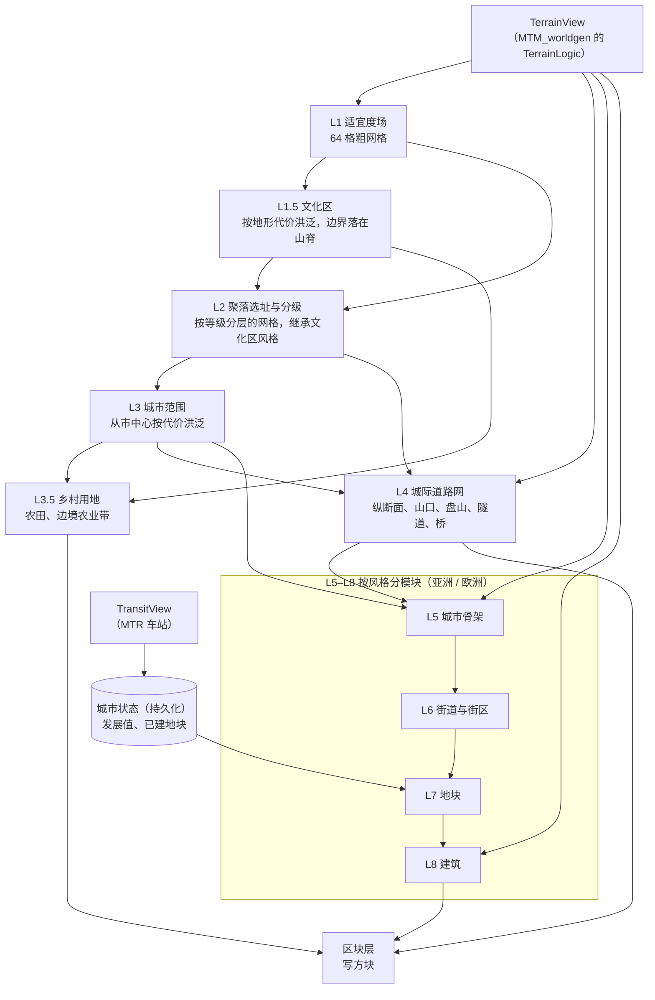

# 城市逻辑层设计（构思稿）

状态：构思，尚未实现。初稿 2026-11-19；同日讨论后定下文化区、乡村用地、翻山道路、风格模块和建筑多样性方案。标 **【已定】** 的是和用户讨论确定的；标 **【待决定】** 的是未定事项，括号内为建议默认值。数值都是建议的起点，最终要做成配置项。

## 1. 从 MTM_worldgen 借来的原理

MTM_worldgen 之所以能做出跨越数千格、彼此衔接的河流和山脉，靠的是下面几条。城市逻辑整套照搬：

| MTM_worldgen 的做法 | 城市逻辑里的对应做法 |
|---|---|
| 地形由 seed + 坐标 + 配置的纯函数决定，与探索顺序、线程无关 | **城市规划**同样是纯函数：输入是 seed、坐标、城市配置和 `TerrainView`（它本身也是纯函数）。不读已生成的区块 |
| 按尺度分层：大陆 → 骨架 → 水系 → 细节，后一层只依赖前面的层 | 适宜度 → 文化区 → 选址 → 城市范围 → 乡村 → 城际道路 → 城市骨架 → 街道 → 地块 → 建筑，逐层细化 |
| 逻辑区域（4096 格）只是缓存单位，不是计算边界；每条规则只看有限邻域（预读半径） | 一样。城市跨区域边界时，两个区域各自算出同一座城 |
| 粗网格（64 格）上的局部规则；河流在 256 格路由网格上做优先级洪泛 | 适宜度用同一套 64 格网格；文化区和城市范围都用"按代价洪泛"求出，形状跟着地形走 |
| 共享边的河道曲线以两端坐标为种子，两侧算出同一条线 | 城际道路和城市主干道同样以端点为种子 |
| 河流按汇水量分级（溪流、支流、干流、大型干流） | 聚落按"腹地"分级（村、镇、城市、大都市），即中心地理论 |
| 气候带由连续场按顺序切分，热带与寒带不接壤 | 文化区由地形代价划分，边界落在山脊、海峡上；落在平原上时用农业带隔开 |
| 昂贵结果按区域缓存，侵蚀写进磁盘缓存；算法并行，因为是纯函数 | 每座城的规划按城市缓存，写进 `<存档>/citybuilder/`；删掉缓存是安全的，会重新算出相同结果 |
| `TerrainLogic` 是唯一入口，什么都问它 | `CityLogic` 是唯一入口：这一列是不是路？这个区块里有哪些建筑？ |

worldgen 里没有、城市逻辑需要另加的只有一样：**时间**，也就是城市的扩展。见第 8 节。时间进来之后，"纯函数"这个原则怎么保住，也在那一节。

## 2. 总体结构

- L1–L4 是**区域尺度**（数千到数万格），对整个世界都适用，便宜到可以对任意坐标直接求值，按区域缓存。
- L5–L8 是**城市尺度**，只在某座城附近才算，按城市缓存（键是城市 id，不是区域）。**每种风格各有一套 L5–L8**，L1–L4 共用（第 5 节）。
- 只有"城市状态"一项会随游戏进行而变化，而且它只决定"规划里的哪些地块已经建了"，不改变规划本身。

## 3. 区域尺度

### L1 适宜度场

在 64 格粗网格上，对每个格子算一个 0–1 的"适合建城"分数，全部来自 `TerrainView`：

- 坡度：平地最高，坡度超过约 8% 很快降到 0（`grade`）
- 地貌：平原 > 丘陵谷地 > 高原 > 山地，海洋为 0（`landform`）
- 近水：靠近河流、湖泊、海岸有加分（`waterLevel`；海岸距离【待决定】是否要请 MTM_worldgen 暴露 `sampleCoastDistance`）
- 海拔与气候：过高、过冷、沙漠中心减分，绿洲加分（`biome`）

结果只看格子本身和相邻格子，所以是纯函数，任何位置都能直接求。

### L1.5 文化区【已定】

世界分成亚洲风格和欧洲风格两种文化区，**各占一半面积**（配置项）。划分按地形进行，效果是"山这边是亚洲，那边是欧洲"。

1. **文化核心**：在很粗的网格上（建议 16384 格一格），每格选一处最大的连片平原或盆地作为核心，按种子给它定风格。两种风格的比例由分位数换算，保证每个种子都是各一半左右。
2. **按代价洪泛**：每个核心在 256 格网格上向外扩张，每个格子归先到达它的那个核心。代价：平地低，丘陵较高，**山地很高**，海面很高。
3. **边界落在山脊和海峡上**：翻山的代价最高，所以两种势力在山上相遇。隔海的大陆和岛屿也各成一区。
4. **同风格的相邻核心合并**，连成大片文化区。
5. **离边界的远近**：每个格子记下到最近核心和第二近核心的代价，两者之差越小离边界越近。L2 和 L3.5 用这个差值判断一处是否靠近平原上的边界，不用另外计算。
6. **平原上的边界**：山脉有缺口时，边界会落在平地或河谷里。这时不硬改边界，而是由 L3.5 的**边境农业带**把两边隔开（见下）。另外可以给落在平地上的边界加一点惩罚，让它尽量往旁边的山上靠。

输入只来自 `TerrainView`（地貌、高度），不需要 MTM_worldgen 新增接口；洪泛半径有上限，所以结果与区域无关。

### L2 聚落选址与分级

用"按等级分层的网格"来做，和山脉站点的做法相同：

| 等级 | 网格边长（建议） | 成熟后的大致半径 | 与更高等级的最小间距 |
|---|---|---|---|
| 大都市 | 16384 | 2000–4000 | — |
| 城市 | 4096 | 800–1500 | 3000 |
| 镇 | 1024 | 200–500 | 800 |
| 村 | 256 | 50–150 | 250 |

- 每个等级的每个格子里，取若干个抖动的候选点，选**周围一片的适宜度总和**最高的那个（"腹地"，类似河流的汇水量）。
- 只有腹地超过该等级阈值，并且附近没有更高等级的聚落时，才成为这一级的聚落。阈值按分位数换算（像 worldgen 用 `NoiseStats` 把"三成海洋"换算成阈值），这样每个种子的城市密度都一致。
- 检查"附近"只看有限个相邻格子，所以结果与区域无关。
- **风格【已定】**：每个聚落取市中心所在文化区的风格，一座城从里到外只有一种风格。镇和村跟随附近的上级城市，所以一个都市圈的风格一致。
- **边境附近不选址【已定】**：落在平原边界两侧约 1–2 km 内的位置，适宜度视为零，城、镇、村都不会选在这里。
- 每个聚落得到：id（由格子坐标和等级算出，稳定不变）、中心、等级、风格、目标规模、**建城年代**（决定老城区的街道是否自然弯曲）、初始发展值（见第 8 节）。

【待决定】原版村庄的处理：（城市范围内不生成原版村庄，范围外保留；需要一个 Mixin）。

### L3 城市范围

从市中心出发，在 64 格网格上做优先级洪泛（也就是 Dijkstra）。代价由坡度、过河、上山决定，扩张到面积达到目标规模为止。

- 城市因此沿着平原、河谷、海岸线伸展，碰到山就停，形状自然。
- 两座城相邻时，同一个格子归先到达它的那座城，这就是按代价划分的 Voronoi 图。
- 洪泛半径有上限（等级半径的 1.5 倍左右），所以要预读的范围也是有界的。
- 洪泛时记下的"到市中心的代价"会在后面各层反复用到：决定片区、密度和开发次序。

### L3.5 乡村用地【已定】

城市范围之外、适宜度高的平地铺成农田，不留成空旷的原野。

- 田地样式按文化区：
  - 亚洲：小块水田、梯田，田埂纵横
  - 欧洲：大块麦田、长条田、树篱
- 村子（最小一级的聚落）坐落在农田当中，成为农田的一部分。
- **边境农业带**：平原上的文化区边界两侧（约 1–2 km，按 L1.5 的代价差判断）是一条没有建筑的农业带：田块、田埂、防风林、灌溉渠、田间小路，最多零星几个不带风格的农具棚。越靠近边界田地样式越平淡，正中间是普通农田和林带。走过去看不到一条明显的线，但两头已经完全不同。
- 区块层：改地表方块（耕地、水田水面、田埂），放农作物和防风林。
  - 【待决定】农田范围内要去掉树木，和 worldgen 的植被、原版的树木生成冲突，接入方式待定。

### L4 城际道路【已定：翻山方式】

- 用 L2 的聚落建一张图：每个聚落连向附近的同级或上一级聚落，取 Gabriel 图或相对邻域图，避免道路过多。跨文化区的连线照常建。
- 每条边在 64 格网格上按代价寻路，之后在细网格上平滑。寻路窗口只取两端点外包矩形再外扩一定距离，所以与区域无关。
- 道路等级由两端聚落中较低的等级决定。曲线以端点坐标为种子，两侧区域算出同一条路，做法和河道相同。
- **纵断面**：道路有自己的高程线，坡度上限约 6–8%（山区公路的水平），不贴着地面走。
  - 地面高出路面太多：开**隧道**
  - 地面低于路面太多：架**桥或高架**
  - 两者之间：挖填路基，留出边坡
- **翻山方式由代价决定**：寻路时比较绕到山口（垭口）、盘山展线（之字形）、直接打隧道（按长度计费）的代价。有低山口时翻山口，山又高又厚时打长隧道，山腰上出现盘山路，不用人为指定。
- **文化区交界**：两侧城市之间的干道多半要穿过分界山脉，长隧道和山口因此天然出现在交界处，像国境线。隧道口和山口附近可以长出各自风格的小镇（东亚的山间宿场、东欧的山口小镇），每个聚落仍只有一种风格。平原边界上，道路穿过边境农业带，路边只有农田。
- **区块层**：道路和隧道都是事先算好的确定曲线，区块生成时直接挖出隧道、铺路面、加衬砌和洞口，和 worldgen 刻河道一样，不依赖其他区块。
- 和 MTR 的关系：玩家修的铁路隧道和公路隧道互不干涉；玩家拆了的路段不再重建（第 8 节，只增不改）。【待决定】是否用同一套寻路给 MTR 预留铁路走廊（先不做）。

## 4. 城市尺度

L5–L8 每种风格各有一套规则和素材，见第 5 节；这里先写共通的部分。

### L5 城市骨架

- **片区**：中心商务区、老城、住宅、工业、港口、车站周边。主要按到中心的代价分层，再按地形调整：近水且平坦的地方给港口和工业，坡地给住宅。
- **方向场**：主干道的走向不用一个统一的网格，而是一个随位置变化的方向场。它在海岸、河岸、入城道路附近顺着这些线，在开阔平原上趋向规整的网格。这对应 worldgen 里控制山脊走向的低频方向场。现代城市生成常用的"张量场"做法就属于这一类。
- **主干道**：入城的城际道路一路延伸到市中心，再沿方向场生成环线和放射线。
- **车站位置**：车站在这一层定下，作为规划的锚点（第 7 节）。
- 道路的分级、生成方法和地形处理见第 7 节。

### L6 街道与街区

- 主干道围出的大块按片区和风格再切分（各风格的样式见第 5 节，京都原型见第 7 节）。
- 只在主干道围成的单元内计算，单元之间共享的那条边由主干道决定，所以单元可以单独计算、单独缓存。

### L7 地块

每个街区沿街切成地块，每块记下：

- 占地范围、临街方向
- 用途和高度等级：由片区、到中心的代价和车站影响决定
- 所属的**开发项目**（见 L8）
- **开发次序值**：一个数，越小越早建。由到中心的代价、片区和噪声决定，见第 8 节

### L8 建筑：用有限的模板做出多样性

显得不自然的根源往往不是"重复"，而是**随机的重复**。真实城市里有很多重复（一整排联排住宅、一片同款住宅区），但它们是有结构的。所以分两半来做：把模板拆开重组，让组合数成倍增加；再控制重复出现在哪里，让它像有意为之。

**1. 模板拆成部件，按规则拼装**

- 竖向分三段：底层（商铺、门厅）、标准层（可重复）、顶部（屋顶、女儿墙、水箱）。横向按柱距或窗距分开间。
- 楼高 = 底层 + 标准层 × N + 顶部，宽度 = 开间 × M，N、M 由地块大小和高度等级决定（"分割文法"）。楼可以随地块伸缩，不要求地块恰好等于模板尺寸。
- 拼装要在区块生成时实时进行，所以部件接缝要规整（墙厚一致、层高取几个固定值）。【待决定】只收录符合规格的模板，还是让工具去适配各种尺寸。
- 切不开的模板（教堂、车站这类地标）整体使用，每座城限一次。

**2. 换材质**

- 方块按角色分类：主墙、副墙、装饰线、窗框、屋面、地面；每一类整体替换，朝向等状态属性照样保留。
- 风格调色板按年代、气候、群系、片区来选。
- 成片地变，不逐栋随机：同一条街颜色相近，换片区才明显不同。颜色用低频噪声决定，像 worldgen 决定群系斑块那样。

**3. 变换与细节**

- 沿街的楼正面必须朝街，所以真正能用的是左右镜像（原版 `StructureTemplate` 支持，会转好方块朝向）。转角地块用专门的转角部件。
- 立面每个开间按概率加空调外机、阳台、雨棚、招牌、花盆，屋顶加水箱、天线、太阳能板。
- 按建城年代把一部分方块换成裂纹石砖、苔石，部分墙面加藤蔓。
- 相邻地块可以合并成大楼、L 形或围合院落；也可以用 A 模板的裙楼加 B 模板的塔楼。

**4. 控制重复出现在哪里（最关键）**

- **开发项目**：一个街区或一个年代里的一片地，由同一个"开发商"建成。项目内用同一套部件和调色板，只做小变化（镜像、层数差一两层、细节不同）；不同项目之间明显不同。
- **避免相邻重复**：同一个部件组合在 K 个地块内不重复（项目内部除外）。按固定顺序遍历地块，只检查在它之前的有限个相邻地块，所以结果仍是确定的。
- **天际线优先**：远看是高度和屋顶轮廓，近看才是立面细节，所以优先保证高度、屋顶形状的变化。
- **不是每块地都盖楼**：穿插公园、停车场、广场、空地、在建工地。

所有选择（部件、调色板、镜像、细节）都以"地块 id 或项目 id + 种子"作为随机种子，规划仍是纯函数。

| 概念 | 内容 |
|---|---|
| 部件库（kit） | 由一个模板拆出：底层、标准层、顶部、开间、转角件，各自记下尺寸和挂点 |
| 风格 | 调色板 + 细节集 + 可用的部件库，按年代、气候、片区选取 |
| 开发项目 | 一个街区或一片地，固定一种风格和一套部件组合 |
| 地块 | 在项目的范围内做小变化：镜像、层数、细节 |

**5. 地基**

- 不改 MTM_worldgen 的地形函数，按建筑自己的规则挖填：建筑底面取地块内的地面中位数，低处垫地基，高处挖平并留挡土墙。
- 【待决定】大片城区是否要请 MTM_worldgen 提供"整平"接口，让地形在生成时就按城市平台压平。这样效果更好，但两个 mod 会互相依赖得更深。

**6. 授权**

- 拆分和换材质都属于修改原作品，所以不收录 ND（禁止演绎）素材。
- 每个部件记下它来自哪个模板，署名清单能追溯到原作品；BY-SA 素材拆出的部件仍标原作者和协议。

### 区块层

区块生成时，问 `CityLogic`：这个区块碰到哪些道路、隧道、农田、已建地块？然后写方块。

- 道路：路面、人行道、路灯；隧道：挖空、衬砌、洞口
- 农田：地表方块、作物、防风林
- 建筑：按模型把方块放进区块。跨区块的建筑在每个区块里只写落在本区块内的那一部分，原版大型结构也是这样做的。
- 接入点：【待决定】（作为原版结构 `Structure` 注册，每座城或每个街区一个结构起点，借用原版的分块放置和保存机制；或者在 `ChunkGenerator.applyBiomeDecoration` 之前用 Mixin 写入）。

## 5. 风格模块【已定】

两种风格都要有，但**不在同一座城里混用**。风格不只是换建筑，也决定城市形态，所以 L5–L8 每种风格各一套；以后加第三种风格（比如欧美郊区、中式老城），也只是多加一个模块。

| | 欧洲（苏联/东欧） | 亚洲（东亚现代） |
|---|---|---|
| 文化区倾向 | 可参考寒温带、内陆平原、针叶林 | 可参考温暖湿润的沿海和多山地带 |
| L5 骨架 | 宽阔大道、轴线、中心广场或集市广场（rynek） | 第一版以京都为原型：棋盘格（条坊制）、几条宽的大路，平面车站和地下车站（第 7 节） |
| L6 街区 | 苏联：超大街区（小区），板楼散布在绿地里。东欧老城：围绕广场的不规则窄街 | 小而规整的街区，窄街，细分得很碎 |
| L7 地块 | 一栋楼占一大块地，楼间距大 | 地块小而密，临街贴建，商住混合 |
| L8 建筑 | kogtyv-TAV 的部件拼装 | 程序化生成为主，PLATEAU 提供真实形体 |
| 农田（L3.5） | 大块麦田、长条田、树篱 | 小块水田、梯田 |
| 车站影响 | 车站周边加密 | 站城一体最明显，车站前就是商业中心 |

【待决定】文化区是否参考气候来分配风格（上表第一行），还是只按核心随机。

### 素材来源

**kogtyv-TAV**（https://github.com/kogtyv/kogtyv-TAV，2026-11-19 查看）：欧洲风格的主要来源。

- 授权：仓库根目录 LICENSE 是 CC0，mod 内 `src/main/resources/LICENSE` 是 MIT（Copyright 2023–2025 kogtyv）。两处不一致，按 MIT 处理：保留版权声明；参与搭建的 Mr_Divar 也署名。
- 内容：约 3500 个 `.nbt`。苏联板楼约 1100 个房屋部件（赫鲁晓夫楼 5 层、9 层楼、"蜡烛楼"、斯大林式砖楼等）和 850 个室内家具部件，另有工厂、商店、雕像、广场；波兰/欧洲中世纪小镇约 350 个房屋部件；还有沙漠、热带草原村庄和地堡。
- **已经拆成部件**：用原版拼图方块（jigsaw）拼装。例如 `krutovoy_5` 由地基 `fundament`、7 种楼层组合（每种 a–h 共 8 个分段）、4 种女儿墙 `paraped` 组成，正是"底层 + 标准层 + 顶部"。可以沿用它的切分，不用自己标注。
- 版本：mod 面向 1.21，但抽查的一个文件是 1.20.1 格式（DataVersion 3465）。正式导入前要扫一遍全部文件，看有没有 1.20.1 以后才有的方块。

**亚洲风格**：没有找到现成的明确授权的东亚城市建筑包，所以以程序化生成为主。

- **程序化生成**：住宅板楼、中高层公寓、写字楼、商住楼、低层独栋形体规整，用"体块 + 立面开间 + 调色板"直接生成，数量不受素材限制，也没有授权问题。模板只用于地标、细节部件和特殊建筑。
- **日本 PLATEAU**（国土交通省三维城市模型）：建筑体块和屋顶形状，体素化后得到真实的日本城市形体。据了解授权与 CC BY 4.0 兼容，**使用前要核实原文条款**。

**其他候选**（都要逐个核实授权）：

- OpenStreetMap（ODbL）：用来统计真实城市的楼栋尺寸、高度、密度分布，给程序化生成调参数
- CC0 的三维模型套件（如 Kenney 的城市套件，需核实）：体素化后做立面细节和街道小品
- 原版游戏自带的结构：运行时从游戏本体读取，不复制不分发；风格是中世纪，只适合乡村填充
- Modrinth 上明确标了 MIT 或 CC0 的建筑类 mod 和数据包

## 6. 尺度与布局

### 尺度基准【已定】

**1 格 = 1 米，按现实尺寸设计，不以原版村庄为参照。**

- MTR 是现实比例：车厢长 24 格（港铁列车车厢约 23 m），8 节编组的站台约 190 格长。
- MTM_worldgen 同样按 1 格 = 1 米设计，地形尺度已经为此留好空间：连片大平原给大城市，世界高度默认提高到 1648。
- 原版村庄的房子只有 5–9 格宽，相当于把真实建筑缩小了一半左右。和 MTR 列车放在一起会像玩具，所以原版村庄的尺寸不作为任何参照；原版结构最多用于乡村零星的填充。
- 因此城市会非常大：一条普通干道 20–30 格宽，一栋板楼上百格长，一个苏联小区几百格见方。这正是 MTR 列车穿行其中时需要的尺度。

下表的数值来自现实城市的常见尺寸，作为程序化生成和模板校验的范围；最终都做成配置项。

### 层高

| 类型 | 层高（格） | 说明 |
|---|---|---|
| 住宅（亚洲） | 3 | 现实 2.7–3.0 m；净高 2 格，正好一扇门高 |
| 住宅（欧洲） | 4 | 照用 TAV 的层高，见下 |
| 办公、公共建筑 | 4 | 现实 3.5–4.0 m |
| 商业底层（店铺、门厅） | 5 | 现实 4.5–5.5 m |
| 工厂、仓库、车站大厅 | 6–12 | 按用途 |

- 【已定】欧洲风格的住宅层高照用 TAV 的 4 格（实测 `krutovoy_5` 的楼层部件高 4 格），不缩放模板。比现实 2.7 m 高，苏式城市整体略高，但室内更宽敞。欧洲风格程序化生成的住宅也按 4 格，和 TAV 的楼放在一起层线对齐；亚洲风格住宅仍是 3 格。

### 建筑高度

| | 亚洲（东亚现代） | 欧洲（苏联/东欧） |
|---|---|---|
| 低层 | 独栋住宅 2–3 层；町屋式商住 2–3 层 | 东欧老城联排 2–4 层 |
| 多层 | 低层公寓 3–5 层 | 赫鲁晓夫楼 5 层；斯大林式 5–8 层 |
| 中高层 | 公寓（mansion）7–15 层 | 板楼 9 层、12–16 层 |
| 高层 | 塔式公寓 20–40 层；写字楼 10–50 层（40–200 m） | 塔楼（"蜡烛楼"）16–25 层 |

### 占地尺寸

| 类型 | 占地（进深 × 面宽，格） |
|---|---|
| 日本独栋住宅 | 7–10 × 8–12，地块约 10 × 15 |
| 町屋式商住 | 面宽 5–8，进深 15–30 |
| 公寓（mansion，单侧走廊） | 进深 10–15，长 30–80 |
| 写字楼标准层 | 30 × 30 – 50 × 50 |
| 赫鲁晓夫楼（5 层） | 进深约 12，长 60–90；TAV 实测 9 × 29（一个单元） |
| 9 层板楼 | 进深 12–13，长 80–150；TAV `twobalkon9` 实测 13 × 41 |
| 苏联塔楼 | 20 × 20 – 25 × 25 |
| 东欧老城联排 | 面宽 5–8，进深 10–20 |

### 道路宽度

一条车道 3 格（现实 3–3.5 m），人行道 2–4 格。

| 等级 | 亚洲 | 欧洲 |
|---|---|---|
| 小巷、生活道路 | 4–6 | 老城街巷 4–8 |
| 街区道路 | 6–8 | 小区内部路 6–7 |
| 干道 | 16–30（2–4 车道加人行道） | 20–30 |
| 大道 | 40–50 | 苏联大街（prospekt）40–80 |
| 城际道路 | 2 车道 8–10，4 车道 20–25（含路肩），按 L4 等级 |

### 街区尺寸

| 风格 | 街区边长（格） |
|---|---|
| 亚洲中心区、住宅区 | 50–120（参考：京都约 120 m 方格） |
| 苏联小区 | 250–500（面积 10–60 公顷） |
| 东欧老城 | 40–80，不规则 |

### 密度

用"容积率"（总建筑面积 ÷ 地块面积）和"建筑密度"（占地面积 ÷ 地块面积）控制每个片区，这样高度和间距由同一组数决定：

| 片区 | 容积率 | 建筑密度 |
|---|---|---|
| 亚洲中心商务区 | 6–10 | 70–90% |
| 亚洲站前商业 | 4–8 | 70–90% |
| 亚洲中高层住宅 | 2–4 | 30–50% |
| 亚洲独栋住宅区 | 0.6–1.0 | 40–60% |
| 苏联小区 | 1.0–1.5 | 20–25% |
| 东欧老城 | 1.5–2.5 | 60–80% |

### 布局逻辑

L6–L8 按下面的步骤把街区变成建筑，每种风格的做法不同：

**亚洲（以地块为单位，沿街贴建）**

1. 街区沿各条临街边切成地块：面宽 6–15、进深 12–25，按片区取值；转角地块单独处理。
2. 地块减去退线（商业 0–1 格，住宅 1–2 格）得到可建范围。
3. 按片区的容积率和高度等级，求出楼的层数和占地；在可建范围里放下一栋能伸缩的楼（部件拼装：N 层、M 个开间）。
4. 相邻小地块可以合并成一栋大楼（站前、中心区）。
5. 【待决定】是否模拟日本的北侧斜线限制（高楼北侧逐层退台）。（先不做）

**苏联小区（以楼为单位，散布在绿地里）**

1. 不切地块。小区内部按方向场铺出平行的"楼位线"。
2. 板楼沿楼位线摆放，平行的两排之间留出日照间距：约为楼高的 1.5–2 倍（9 层楼约 50–60 格）。
3. 空档放塔楼，小区中央放学校、幼儿园、商店；其余是绿地、停车场和小路。
4. 建筑密度控制在 20–25%，所以楼看起来"稀疏地立在大片空地上"，这正是苏联小区的样子。

**东欧老城（周边式街区）**

1. 街区四周沿街连续排列联排房屋（面宽 5–8），围出内院。
2. 集市广场（rynek）四周是最高、最华丽的房子；离广场越远越低矮。

**车站**

- 8 节编组的站台约 190 格长、8–12 格宽（岛式），站房和站前广场按站台尺寸预留。
- 高架线下方要留出道路净空（约 5 格）。

### 模板校验

导入工具读取每个模板的层高和占地，和上面的范围比较：

- 落在范围内的直接收录；
- 明显是原版村庄尺度的（比如 7 格宽、一层 5 格高的"房子"）拒收，或只用作乡村零星填充；
- 在范围边缘的标出来，由人工确认。

### 城市规模

按现实比例，真正的大都市方圆数十公里，在游戏里生成和游览都不现实。L2 表里的半径（大都市 2–4 km）指的是**连续建成区**；建成区之外是郊区和农田（L3.5），城市之间靠城际道路和 MTR 连接。

- 【待决定】大都市的建成区半径是否要加大到 5–10 km，以充分利用 worldgen 的大平原（会大幅增加 L5–L7 的计算量和区块生成量）。

## 7. 道路、车站与交通【已定】

### 第一版的范围

- **亚洲风格以京都为原型**：城市内**没有高架和立交**，所有路口都是平面路口；有**平面铁路车站**和**地下铁路车站**。
- 欧洲风格第一版同样不做快速路和立交。
- 【已定】以后的高架和立交**借 MTR 的算法**，在本 mod 里自己生成方块，不写 MTR 数据（第一版仍不做）。MTR 分支已经解决了方块世界里做高架最难的几件事：任意角度的平滑曲线、缓和曲线、超高、桥面铺到轨面高度、带坡度的填缝方块；ANTE 还能给轨道换模型（比如渲染成路面）。两种用法：
  - **借算法**：在本 mod 自己的方块生成里，复用这些几何算法（缓和曲线、斜面填缝、桥面铺设），不写 MTR 数据。高架是真正的方块，不装 MTR 也能用；
  - **借数据**：把高架路写成 MTR 轨道，由 ANTE 渲染成路面，客户端车流沿轨道曲线行驶。曲线最平滑，但要写 MTR 数据（和"只读不写"冲突），没装 MTR 就没有高架，玩家也走不上纯渲染的路面（要靠桥面方块）。
  - 选定借算法。移植时要保留 MTR 的 MIT 版权声明，并在代码注释里注明出处（MTR 分支的哪个类）。

### 城市内道路（L5 干道、L6 街道）

**分级与间距**

| 等级 | 作用 | 间距（亚洲 / 欧洲，格） |
|---|---|---|
| 入城干道 | 城际道路（L4）延伸进城，直通中心 | — |
| 干道 | 划分片区，承担穿城交通 | 400–800 / 500–1000（含苏联大街） |
| 次干道 | 把片区内的交通汇集到干道 | 150–250 / 250–500（即小区边界） |
| 支路 | 划出街区，地块临街 | 50–120 / 老城 40–80 |
| 小巷、小区内部路 | 不承担穿行交通 | 亚洲：街区内的窄巷；苏联：小区内的环形路、尽端路 |

**生成方法：方向场 + 流线**

- 干道和次干道从种子点出发顺着方向场描线；线与线的间距达到这一级的间距时停止，或接到已有道路上。
- 方向场由几种场叠加：
  - 网格场：开阔平原上形成规整网格
  - 放射场：以市中心、车站、集市广场为圆心
  - 边界场：顺着海岸、河岸
  - 等高线场：坡地上顺着等高线走，陡的连接路自动成为之字形
- **流线追踪的结果和描线顺序有关**，不能按区域分开算。所以**干道和次干道以整座城为单位一次算完**，种子点按固定顺序处理，结果仍然确定；城市本来就按城市缓存，没有矛盾。
- 支路以干道围成的单元为单位计算，边界已由干道定好，单元之间互不影响。

**京都原型（亚洲第一版）**

- 平地上铺棋盘格（条坊制），街区约 120 格见方。
- 几条宽的大路（现实中 30–50 m，如御池通、五条通），其余是 6–8 格的通；大街区内部有 2–4 格的小巷（路地、図子），町屋沿小巷排列。
- 方格网只铺在盆地平地上，到山脚就停，山边改为顺等高线的路。正好对应 worldgen 的"平地集中在盆地"。

**地形**

- 坡度上限按等级：干道约 6%，支路 10–12%，山坡小巷可到 15%。
- 路面高度沿路平滑，**以道路为准**：地块按临街一侧的路面高度挖填地基。
- 跨河的桥只建在干道和次干道上，并限制间距；支路在河边截止，沿河建滨河路。

**交叉口与横断面**

- 两条路夹角不小于 60°，太近的路口合并。
- 路口形式按两条路的等级定：信号灯路口、T 字路口；欧洲风格多环岛。第一版没有立交。
- 每个等级、每种风格一种横断面模板：车道数（一条车道 3 格）、中央分隔带、人行道、行道树、路灯；苏联大街可加有轨电车道。区块生成时按每列到道路中心线的距离决定铺车道、路缘石还是人行道。

**分期修建**

- 道路随发展值逐步出现：每段路的开发次序取两侧地块中最早的那个。干道最先修，支路等它两边的地块开始建时才修。
- 增长期修路遇到玩家铺的地面铁轨：高度相同就修成**道口**，否则这段路不修。

### 交通量估算（规划依据，看不见）

- 在道路网上按片区规模和车站位置估算交通量（重力模型：两个片区越大、离得越近，之间的交通量越大）。
- 用来决定：哪些路加宽、升级；商铺扎堆的位置（人流大的街道底层更容易是商铺）；停车场的位置和数量；客户端车流的密度。
- 只在规划时算一次，是纯函数。车站是重要节点，会吸引人流，所以站前有广场、接驳道路和公交站。

### 车站与设施

**城市生成车站建筑和设施，但不产生 MTR 车站数据。** 车站真正"开通"（在 MTR 里划出车站范围、铺轨道和站台）由玩家完成。

- **平面站**：站房、站台结构、天桥或地道、站前广场。铁路与道路平面相交处形成道口。
- **地下站**：地铁线路**走在宽的大路下方**（京都的乌丸线在乌丸通下、东西线在御池通下），车站出入口开在路口的人行道上。地下线因此和地面路网对齐，不从房子底下穿过。城市生成站厅、站台空间和出入口。
- **铁路走廊**：地面线留出路基带，地下线留出大路下方的空间，玩家在里面铺 MTR 轨道。
- **公交站**：沿干道和次干道每隔约 300–500 格一个，包括港湾式停靠位、候车亭、站牌位置。
- **方块**：站台和设施只用**原版方块**和**本 mod 按需增加的装饰性方块**，不用 MTR 的方块。本 mod 的方块贴图同样要遵守素材授权规则（自制，或使用授权明确的素材）。
- **车站是规划的锚点**：车站位置在规划阶段就定下，周边片区、站前商业、道路都围绕它布置，所以开局的城市就是"站城一体"的样子。玩家在这里建好 MTR 车站后，城市从 MTR 读到它，"车站周边加速发展"的机制（第 9 节）随之生效。

### 公交

- 沿用以前服务器上的做法：**公交是 MTR 列车加公交车模型**，在沿路铺设的 MTR 轨道上行驶，时刻表、站点、运用都交给 MTR。
- 城市只做配合：预留公交站位和候车亭，路面要能嵌入 MTR 的轨道节点；后续修路、扩建不覆盖已有的轨道节点（由"只增不改"和"玩家占用"两条规则保证）。
- 【待决定】以前的具体铺法：轨道在哪条车道（最外侧还是中间专用道）、节点方块露在路面上还是藏在下面、公交站台的形式。这决定预留空间的细节。

### 客户端车流

看得见的交通做成**客户端车流**：车辆只在客户端存在，服务端没有开销。

- **车道网由服务端下发**：客户端不能自己算城市规划，因为规划依赖世界种子，服务器一般不把种子发给客户端（泄露种子会让人提前算出整张地图）。服务端从道路规划推出车道级路网（每条车道一条中心线，路口补上转弯连接线），玩家走近时按区块范围下发，客户端缓存。
- **车辆**：只在玩家周围约 128–256 格内生成，走远就消失；密度按交通量估算；用跟车模型（IDM）控制加减速；设数量上限（如同时 200 辆），远处降低细节。
- **信号灯**：相位由"路口 id + 世界时间"算出，所有客户端同一时刻看到同一个灯色。车辆各客户端各自生成，用"车道 + 时间段"作种子，让多个玩家看到的车流大体一致。
- **和玩家、方块的互动**：玩家站在路上时车会停下；路上被放了方块时，车在前方停下或换车道。车辆不造成伤害，不参与碰撞。
- **和 MTR 的互动**（读 MTR 的客户端数据，没装 MTR 时跳过）：
  - 沿车道铺的轨道上跑的是**公交**：客户端车辆把它当作同车道的前车，跟在后面；
  - 横穿道路的轨道是**铁路道口**：列车经过时车辆停下等待；
  - 按轨道和车道是平行还是相交来区分。
- **渲染与素材**：同款车批量绘制；车辆模型要有明确授权（如 CC0 低多边形车辆），也可以先用方块风格的程序化车辆。【待决定】是否借用 MTR 内 ANTE 的模型渲染能力（会依赖 MTR 内部代码）。

## 8. 时间：城市的扩展

时间进来之后，"纯函数"原则按下面的方式保住：

1. **规划不变**。L1–L8 描述的是每座城**完全长成之后**的样子，叫"潜在城市"。它只取决于 seed、坐标和配置。
2. **发展值是唯一的状态**。每座城持久化保存一个发展值 `G`（大致对应人口或已开发面积）。开发次序值不大于 `G` 的地块就是"该建了"的地块。
3. **初始状态也是纯函数**。新世界里每座城的初始发展值 `G0` 由 seed 决定（大都市已经成形，村子还很小）。区块生成时，直接把次序值不大于 `G0` 的地块建出来，所以开局的世界完全确定，和探索顺序无关。
4. **增长**：`G` 随游戏时间按规则增长。增长率取决于城市等级、腹地，以及线网接入程度（第 9 节）。
5. **把增长落到方块上**：
   - `G` 变大后，新跨过阈值的地块如果所在区块**已加载**，就在服务端线程上分帧建造，每 tick 有预算上限。
   - 区块**未加载**的，记在这座城的待建列表里，区块加载时补上。和 MTR 分支里"自动扶梯拆除时不加载区块"的做法相同。
   - 建造按次序值的顺序进行，不按区块加载顺序，所以同样的 `G` 总是对应同一组建筑。
6. **只增不改**：已建的地块在存档里记下，以后不推倒重建。规则和 MTR 的"存档只能增加内容"一致。
   - 【待决定】是否允许"更新换代"，比如低层住宅被高层替换。（先不做）
7. **玩家改动优先**：玩家在某个地块上放过或拆过方块，这个地块就标为"玩家占用"，城市不再动它。
   - 【待决定】判定方式：（只按 `CityLogic` 记录的已建地块和方块指纹判断，不追踪每一次方块变化）。

这样一来，可以验证的性质和 MTR 模拟组件的保证类似：**同一个 `G` 序列，不论跳过多少 tick、区块以什么顺序加载，最后建出的城市都相同**。

## 9. 和 MTR 的关系

- 车站（`TransitView.stations()`）是城市增长的主要外部驱动力：
  - 城市范围内每多一个车站，城市的增长率就上调。
  - 车站周边一定半径内，未建地块的开发次序值按距离打折，同时可以提高高度等级。效果是"站城一体"：车站先开通，周围先长起来，也长得更高。亚洲风格里这个效果最强（第 5 节）。
- 这一层的输入是"规划 + 车站快照"，所以仍是确定的：同样的车站，得到同样的次序调整。已建地块不受影响。
- 车站快照只在服务端线程上读取（见 CLAUDE.md），读完之后交给逻辑线程使用。
- 【已定】城市生成车站建筑、铁路走廊、公交站位等设施，但**不写 MTR 的数据**（不建车站、轨道、站台数据），见第 7 节。MTR 方面仍然只读不写。
- 客户端车流读 MTR 的客户端数据（公交、道口），见第 7 节。
- 【待决定】范围外的新车站能否催生卫星镇（先不做）。

## 10. 性能与缓存

| 层 | 粒度 | 缓存 | 预计开销 |
|---|---|---|---|
| L1 适宜度 | 64 格 | 按区域，内存 | 便宜，等于读 worldgen 的地形 |
| L1.5 文化区 | 256 格洪泛 | 按区域，内存 + 磁盘 | 中等，窗口大但网格粗 |
| L2 选址 | 等级网格 | 按区域，内存 | 便宜 |
| L3 范围 | 64 格洪泛 | 按城市，内存 + 磁盘 | 中等 |
| L3.5 乡村 | 64 格 | 按区域，内存 | 便宜 |
| L4 城际道路 | 64 格寻路 + 纵断面 | 按边，内存 + 磁盘 | 中等 |
| L5–L7 骨架、街道、地块 | 城市内 | 按城市或主干道单元，内存 + 磁盘 | 较贵，只在城市附近才算 |
| L8 建筑 | 地块 | 不缓存，按需求值 | 便宜 |

- 和 worldgen 一样：`CityLogic.forWorld(seed, settings, terrain)` 共享实例；按区域和按城市的 LRU 缓存；用一个小的并行线程池；区块生成到城市附近时，把相邻的城市排进后台预算队列。
- 地形查询是主要开销来源。适宜度、文化区和洪泛都用 worldgen 的粗粒度查询（`sampleLandformKind` 这类不算侵蚀的接口），只有道路纵断面、落位和地基才查精确的 `surfaceHeight`。

## 11. 调试与测试

- **单元测试**：core 的测试类路径上已经有 MTM_worldgen 的 `TerrainLogic`，可以直接在真实地形上跑城市逻辑。要覆盖的性质和 worldgen 相同：
  - 确定性：同样输入，同样输出
  - 顺序无关：从不同方向、以不同顺序查询，结果相同
  - 跨区域连续：文化区边界、城市和道路跨过区域边界时一致
  - 文化区：两种风格的面积比例在多个种子上接近各一半；边界落在山地上的比例
  - 第 8 节的增长性质：跳过 tick 与不跳过结果相同；区块加载顺序不影响结果
- **调试图**：仿照 worldgen 的 `debugmap` 和独立预览，把适宜度、文化区、聚落、城市范围、农田、道路（标出隧道和桥）、片区渲染成 PNG。可以 `java -jar` 直接在任意种子上看，不用进游戏。这是调整分布最快的手段。
- **游戏内命令**：`/city locate`、`/city info`、`/city grow <量>`（手动推进发展值）。

## 12. 待决定事项汇总

1. 没装 MTM_worldgen 时怎么办：（不生成城市）。另一种做法是用原版 `ChunkGenerator.getBaseHeight` 估地形，它不需要生成区块，但慢，也不知道河流在哪。
2. 海岸距离等查询是否请 MTM_worldgen 暴露成公开方法
3. 文化区是否参考气候分配风格，还是只按核心随机
4. 原版村庄的处理（城市范围内不生成）
5. 农田范围内去掉树木的接入方式
6. 是否要 worldgen 提供整平接口；在那之前，地基在建筑这一层自己挖填
7. 模板规格：只收录接缝规整的模板，还是让工具适配各种尺寸
8. 素材格式和导入工具（`.nbt`，从 `.schem` / `.litematic` 转换）
9. 区块层的接入方式（注册为原版 `Structure`）
10. 是否允许更新换代（先不做）
11. 玩家占用的判定方式
12. 范围外的 MTR 车站能否催生卫星镇（先不做）
13. 各等级的网格尺寸、半径、间距，边境农业带宽度的默认值（见 L2 的表、L3.5）
14. PLATEAU、Kenney 等素材的授权核实
15. 是否模拟日本的北侧斜线限制（先不做）
16. 大都市建成区半径是否加大到 5–10 km（第 6 节"城市规模"）
17. 以前服务器上 MTR 公交的铺法：轨道在哪条车道、节点是否藏在路面下、站台形式（第 7 节"公交"）
18. 客户端车流是否借用 MTR 内 ANTE 的模型渲染能力
19. 车辆模型的素材来源

## 13. 建议的实现顺序

每一步都先有单元测试和调试图，再接进游戏：

1. `CitySettings`、`CityLogic` 骨架，以及 L1 适宜度和它的调试图
2. L1.5 文化区。看调试图，在多个种子上检查边界是否落在山上、比例是否各一半
3. L2 选址与分级。调整密度
4. L3 城市范围、L3.5 乡村用地
5. L4 城际道路（纵断面、隧道、桥），然后接入游戏：先只铺路和农田，验证区块层和确定性
6. 城市内道路（第 7 节），先做京都原型的棋盘格；车站建筑和公交站位
7. 欧洲风格模块：导入 TAV 部件，L5–L8
8. 亚洲风格模块（京都原型）：程序化建筑生成，L5–L8
9. 第 8 节的城市状态与增长，第 9 节的 MTR 车站影响
10. 客户端车流（第 7 节）
