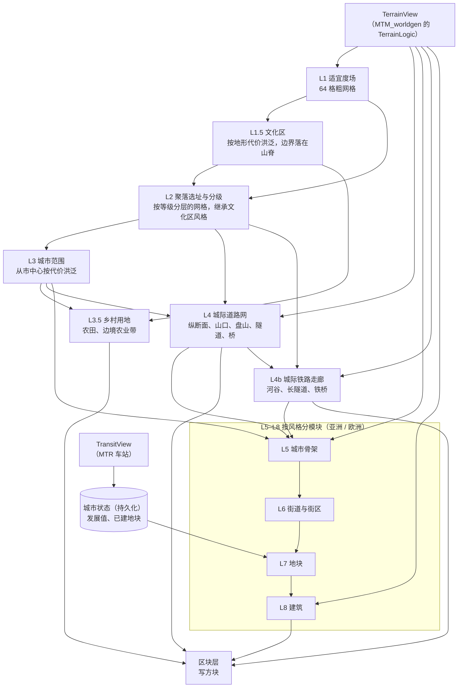

# 城市逻辑层设计（构思稿）

状态：构思，尚未实现。初稿 2026-11-19；同日讨论后定下文化区、乡村用地、翻山道路、风格模块和建筑多样性方案。标 **【已定】** 的是和用户讨论确定的；标 **【待决定】** 的是未定事项，括号内为建议默认值。数值都是建议的起点，最终要做成配置项。

## 1. 从 MTM_worldgen 借来的原理

MTM_worldgen 之所以能做出跨越数千格、彼此衔接的河流和山脉，靠的是下面几条。城市逻辑整套照搬：

| MTM_worldgen 的做法 | 城市逻辑里的对应做法 |
|---|---|
| 地形由 seed + 坐标 + 配置的纯函数决定，与探索顺序、线程无关 | L1、L1.5 和城市尺度的细节（L5–L8）同样是纯函数：输入是 seed、坐标、城市配置和 `TerrainView`（它本身也是纯函数）。**L2–L4 改为"一次规划、存入存档"**（第 2 节"规划块"），可以依赖规划顺序。都不读已生成的区块 |
| 按尺度分层：大陆 → 骨架 → 水系 → 细节，后一层只依赖前面的层 | 适宜度 → 文化区 → 选址 → 城市范围 → 乡村 → 城际道路 → 城市骨架 → 街道 → 地块 → 建筑，逐层细化 |
| 逻辑区域（4096 格）只是缓存单位，不是计算边界；每条规则只看有限邻域（预读半径） | 一样。城市跨区域边界时，两个区域各自算出同一座城 |
| 粗网格（64 格）上的局部规则；河流在 256 格路由网格上做优先级洪泛 | 适宜度用同一套 64 格网格；文化区和城市范围都用"按代价洪泛"求出，形状跟着地形走 |
| 共享边的河道曲线以两端坐标为种子，两侧算出同一条线 | 城际道路和城市主干道同样以端点为种子 |
| 河流按汇水量分级（溪流、支流、干流、大型干流） | 聚落按"腹地"分级（村、镇、城市、大都市），即中心地理论 |
| 气候带由连续场按顺序切分，热带与寒带不接壤 | 文化区由地形代价划分，边界落在山脊、海峡上；落在平原上时用农业带隔开 |
| 昂贵结果按区域缓存，侵蚀写进磁盘缓存；算法并行，因为是纯函数 | 纯函数的各层按区域、按城市缓存，删掉可以重算；L2–L4 的规划块存进 `<存档>/citybuilder/plan/`，是存档的一部分，**不能删**（删掉后会按新的顺序重新规划，与已生成的区块对不上） |
| `TerrainLogic` 是唯一入口，什么都问它 | `CityLogic` 是唯一入口：这一列是不是路？这个区块里有哪些建筑？ |

worldgen 里没有、城市逻辑需要另加的只有一样：**时间**，也就是城市的扩展。见第 9 节。时间进来之后，"纯函数"这个原则怎么保住，也在那一节。

## 2. 总体结构

- L1–L4 是**区域尺度**（数千到数万格），对整个世界都适用，便宜到可以对任意坐标直接求值，按区域缓存。
- L5–L8 是**城市尺度**，只在某座城附近才算，按城市缓存（键是城市 id，不是区域）。**每种风格各有一套 L5–L8**，L1–L4 共用（第 5 节）。
- 只有"城市状态"一项会随游戏进行而变化，而且它只决定"规划里的哪些地块已经建了"，不改变规划本身。

### 外来区域不参与计算【已定，2026-11-20】

从其他世界拼进来的地图（MTM_worldgen 的"外来区块"），以及它周围地形向它过渡的缝合带，**不参与城市逻辑的任何计算**：

- 判断：`TerrainView.foreign(x, z)`。MTM_worldgen 对外只公开了外来区块本身（`foreign().contains`），缝合带的计算是包内私有的，所以缝合带按 worldgen 配置里最宽的缝合宽度（`foreign.maxWidth`、`upgradeMaxWidth` 中较大者，默认 2000 格）保守地取，可能比实际的缝合带宽一些（`core.terrain.ForeignMask`）。【待决定】是否请 MTM_worldgen 公开缝合带的实际范围，以便收窄。
- L1：这些节点不存值，插值时不参与；也不计入邻居的地貌平均、近水加分和坡度（这一侧用节点自己的高度代替）。旁边的节点算出的值和没有外来区域时完全相同（`SuitabilityLayerTest`）。
- L1.5：洪泛不能穿过它们，也不从它们出发（`CultureLayerTest`）。
- 以后各层同样如此：不在这里选址、不让城市范围扩进来、道路和铁路绕开、不在这里放任何方块。
- 调试图上用灰色斜纹标出。

### 规划块：一次规划、存入存档【已定，2026-11-20】

城市**不要求**由种子完全复现。L2–L4（选址、范围、城际道路和铁路）以"规划块"为单位，第一次被需要时规划，结果存进世界存档，以后只读不改。

**为什么**：真实的城市体系是按历史顺序长出来的：先有古都和港口，再沿古道长出宿场町，铁路来了才有站前町。纯函数只能让每条规则看有限个邻格，模拟不了"先建的影响后建的"；整体优化（按区域定额、道路求连通树）也做不了。存盘之后这些都可以做。另一个好处是规划版本锁定的问题基本消失：已存的规划不随算法升级而变（见 L4b"规划算法的版本锁定"）。

**分层**：

| 层 | 做法 |
|---|---|
| L1 适宜度、L1.5 文化区 | 保持纯函数：只依赖地形，便宜，没有历史可言 |
| L2 选址、以后的 L3 范围、L4 城际道路和铁路 | 按规划块规划，存盘；可依赖顺序 |
| L5–L8 街道、地块、建筑 | 读已存的规划，在其中仍按种子确定：数据量大，不值得存 |
| 发展值、已建地块 | 本来就是存盘状态（第 9 节） |

**规则**（L2 已实现，`SettlementLayer`、`core.plan`）：

- **每个等级一套规划块**，边长是该等级网格的整数倍：大都市 32768、城市 16384、镇 8192、村 4096（大的两级原为 65536、32768，2026-11-20 为性能缩小）（`Tier.planBlock`）。规划块越小，规划时读的地形越少：镇和村读完整的 L1（要算水系），所以块小；大的两级读粗略适宜度，块大。
- **依赖只指向上级**：规划一个块之前，先规划（或读出）所有可能影响它的上级块：上级聚落的避让范围、镇和村跟随风格的范围。同级的相邻块**已存在的**就读进来作为约束，还没规划的不去触发，它以后规划时会反过来读这个块。所以结果与规划顺序有关，但永远不会对不上：后规划的块总是看得见先规划的。
- **块内按优先顺序贪心**：块内每格选出潜在聚落（和以前相同：候选点、中心适宜度、腹地阈值、文化边界、外来区域），排除落在上级避让范围内的、离相邻已存同级聚落近于间距的，然后按腹地从好到差依次放下，离已放下的同级聚落近于间距的跳过。以后加入建城年代、吸附点等"历史"规则，也在这一步做。
- **同一等级同一时间只规划一个块**（每级一把锁）：两个相邻块同时规划会互相看不见。锁的顺序永远是下级到上级，不会死锁。
- **块内仍是确定的**：给定种子、配置、地形和已存的相邻块，规划结果相同，所以调试仍可重放；只有相邻块的规划顺序会影响结果。
- **存储**：`core.plan.PlanStore`（按键存取字节）。游戏里用 `FilePlanStore`，放在 `<存档>/citybuilder/plan/`（【待做】接进游戏）；测试和 `cityMap` 用内存中的 `MemoryPlanStore`，所以离线图是"按查询顺序规划"的一种结果。每个块记下规划时的 `planVersion`。
- **预规划**：玩家接近时在后台提前规划（【待做】接进游戏时），来不及时区块生成要等。村一级的块在冷启动时约需数秒到十几秒（主要是 worldgen 的水系）。

## 3. 区域尺度

### L1 适宜度场

【已实现，2026-11-20】在 64 格粗网格上，对每个节点算一个 0–1 的"适合建城"分数，只用 `TerrainView` 的便宜查询（不需要侵蚀）。实现：`core.layer.SuitabilityLayer`，参数在 `CitySettings.suitability`。

- **坡度**：用 `smoothHeight`（不带纹理和侵蚀的平滑地面）在相邻节点间做差分；2% 以下为平地，10% 以上为 0，中间平滑过渡。
- **地貌**：平原 1、丘陵 0.6、高原 0.75、山地 0.1、海洋 0（`landform`）。高原按用户要求调高（原为 0.4），平坦的高原顶部能达到 0.6 左右，仍比平原低一档。高原适合建镇和小城市，但不以大城市为主，这一点由 L2 计算大都市、城市的腹地时对高原打折来实现，不在 L1 里压低。地貌是离散的类别，直接用会在交界处形成台阶，所以**在周围约 192 格内取平均**（`landformBlend`），变成连续的过渡。
- **海拔**：高出海面 300 格以内不扣分（worldgen 的高原平均高出海面约 270 格），之后在 500 格内降到 0.5 倍。山地本来就由地貌和坡度压低，海拔一项只是轻微的修正。
- **近水**：海、湖在 384 格内（`waterReach`）按距离加分；河按河岸距离加分，河越宽加得越多（48 格以上算满）。水的权重 0.25：紧邻水边的地方最多比内陆高四分之一。海岸由"附近节点有海"判断，不需要 MTM_worldgen 新增接口。
- **水面本身**（海、湖、河道里的节点）不存值，插值时不参与，所以河岸的陆地保持周围陆地的值，不会沿粗网格被拉低成台阶。一个位置是不是水面，由地形去判断。
- 河用的是 worldgen 按水系路由出来的原始河道（`riverRegion(rx, rz).nearest`），不是拟合到侵蚀地面的河，后者需要先算侵蚀。
- 气候和群系（过冷、沙漠）暂未计入，放到文化区和选址时再考虑。

每个节点的值只取决于节点及周围有限范围的地形，所以是纯函数；任何区域算出的同一节点相同，区域边界两侧连续。

实测（默认配置）：每个 4096 格区域平均 0.1–0.25 秒，第一次碰到一片新水系时约 1.3 秒（MTM_worldgen 计算水系路由）。种子 12345 原点周围 3.3 万格见方：平原平均 0.57，丘陵 0.27，山地 0.01；种子 707121638 原点周围：平原 0.46，高原 0.43，丘陵 0.17。

### L1.5 文化区【已定】

> 第一版暂时只用亚洲风格（用户 2026-11-21）：`culture.europe` 默认关，所有城都是亚洲（日本）风格，没有风格边界和边境农业带。下面的做法保留，做欧洲风格时打开。

世界分成亚洲风格和欧洲风格两种文化区，**各占一半面积**（配置项）。划分按地形进行，效果是"山这边是亚洲，那边是欧洲"。

【已实现，2026-11-20】实现：`core.culture.CultureLayer`，参数在 `CitySettings.culture`。

1. **风格场决定大片区域**：一个波长约 8 万格的平滑噪声场（`styleWavelength`），场值低于 0.5（`asiaShare`）为亚洲，高于为欧洲。文化区因此是成片的（约 4 万格见方），两种风格各占一半（场在 0.5 两侧对称，实测 13 万格见方的范围里亚洲占 60% 左右，更大范围趋近一半）。
2. **交界带**：场值等于 0.5 的那条线两侧各 4000 格（`borderHalfWidth`）是交界带。距离用"场值与 0.5 之差 ÷ 场的梯度"估算，所以不论场变化得快还是慢，交界带都是固定宽度。
3. **地形决定交界带里的边界**：两种风格各自从交界带外侧（已确定的一侧）出发，在 256 格网格上做按代价的洪泛，交界带里的每个点归代价更低的一方。代价：平地 1、丘陵 2、高原 2、**山地 4**、海面 8（每格），外加爬升每格 0.3。所以边界会被拉到交界带里的山脊和海峡上；交界带里没有山的地方，边界就落在平原上，由 L3.5 的**边境农业带**隔开。
4. **离边界的远近**（`CultureSample.margin`）：两种风格的代价之差。L2 和 L3.5 用它判断一处是否靠近边界。
5. **洪泛到不了的地方**：代价上限 4 万（`maxCost`），足以穿过整条交界带，即使全是山。只有一方被海面或外来区域挡住时，到达的一方获胜；两方都到不了（远海）时由风格场直接决定。

**为什么不用"文化核心"**：最初的做法是在每 16384 格选一处平原作为核心、每个核心随机一种风格、从核心洪泛。实测有两个问题：(1) 核心风格各自随机，文化区成了拼图；(2) 改用平滑场给核心定风格后区域变成大片，但边界往往离另一种风格的核心几万格远，洪泛够不着，三成以上的边界只能按直线距离划分，成了穿山的直线。现在的做法让洪泛只需穿过固定宽度的交界带，问题都解决了（边界节点中洪泛未到达的比例从 29–61% 降到 0%）。

**结果与区域无关**：每个节点的场值、地形只取决于它自己的位置；洪泛代价有上限，每格代价至少为 1，所以代价不超过上限的路径不会离开它周围 `maxCost` 格的范围，而每个缓存单元（16384 格，`cellSize`）恰好读取这么大的窗口。地形采样按 4096 格一块缓存，相邻单元共用。

实测（种子 12345，13 万格见方）：每个单元平均 0.4 秒，第一次碰到一片新地形时最多约 5 秒（worldgen 计算大尺度地形场）。边界 32% 在山地、18% 在高原、25% 在丘陵、25% 在平原。

输入只来自 `TerrainView`（地貌、高度），不需要 MTM_worldgen 新增接口。

### L2 聚落选址与分级

【已实现，2026-11-20】实现：`core.settlement.SettlementLayer`，参数在 `CitySettings.settlements`。

用"按等级分层的网格"来做，和山脉站点的做法相同：

| 等级 | 网格边长 | 半径（上级避让用） | 同级最小间距 | 候选点 | 腹地阈值 | 腹地半径 |
|---|---|---|---|---|---|---|
| 大都市 | 16384 | 6000 | 30000 | 9 | 0.50 | 4000 |
| 城市 | 4096 | 2500 | 12000 | 9 | 0.42 | 1500 |
| 镇 | 1024 | 500 | 6000 | 6 | 0.35 | 400 |
| 村 | 256 | 100 | 700 | 6 | 0.30 | 96 |

- **候选点**：每个等级的每个格子里，取若干个抖动的候选点（由种子和格子决定）。候选点的中心要满足：适宜度不低于 0.35（`minCentre`）、不在外来区域、离文化边界不近于 1500（`borderBuffer`，文化区的 margin）。满足的候选点中，**腹地**（半径内 7×7 采样的平均适宜度，海面和外来区域算 0）最好的一个，若达到该等级的阈值，就是这个格子的"潜在聚落"。
- **成立条件**（2026-11-20 改为按规划块规划，见第 2 节"规划块"）：
  1. 上级优先：任何更高等级的聚落都不在"两者半径之和"以内；
  2. 同级间距：块内按腹地从好到差贪心放下，同级间距以内已有聚落（本块已放下的，或相邻块已存的）就不放。
  以前的做法是"同级间距内没有更好的潜在聚落才成立"，与顺序无关，但会留下空隙；贪心排得更满，代价是与相邻块的规划顺序有关。

| 等级 | 规划块边长 |
|---|---|
| 大都市 | 32768 |
| 城市 | 16384 |
| 镇 | 8192 |
| 村 | 4096 |
- **密度按现实校准【已定，2026-11-20】**：贪心放置几乎排到最小间距，所以间距就是密度。参照日本：农业集落约 1 个/km²、相邻约 0.7–1 km；平原上的町相距约 4–5 km（奈良盆地）；地方城市相距 10–20 km。镇的间距 3000 → 4000、村 400 → 700 之后，种子 12345 的平原一带：镇平均相距 5.0 km、村 830 m。（参照数字是凭记忆的近似值，以后用 OSM 统计核实，第 8 节）
- **大城市周边不凝聚成镇【已定，2026-11-20】**：大都市和城市的郊区是从市区连续变稀的（L3 的郊区尾部），而不是一圈以镇为中心的小团块。所以镇和村除了避开"两者半径之和"，还要避开大都市和城市的郊区：距离不小于 1.6（`extent.suburbTail`）× 上级半径 + 自己的半径。城市和大都市之间仍按半径之和（卫星城可以在大都市郊区外缘）。镇的间距同时从 4000 加大到 6000，减少镇的密度。
- **选址偏好【已定，已实现，2026-11-20】**：现实的村落不是均匀铺开的，而是在河边稍高的地方（自然堤防、台地或扇状地边缘）和山脚，不在洪泛低地。镇和村的候选点得分 = 腹地 ×（1 + 0.6 × 选址值），选址值在 −1 到 1 之间（`SitePreference`，参数 `settlements.site`）：
  - 河流吸引：离河岸 80–400 格最好，近于 80 或远到 1000 渐弱；
  - 抬高：比周围 300 格一圈最低的地面或水面高出 4 格以上算完全抬高；河流吸引 × 抬高程度；
  - 山脚：600 格外一圈最高处比这里高 25 格以上算山脚（12.5 格起渐增）；
  - 洪泛低地：离河岸 1000 以内、高出不到 1.5 格，扣 0.6；
  - 取"河边抬高"和"山脚"中较大的，减去洪泛扣分。
  这一步读精细地形（`surfaceHeight`、`waterLevel`，要算侵蚀），只给镇和村用：它们的规划块小，而且在玩家附近，worldgen 本来就要算那里的侵蚀。大都市和城市不用。
  实测（种子 12345 平原一带）：河边 80–400 格的比例，随机的可建地 34%、村 48%、镇 86%；山脚 28% → 村 50%；洪泛低地 21% → 村 11%、镇 0%。镇这一级冷启动从 7 秒增加到约 48 秒（规划块外围一圈的侵蚀），村约 20 秒。【待定】"抬高"在随机地上已有 54%，区分度不高，可以再调；湖岸、海湾的吸引还没有做。
- **高原不以大城市为主【已定，已实现】**：L1 的适宜度回答"这里能不能建"，高原上可以建；但"能长成多大"另算。计算**大都市和城市**的腹地时，高原和山地上的适宜度乘以 0.3（`highlandFactor`），镇和村不打折。测试确认：整片高原上有镇，没有大都市和城市。【待定】打折系数目前按每个采样点的地貌直接取，以后可改为按周围平均，避免高原边缘的硬边。
- **大的两级用"粗略适宜度"**：大都市和城市的判断要看几十公里外的候选点，而完整的 L1 要查河流和湖泊，会让 MTM_worldgen 在远处计算水系路由（每片第一次 1 秒以上）。所以这两级读的是不含河流、湖泊的 L1（`CityLogic.broadSuitability`，仍含海岸、地貌、坡度、海拔）；镇和村的判断范围只有几公里，用完整的 L1。
  - 粗略适宜度不含湖泊，所以大城市的中心可能落在湖上。【已定，2026-11-20】这不是问题，不在 L2 规避：城市在 L3 环湖展开（见 L3"环湖城市"），实际中心在岸上。曾在放下之后把中心挪到岸上，那要在每个城市中心附近算河湖，占冷启动的一大块；去掉后大的两级规划时完全不读河湖。
- 阈值目前是固定值。【待定】改为按分位数换算（像 worldgen 用 `NoiseStats` 把"三成海洋"换算成阈值），让每个种子的城市密度一致。
- **风格【已定，已实现】**：每个聚落取市中心所在文化区的风格。镇和村若在大都市或城市三倍半径以内，跟随它的风格，所以一个都市圈的风格一致。
- **边境附近不选址【已定，已实现】**：见上面的 `borderBuffer`。
- 每个聚落现在有：id（由种子、等级、格子算出，稳定不变）、等级、格子、中心、风格、腹地。【待做】目标规模、建城年代、初始发展值（第 9 节），在 L3 和城市状态里补上。

实测（种子 12345）：
- 1.6 万格见方（平原、河口一带）：1 座城市（在平原边缘的河口）、4 个镇（平均相距 5.3 km）、140 个村（平均相距 660 m），没有聚落落在上级的范围里。冷启动约 40 秒，其中镇这一级 24 秒，主要是 worldgen 第一次计算外围一圈的水系；游戏里 worldgen 生成区块时本来就要算这些。
- 6.5 万格见方：1 个大都市（在最大的一片平原上）、12 座城市（平均相距 14 km）。比例尺 32 格/像素以上的调试图只画大都市和城市（`SettlementMap.lowestTier`）。

【待决定】原版村庄的处理：（城市范围内不生成原版村庄，范围外保留；需要一个 Mixin）。

### L3 城市范围

【已实现，2026-11-20】实现：`core.extent.ExtentLayer`，参数在 `CitySettings.extent`；调试图 `gradlew :core:cityMap -Players=extent`。

从市中心出发，在 64 格网格上做优先级洪泛（也就是 Dijkstra）。代价由坡度、过河、上山决定，扩张到面积达到目标规模为止。

**实现的规则**：
- **目标规模**：目标半径 = 等级半径 ×（0.7 到 1.3，按腹地在该等级门槛以上的程度），目标面积 = π × 目标半径²。
- **代价**：每步代价 = 步长 ×（1 + 3 ×（1 − 适宜度））+ 8 × 高差（格），跨河、跨湖每格再加 3 倍步长；海和外来区域不能通过。河道和湖面能跨过，但不计入建成区。
- **停止**：按代价从低到高取陆地节点，取满目标面积就停；离中心超过 1.5 个目标半径的节点不取。所以被海或山夹住的城市会沿谷、沿海岸伸得更远，但有上限。
- **郊区尾部【已定，2026-11-20】**：大都市和城市不在目标面积处截止，而是继续洪泛到停止代价的 1.6 倍（`extent.suburbTail`），强度在其中连续降到 0，形成逐渐变稀的郊区；镇和村在目标面积处截止。镇和村不在大都市、城市的郊区里选址（见 L2），所以郊区是城市本身变稀，而不是一圈小镇。
- **城市强度** = 核心项 × 抬高衰减 × 坡度衰减，其中 t = 代价 ÷（停止代价 × 尾部倍数）；镇和村的核心项是 1 − t²，大都市和城市是 (1 − t²)²（目标面积边缘约 0.37，郊区外缘降到 0）。抬高和坡度衰减：高出盆地底面（周围 1000 格内最低的陆地）80 格时衰减到 0；坡度 5% 起衰减、35% 时为 0。这就是山麓渐变的输入。
- **与区域无关**：每座城的范围只由它自己（已存的 L2 聚落）和地形决定，所以 L3 不需要存盘，任何区域算出的都相同；重叠处归强度高的一方（`ExtentLayerTest.regionsAgreeOnTheirSharedEdge`）。
- **环湖城市【已定，2026-11-20】**：中心落在湖上时，洪泛越过这片湖（与中心相连的湖面）只计长度，不计架桥，湖面本身不算建成区，所以城市沿湖岸四周展开；目标面积乘以 1.5（`extent.lakeAreaFactor`）。洪泛最先到达的陆地格点是**实际中心**（`CityExtent.coreX/coreZ`，在岸上），以后的市中心、车站、入城干道都以它为准；中心在陆地上时它就是中心本身。其它水面照常按架桥计价。测试：`ExtentLayerTest.aCityCentredInALakeRingsItWithMoreLand`。
  - **小湖**：面积不超过这座城目标面积一半（`extent.smallLakeShare` = 0.5）、整个在窗口里的湖，不论中心在哪，洪泛同样只计长度越过，城市绕湖长；目标范围内这些湖面有多大，就多给多少陆地。大湖（城市只占一侧湖岸，像琵琶湖）、河流仍按架桥计价。测试：`aCityBesideASmallLakeGrowsRoundIt`。种子 12345 的湖区城市从 43 km² 变成 54 km²，绕过了东北和西南的几片小湖，中间约 11 km² 的大湖仍只占东岸。
  - 【待调】大都市的范围在被地形挤压时最远伸到约 14 km，而镇和村只避开它 1.6 倍半径（约 9.7 km）以内，所以大都市郊区的外缘里还会有村子。用户决定先保持现状（2026-11-20），等 L5–L6 生成出来看效果再调。现状的问题：村子中心强度接近 1，会在低强度的郊区里占下一小块并被当成市中心级密度；大城市路网要绕开它；增长各算各的。备选方案：
    - **被吞并的旧村落**（倾向）：大城市强度超过某个阈值处的镇和村，土地归大城市，不再单独占地；大城市的规划里记下这些"旧村落核心"，L5–L6 把它们当老城的种子（不规则窄巷、神社、古道走向，方格网绕开），增长跟随大城市。对应第 8 节"时代层叠"的第一层。
    - 直接去掉：镇和村的避让范围放大到大城市实际能伸到的距离。
- **边缘**：查询位置的强度在四个节点间插值，达到 0.05 才算建成区，所以城镇的边缘是平滑的曲线，不是 64 格的台阶（`UrbanRegion.sample`）。网格太粗，判断不了某个位置是否在水里，要问地形。

实测（种子 12345 平原、河口一带，放大规模之前）：每座城的建成面积都等于目标（城市 3.75 km²，镇 0.25 km²，村约 0.03 km²）。
实测（放大规模、加入郊区尾部之后，种子 12345 的大都市一带，24.5 km 见方）：大都市核心 119 km²，连同郊区 247 km²，郊区从市区连续变稀，里面没有镇和村；城市约 20 km²，镇约 0.9 km²。这片地 41% 是建成区（含郊区）。大都市的 L3 冷启动约 70 秒（30 km 窗口里的水系和侵蚀）。城市沿平地展开，在河道和山脚处收住，有一部分跨过了河。
【待定】平地上这些城市大致是圆的，指状的山麓形状要在多山的地方才看得出来，还没有专门检查过。

- 城市因此沿着平原、河谷、海岸线伸展，碰到山就停，形状自然。
- 两座城相邻时，同一个格子归先到达它的那座城，这就是按代价划分的 Voronoi 图。
- 洪泛半径有上限（等级半径的 1.5 倍左右），所以要预读的范围也是有界的。
- 洪泛时记下的"到市中心的代价"会在后面各层反复用到：决定片区、密度和开发次序。
- L3 给出的不只是范围，还有连续的**城市强度**（0–1），由到中心的代价、坡度、高出盆地底面的高度合成，用来做山麓渐变（第 8 节"山麓渐变"）。

### L3.5 乡村用地【已定】

城市范围之外、适宜度高的平地铺成农田，不留成空旷的原野。

【已实现基础部分，2026-11-20】`ExtentLayer.region` 给每个 64 格节点定下用途（`LandUse`）：
- 建成区（URBAN）：城市强度大于 0；
- 农田（FARMLAND）：适宜度不低于 0.4，并且离某个聚落中心不超过 2500 格；
- 边境农业带（BORDER_BELT）：文化区 margin 小于 1000 的地方（`rural.beltHalfWidth`，必须不大于 `settlements.borderBuffer`）。这里的建成区强度一律清零，适宜的地全部是农业带；
- 原野（WILD）、水面（WATER）、外来区域（FOREIGN）。

实测（同上）：建成区 3.4%、农田 19.3%、原野 41.1%、水面 36.2%，平地几乎全是农田，山地是原野。
【待做】田块样式（水田、梯田、麦田）、农业带内越靠近边界越平淡、防风林和灌溉渠，都留到区块层。原野和农田的边界还是 64 格的台阶。真实地形上的边境农业带还没在图上看过（种子 12345 的这一带全是亚洲风格），只用测试检查了"农业带里没有建成区"。

- 田地样式按文化区：
  - 亚洲：小块水田、梯田，田埂纵横
  - 欧洲：大块麦田、长条田、树篱
- 村子（最小一级的聚落）坐落在农田当中，成为农田的一部分。
- **边境农业带**：平原上的文化区边界两侧（约 1–2 km，按 L1.5 的代价差判断）是一条没有建筑的农业带：田块、田埂、防风林、灌溉渠、田间小路，最多零星几个不带风格的农具棚。越靠近边界田地样式越平淡，正中间是普通农田和林带。走过去看不到一条明显的线，但两头已经完全不同。
- 区块层：改地表方块（耕地、水田水面、田埂），放农作物和防风林。
  - 【待决定】农田范围内要去掉树木，和 worldgen 的植被、原版的树木生成冲突，接入方式待定。

### L4 城际道路【已定：翻山方式】

【已实现第一版，2026-11-20】实现：`core.road.RoadLayer`，参数在 `CitySettings.roads`；调试图 `gradlew :core:cityMap -Players=roads`。

**实现的规则**：
- **连哪些**：两张相对邻域图（RNG：两点之间若有第三点离两端都更近，就不连，路因此穿过中间的聚落而不是从旁边绕过）。干线连大都市和城市，直线最长 24 km（原 30 km，为缩小依赖范围）；地方道路把每个镇连到附近的镇、城市和大都市，最长 10 km。村不在 L4 里，以后由乡间道路连。
- **寻路**：在两端外包矩形外扩（2000 + 0.25 × 直线距离）的窗口里，在 64 格网格上用 A* 寻路。代价 = 长度 ×（1 + 适宜度差）+ 10 × 爬升米数；比路允许的坡度（7%）陡的地方按"展线长度 × 2"计价，这就是盘山路。在陡坡脚下还可以直接"跳"过山体当隧道：长度 256–3000 格、两端高差不超过坡度上限、中间的覆土至少 20 格，每格隧道 6 + 两个洞口共 400。所以有低山口就翻山口，又高又厚的山就打隧道，山腰出现盘山路，都由代价决定（`RoadLayerTest`）。
- **先粗后细**：第一次寻路用不含河湖的 L1，不在整个窗口里触发水系计算；然后只在路线两侧 1500 格的走廊里查河流和湖泊，再寻一次路，过河过湖架桥（每格加 4 倍代价）。
- **纵断面**：路线平滑（Chaikin 两次，隧道段保持直线）后每 16 格采样，取精细地形。路面高度取"不陡于 7% 的、地面以下最高的线"和"地面以上最低的线"的中点：缓坡上就贴着地面，陡的山脊下面挖、深谷上面架。盘山路段按展线长度计算坡度。地面高出路面 15 格以上是隧道，路面高出地面 8 格以上或在水上是桥。
- **不存盘**：道路只由已存的 L2 聚落和地形决定，任何区域查到的都相同。以后若要"后修的路接到先修的路上"（共线、并线），再改为按规划块存盘。
- 【待做】道路的平面线形还只是 64 格网格上的折线平滑，转弯半径、缓和曲线、隧道和桥的结构细节，以及进城的那一段（L5 入城干道），都留到接入区块层时做。盘山路的之字形也由区块层展开。

- 用 L2 的聚落建一张图：每个聚落连向附近的同级或上一级聚落，取 Gabriel 图或相对邻域图，避免道路过多。跨文化区的连线照常建。
- 每条边在 64 格网格上按代价寻路，之后在细网格上平滑。寻路窗口只取两端点外包矩形再外扩一定距离，所以与区域无关。
- 道路等级由两端聚落中较低的等级决定。曲线以端点坐标为种子，两侧区域算出同一条路，做法和河道相同。
- **纵断面**：道路有自己的高程线，坡度上限约 6–8%（山区公路的水平），不贴着地面走。
  - 地面高出路面太多：开**隧道**
  - 地面低于路面太多：架**桥或高架**
  - 两者之间：挖填路基，留出边坡
- **翻山方式由代价决定**：寻路时比较绕到山口（垭口）、盘山展线（之字形）、直接打隧道（按长度计费）的代价。有低山口时翻山口，山又高又厚时打长隧道，山腰上出现盘山路，不用人为指定。
- **文化区交界**：两侧城市之间的干道多半要穿过分界山脉，长隧道和山口因此天然出现在交界处，像国境线。隧道口和山口附近可以长出各自风格的小镇（东亚的山间宿场、东欧的山口小镇），每个聚落仍只有一种风格。平原边界上，道路穿过边境农业带，路边只有农田。
- **区块层**：道路和隧道都是事先算好的确定曲线，区块生成时直接挖出隧道、铺路面、加衬砌和洞口，和 worldgen 刻河道一样，不依赖其他区块。
- 和 MTR 的关系：城际铁路走廊见 L4b；玩家自己修的铁路隧道和公路隧道互不干涉；玩家拆了的路段不再重建（第 9 节，只增不改）。

### 机场（2026-11-21，用户要求）

"随机部署一些机场，不需要在城市里，也可以在附近略高的山顶和海里"。`core.airport`：`AirportLayer`、`Airport`；`gradlew :core:cityMap -Players=airports -Pseed=707121638 -Px=0 -Pz=0 -Pscale=128` 出图并列出各机场。
- **哪些城**：每座大都市一座（跑道 `metropolisRunway` 3000 × 60）；城市按散列以 `cityChance`（0.35）有一座（2000 × 45），`metropolisClear`（40 km）内有大都市的没有。
- **选址**：在城外一圈上找（大都市 4–20 km、城市 3–12 km，每 1 km 一圈、每圈 24 个方位、12 个方向），先在场面上取 3×3 个点粗筛，再每 150 × 60 格采样。三种：**平地**（场面起伏不超过 `landRelief` 15 格）；**山上**（场面比周围 2.5 km 一圈的最低处高 30–200 格、平均削填不超过 12 格：台地机场，如熊本、高松）；**海上**（场面和外围 300 格全是海、6 km 内有陆地，填岛到海面以上 6 格：关西、中部、神户那样）。离镇以上聚落的中心至少 1.25 倍目标半径（村不算）：搜索时只避开城市和大都市，每种保留得分最好的 8 个候选，最后只对候选检查附近的镇，避免规划周围几十公里的镇。得分 = 平均削填深度（海上按填方深度的 0.3）+ 离城每 km 0.5。三种都找到时按散列：海上 `offshoreChance`（0.4）、找到平地时山上 `hillChance`（0.3），否则平地，再否则海上。
- **布局**（`Airport.part`，跑道坐标系 u 沿跑道、v 横向）：跑道；平行滑行道（中心离跑道中心 180，城市 110）；两端和每四分之一处的联络道；滑行道外侧的停机坪（700 × 160，城市 320 × 90）和航站楼用地；四周的场内草地（跑道两端各外延 300）。场面整体水平（`elevation`）。
- 只由已存的聚落和地形决定（不存盘），按城缓存；只读便宜的地形（平滑高度、地貌、湖面），不查河流（会触发周围各区域的水系计算），穿过场面的小河在平整时填平或做成暗渠。真实地形冷启动选一座大都市的机场约 50 秒，主要是读选址圈上几十个地形区域；合成地形上约 1.6 秒。种子 707121638 这一带 128 km 见方：10 座（平地 3、山上 2、海上 5）。
- **区块层（2026-11-21）**：`ChunkLayer.airports` 给出每列属于哪座机场、哪个部件、在场外多远（边坡）、是否海上岛的护岸，以及跑道和滑行道的标线（和街道同一套画线：线按最近的 16 个方向之一、在格内的位置画，斜着也连续）。`CityChunks`：场内削平或填平到标高（填方表层 3 格泥土、下面石头；海上从海底用石头填起，岛的最外一格是石砖护岸，直上直下）；场外 `AIRPORT_SLOPES`（160 格）内是 1:2 的边坡接回原地形（高处削、低处填，铺草）。跑道：沥青、白色边线、白色中心虚线（画 30 空 20）、两端的白色混凝土入口标志（"钢琴键"，端头内 6–36 格，每条 1.8 格）；滑行道和联络道：沥青加黄色中心线；停机坪浅灰混凝土；航站楼用地平滑石（留给以后的建筑）；其余草地。场内和边坡不长树、巨型蘑菇和森林石堆（`ConfiguredFeatureMixin`）。后台规划线程（`CityPlanner`）在规划完玩家附近的城之后，也给玩家 2.5 km 内可能伸到的机场选址。测试工具 `/airport?x&z` 返回这个世界实际选出的最近机场；游戏内自动测试截跑道端头的俯视图和沿跑道的平视图（种子 12345 的测试世界里是城下町西北约 25 km 的一座平地机场）。
- 【待做】航站楼和管制塔、灯光；海上机场连接陆地的桥；和城际道路、铁路、高速线预留的冲突；连接机场的道路和铁路（MTR 的机场线）。

### 港口：客货运码头（2026-11-21，用户要求）

临海城市的码头（`core.port`：`PortLayer`、`Terminal`；调试图 `cityMap -Players=ports`，叠在街道图上；参数 `CitySettings.ports`）。和机场一样是街道规划和地形的函数，按城缓存、不存盘，只划用地，岸壁、起重机、候船楼等建筑等建筑库。

- **岸线**：沿城市的护岸（`StreetPlan.embankments()`）每 16 格往水那侧找第一格水面，作为水边；离岸 100 格处是海（地貌 OCEAN、不是湖）才算海岸，并记下岸上 20 格处的分区。
- **码头一律向海里伸出**（填海或栈桥），不占岸上的街和地块：底边在水边，宽 `width`（沿岸），伸出 `length`。整片必须都在海上（每 20 格采样）、不碰桥和伸到海上的街、和已选的码头相隔 `spacing`（120 格）加两者半宽。
- **水深**：近岸的平滑地形几乎和海面齐平（实测近岸 0–1 格深），所以只要求从码头外沿往外 `fairway`（1.5 km）内海水达到要求的深度，视为疏浚航道通到深水（日本的港口都这样）。
- **种类和个数**：
  - 集装箱码头（`CONTAINER`）：大都市一个（宽 900、伸出 350，泊位按 300 格一个），城市按 `cityContainer`（0.4）有一个（600 × 300）；选离市中心远的港区、工业区岸线（照神户港岛、东京大井）。
  - 杂货码头（`GENERAL`）：伸出 220、宽 80 的突堤，两侧靠船；大都市 4 个、城市 2 个，港区和工业区岸线。
  - 渔港（`FISHING`）：大都市以外都有一个，30 × 70 的小突堤，外面 40 格有一道沿岸的防波堤（两头各超出 60）；港区、住宅区、老城、工业区岸线，离中心近的优先。
  - 渡轮码头（`FERRY`）：城市和大都市都有，镇按 `townFerry`（0.4）；离车站（没有车站时离城中心）最近的海岸，30 × 90 的栈桥，岸上另占 20 格进深做候船楼和停车场。
- 实测种子 12345 城下町（城市）：渡轮码头、两个杂货码头、一个渔港，这次没抽中集装箱码头。
- 【待做】城市之间的渡轮航线（要先规划邻城）；码头和城际道路、铁路的连接（临港道路、货运线）；河口港、湖上的渡轮（琵琶湖那样）；区块层的填海、岸壁和栈桥。

### 城外山上的寺社（2026-11-21，用户要求）

比叡山延历寺、鞍马、爱宕、伏见稻荷的稻荷山、清水寺那样，城市周围的山上有寺院和神社，规模比城里的大。代码在 `core.sacred`（`SanctuaryLayer`、`Sanctuary`），调试图 `cityMap -Players=sanctuaries`，参数 `CitySettings.sanctuaries`。和机场一样，是已存的 L2 聚落和地形的函数，按城缓存、不存盘，只读便宜的地形（平滑高度、地貌、湖）。

- **个数**：大都市 5、城市 3、镇 0.5 的概率 1 处，村没有；寺 55%、社 45%（按城的散列逐个决定）。
- **规模**：寺的境内半径 150–350，社 100–250（多数靠近下限），城里的大寺社是 130–260、普通寺社 18–45。
- **尽量不削山（用户 2026-11-21 要求）**：境内顺着等高线做成一层层平台（每层进深 `terraceWidth` 24 格），每层往后挖、往前填，平均挖填深度约为一层台阶高的四分之一，再加上地面偏离平面的程度（圆的山顶要削平就大）。在中心和三圈共 37 个点上拟合平面，估出坡度和平均挖填深度，超过 `maxCut`（2.5 格）就把境内缩小（每次 ×0.85，最小到下限的 0.6 倍），还不行就换地方；打分时挖填越少越好。比 `stiltSlope`（0.35）更陡的坡不再挖深平台，殿堂用柱子架在坡上（悬造，像清水寺的舞台），记在 `stilts` 里。
- **选址**：从城的边缘往外 300–6000 格，每 200 格一圈、每圈 64 个方向；只看丘陵、山地、台地上、比城的地面高 60 格以上、不在湖里的点。一个点只属于"距离 ÷ 半径"最近的那座城，并且不在任何城的建成范围里，所以两座城不会在同一座山上选址。打分：高度接近比城高 250 格最好，近一点略好，比周围高（山顶）加分；社偏好山顶（奥宫），寺偏好朝向城的山坡（像清水寺）；同一座城的寺社之间至少相隔 800 格加两者的半径。
- **参道**：从境内边缘朝城走，每 10 格在朝城 ±50° 的方向里选最直、又不往上爬的一步，到城的边缘、降到接近城的地面或走满 3 km 为止。坡度超过 0.12 的段要做石阶（`stairs` 记比例）。
- 实测种子 12345 的城下町（加了挖填限制后）：西面山上较缓的坡上的寺（高出城 339 格，坡度 0.04，平均挖填 0.6 格，参道 2.7 km、35% 是石阶），南面和东南小山平缓山顶上的社（高出 79–81 格，挖填 0.7–1.0 格）；原来选的山脊顶（高出 352 格）因为要削平太多不再入选。
- 【待做】区块层：平台整地、参道的石阶和鸟居、建筑（等建筑库）；和机场、城际道路铁路的冲突检查；参道接上 L4 道路或城里的街。

### L4b 城际铁路走廊【已定】

【已实现第一版，2026-11-20】实现：`core.rail.RailLayer`，参数在 `CitySettings.rail`；调试图 `gradlew :core:cityMap -Players=rail`。

**实现的规则**：
- **线网**：大都市和城市的 Gabriel 图（两点为直径的圆里没有第三点才连），直线最长 30 km。**一端是大都市的是干线**（复线，最小半径 600、常用 1200，坡度 15‰），城市之间是支线（单线，最小半径 300、常用 600，坡度 25‰）。原定"大都市之间是干线"，但大都市彼此至少相距 30 km，几乎连不上，所以改为这样。
- **选线**：寻路状态带朝向（16 个方向）。每一步沿当前方向直走，最多转到相邻方向；步长保证这一转能放进最小半径的圆弧（切线长 R·tan(θ/2) 不超过两侧直线的一半），所以路线一定拟合得出合格的曲线（`RailLayerTest`）。代价：长度、适宜度差、每米爬升 20（线路因此沿谷地走）、过水 3 倍、每次转向 400（不加时为了走两个方向之间的角度会来回锯齿，支线 222 km 有 347 段曲线；加了之后 56 段）。和道路一样，先用不含河湖的 L1 寻路，再在走廊里查河湖重寻。
- **平面线形**：每个转点放两侧直线允许的最大圆弧（不超过 4000）；每段曲线是一个 `RailCurve`：起终点、半径、缓和曲线长度（干线 120→60、支线 60→30，随半径从最小到常用递减）、设计速度（按 MTR 的超高公式，11.8 v²/R，超高上限 180 mm 加欠超高 80 mm）。这就是曲线标上写的内容。
- **纵断面**：平滑地面上每 16 格采样，取"不陡于坡度上限的、地面以下最高线和地面以上最低线"的中点。地面高出轨面 12 格以上是隧道；轨面高出地面 6 格以上或在水上是桥；1.5 格以内是平地，其余是路堤或路堑。桥整段定型：40 格以内是钢板梁；不超过 400 格、且过水宽 50 格以上或高 30 格以上是钢桁架；其余是混凝土高架。
- **车站**：两端城市各一个；线路 1500 格以内的每个镇在离它最近的点设站。
- **不存盘**：只由已存的 L2 和地形决定。

实测（种子 12345，49 km 见方）：19 条线，干线 75 km（直线距离的 1.03 倍，13 段曲线、最小半径 1212），支线 222 km（1.16 倍，56 段曲线、最小半径 303），46 个车站；平地 64–69%，路堤路堑 13–14%，隧道 1–3%，高架 16–17%，钢桁架 1–4%。线路沿海岸和谷地走，2 条跨海的线找不到路线。路网图冷启动约 1 分钟。

【待做】坡度标和竖曲线；车站优先放在直线和平坦段上；走廊宽度（`trunkWidth`/`branchWidth` 已有参数）在区块层用；穿过城区的拆迁代价；和道路的立体交叉。

和 L4 同一套思路：城市逻辑在城市之间生成铁路走廊的**结构**（隧道、桥梁、路堤、路堑、沿线车站），**轨道由玩家用 MTR 铺设**，不写 MTR 数据。

**和城际道路的区别**

| | 城际道路（L4） | 城际铁路走廊（L4b） |
|---|---|---|
| 坡度上限 | 6–8% | 约 2.5–3%（干线更低） |
| 最小弯道半径 | 几十格 | 按现实标准，干线 600 格以上，见下文"线形标准" |
| 翻山方式 | 山口、盘山、隧道 | **不能盘山**：沿河谷走、架桥、打长隧道 |
| 结构 | 路面为主，偶有桥和隧道 | 隧道、桥梁、路堤、路堑占大部分 |

铁路不能盘山，所以在 worldgen 的大山里会更多地**沿河谷走**（河谷是天然的缓坡通道），走不通时用长隧道穿过去。原型是嵯峨野线出城后穿过保津峡：隧道和桥梁交替，沿峡谷前进。

**线网**

- 只连**大都市和城市**，在它们之间建一张图（取 Gabriel 图，和 L4 一样），大都市之间是干线。
- **镇**离线路足够近时在镇上设站；村不设站。
- **干线复线，支线单线**。

**选线**

1. 在 64 格网格上按代价寻路：坡度、隧道长度、桥梁长度、穿过已规划城区（拆迁）都计入代价。寻路状态带**朝向**（比如 32 个方向），每走一步能转的角度受这一级线路的最小半径限制，所以找到的路径一定能拟合成合格的曲线，不会出现事后拉不开的急弯。
2. 拟合成**直线 + 圆弧（两端带缓和曲线）**的平面线形，半径不小于下文的标准，再按坡度上限定出纵断面。
3. 纵断面决定每一段的形式：地面高出轨面太多是隧道，低于轨面太多是桥梁，两者之间是路堤或路堑。
4. 线形以两端点为种子，寻路窗口有界，所以跨区域时两边算出同一条线（和道路、河道相同）。

**线形标准【已定：按接近现实的半径】**

1 格 = 1 米，所以直接用现实的半径（参照日本的铁路标准）。速度按 MTR 分支的超高公式（11.8 v²/R，超高上限 180 mm）加上约 80 mm 的欠超高估算：

| 线路 | 最小半径（格） | 常用半径（格） | 对应速度（约） |
|---|---|---|---|
| 高速线（新干线式） | 2500 | 4000 | 230–300 km/h |
| 干线 | 600 | 800–1200 | 115–160 km/h |
| 支线、山区线 | 300 | 400–600 | 80–115 km/h |
| 城市地铁、城市高架（第 7 节） | 160 | 200–400 | 60–85 km/h |
| 车站站台范围 | 直线优先，必要时不小于 600 | — | — |

- 第一版生成干线和支线的结构；高速线**预留**，见下文"高速线（预留）"。
- **缓和曲线**：圆弧两端各加一段缓和曲线，长度随设计速度增加（干线约 60–120 格，支线约 30–60 格）。MTR 分支的节点支持缓和曲线长度和超高设置，玩家可以照规划设定。
- **竖曲线**：坡度变化处的竖曲线半径不小于 2000–3000 格（MTR 节点默认 500，铺轨时按规划调大）。
- **坡度**：干线不超过 15‰，支线、山区线不超过 25‰，个别困难段 35‰。
- **弯道上的走廊**：半径小于 400 格时，走廊内侧加宽 1 格，留出 24 格长车厢的偏移。
- **代价**：现实的半径会让选线在山区更多地依赖隧道和桥梁。这是正常的，也正是现实中山区铁路的样子。

**让玩家照着铺：曲线标**

规划好的线形要能被玩家用 MTR 精确铺出来。MTR 分支两节点之间的轨道由"直线 + 圆弧"或"两段相切圆弧"构成，角度精度 0.1°，所以只要把节点放在线形的关键点上，就能得到规划的半径。

- 走廊在每段曲线的**起点和终点**（直线与缓和曲线、缓和曲线与圆弧的交点）放一个**曲线标**：本 mod 的装饰方块，像现实铁路旁的曲线标一样，标出半径、缓和曲线长度、设计速度（或超高）。
- 坡度变化点放**坡度标**，标出前后坡度。
- 玩家在这些位置放 MTR 节点，按标上的数值设置节点，就得到规划的线形。
- 曲线标的位置取整到方块，带来的半径误差可以忽略。

**高速线（预留）【已定】**

【已实现线位规划，2026-11-20，用户选定方案 B】实现：`core.rail.HighSpeedLayer`，参数在 `CitySettings.highSpeed`；调试图 `gradlew :core:cityMap -Players=highspeed`（底图用大陆高度）。

**为什么不直接连大都市**：大都市之间常有一两百公里，要知道一个区块有没有高速线经过，就得把几百公里内的大都市都规划出来，碰到上万个 worldgen 区域。所以先在国土尺度上定骨架，再挂到大都市上：
1. **骨架节点**：每 80 km 一格，格内 9×9 个候选点里取周围 16 km 低地最多的一个（只读 worldgen 的大陆高度 `TerrainView.continentHeight`，每点约 0.4 µs，不生成区域），低地比例不到 0.5 的格子没有节点；60 km 内有更好的邻格节点就不成立（与查询顺序无关）。
2. **骨架**：节点的 Gabriel 图，线长不超过 150 km，跨海不超过 50 km（按大陆高度沿直线量）。
3. **挂站**：每个节点取 20 km 内最近的大都市作车站，线路端点就是它的中心；没有大都市的节点只是经过点，不设站。只有大都市设站。
4. **线形**：两端之间在 512 格的粗网格上用和 L4b 共用的带朝向寻路（`rail.Alignment`），最小半径 2500、常用 4000、最大 8000，缓和曲线 250，坡度 20‰，转向代价 2000；纵断面在平滑地面上每 32 格采样，地面高出 15 格以上是隧道，其余都是高架。不读河湖（沿一百多公里算水系太贵）。
5. **预留**：`CityLogic.highSpeedReserved(x, z)`：线路两侧各（6 + 8）格以内，以及车站处 400 × 60 格的站区内，不放任何建筑。第一版不生成结构。
- 代价：骨架只看大陆尺度，看不到具体的山，分段线形会在局部打隧道；不是每个大都市都在高速线上。
- 实测（种子 12345，262 km 见方，`-Pscale=256`）：区域内 5 个骨架节点；与区域相关的 35 条线（大部分伸到区域外），37 个线端挂到了大都市；线形合计 4217 km，是直线距离的 1.07 倍，16% 是隧道，142 段曲线、最小半径 3253。找线和挂站 86 秒（在各节点附近规划大都市），线形 13 秒。
- 这片群岛地形上不少线跨过海湾（都在 50 km 以内）；用户确认保持现状（2026-11-20）。【待做】把预留走廊接进 L3.5/L5（现在只有查询，没人用）；单个区块查询预留时的冷启动开销还没测（要挂站的节点可能在 150 km 外）。

高速线（新干线式）的结构第一版不生成，但**线位和用地从第一版起就规划并留出来**。

为什么要现在就留：区块一旦生成就不会重新生成。如果以后才加高速线，它的线位会穿过早已建好的城市和农田，只能拆房或绕开。所以第一版就算出高速线的线位，在城市和乡村里把这条走廊空出来；以后的版本只需要在空着的走廊里补建结构。

- **线网**：只连**大都市**，大都市之间直连，中间不设站或只在城市设少数站。
- **线形**：最小半径 2500 格、常用 4000 格；坡度不超过 20‰（个别 30‰）；缓和曲线 200–300 格；竖曲线半径 10000 格以上。
- **结构形式**：几乎全部是高架桥和隧道，很少有路堤；平原上是长距离混凝土高架，山区是长隧道接高桥。
- **走廊**：复线宽约 12 格，加两侧余量。和所有道路、铁路立体交叉，没有道口。
- **车站**：设在大都市，站台约 400 格长（16 节编组），和普通铁路的主站相邻或同一站区；车站用地第一版就留出。
- **城市里**：以高架或隧道进城，走专用的带状用地，和城市高架线一样不从房子上方穿过。
- **第一版怎么"留"**：
  - 线位和站位在规划阶段算出（纯函数，和其他线路一样以端点为种子）；
  - 城市里，走廊和站区内不放建筑，暂时做成绿带、停车场或空地；
  - 乡村里，走廊照常是农田（农田以后可以直接被高架占用，不算拆房）；
  - 不生成高架桥墩和隧道。
- **以后补建**：新版本在区块生成时直接建出高速线结构；对已经生成过的区块，沿用第 9 节"待建列表"的机制，在区块加载时把结构补建进去。走廊里本来就没有建筑，所以不会冲突。
- 地下的部分（隧道）以后补建时，挖穿的是自然地形，不影响地面已有的东西。

**规划算法的版本锁定**

高速线预留牵出一个更普遍的问题：规划算法以后改了，同一个世界里已生成和未生成的区块就会按两个版本的规划生成，在交界处对不上。处理方式和 worldgen 锁定世界配置的做法一样：

- 世界创建时记下**规划算法版本**和城市配置，之后这个世界一直按这个版本规划；
- 采用规划块之后（第 2 节），L2–L4 已存的部分天然不受算法升级影响，新规划的块可以直接用新算法，只要它把已存的相邻块当作约束；需要锁版本的只剩纯函数的各层（L1、L1.5、L5–L8），因为它们没有存盘；
- 新版本要改变规划时，新旧两套算法并存，旧世界继续用旧算法；
- 只是"补建预留的东西"（比如高速线结构）的改动，不改变规划本身，可以直接用于旧世界。

**接进城市、跨文化区、和道路交叉**

- 城市里的高架线和地下线在建成区边缘留有"走廊去向"（第 7 节），城际走廊从这里接出：出城先落到地面，再进山。
- 跨文化区的干线以**长隧道**穿过分界山脉，穿出隧道就是另一种风格的地方。
- 和城际道路立体交叉：铁路架桥跨过，或道路从下方穿过；乡间小路可以设道口。

**结构**

- **隧道**：复线隧道净宽约 10–12 格、净高约 8–9 格（单线约 6–7 格宽），带衬砌，两端有洞门。
- **桥梁**，按跨度和地形选样式：
  - **混凝土高架桥**（梁桥）：低而长的跨越，比如平原上的长距离高架、城市边缘的过渡段；桥墩间距 20–30 格
  - **钢桁架桥（铁桥）**：大跨度跨越大河、深谷、峡谷；桁架在桥面上方（下承式）或下方（上承式），单跨可达 50–100 格，中间少设或不设桥墩
  - **钢板梁桥（铁桥）**：短跨度跨越道路、小河，梁身用铁块类方块
  - **钢拱桥**（可选）：深谷中特别大的单跨
  - 样式按跨度、桥下净空、地形选取，同一条线上的同类跨越用同一种样式，保持统一；以种子在几种样式间小幅变化（桁架形式、涂装颜色）。
  - 铁桥用原版的铁块、铁栏杆、锁链等，加上本 mod 按需增加的钢结构装饰方块。
  - 【待决定】城际道路（L4）的大跨度桥梁是否也使用铁桥样式（倾向使用，规则相同）。
  - 桥梁的具体细节（各样式的结构尺寸、选型阈值、方块构成）留到实现时再展开。
- **路堤和路堑**：两侧放坡，路堑必要时加挡土墙。
- **沿线车站**：设在镇上，有站房和站台结构，只用原版方块和本 mod 的方块。
- 走廊宽度留出余量，玩家铺轨时允许一点偏差。

**时间**：**开局就有完整的走廊结构**：空的隧道和桥梁等着玩家铺轨。走廊属于规划（纯函数），在区块生成时直接建出，不随发展值变化。

**区块层**：隧道、桥梁、路堤都是事先算好的确定线形，区块生成时直接挖隧道、立桥墩、架梁，不依赖其他区块。

## 4. 城市尺度

L5–L8 每种风格各有一套规则和素材，见第 5 节；这里先写共通的部分。

### L5 城市骨架

- **片区**：中心商务区、老城、住宅、工业、港口、车站周边。主要按到中心的代价分层，再按地形调整：近水且平坦的地方给港口和工业，坡地给住宅。
  - **计算顺序【已定，2026-11-20】**：功能分区 → 主站和城际线进城段 → 城内铁路（按分区估算客流布线）→ 车站周边加密（第 9 步的地块层生效）→ 公交站。每一步只用前面的结果，不形成循环。城际线由 L4b 规划到建成区边缘，城内段和主站位置在 L5 按分区定：主站放在老城外缘，所有城际线共用。
  - **已实现（2026-11-20）**：`StreetLayer` 在锚点和城址空地之后、古道和干道之前算出 `Districts`（64 格网格上每个节点一个 `District`，放在 `StreetPlan.districts()` 里），是范围、空地、锚点和地形的纯函数：
    - 城址、宫城、寺社的空地是 `GROUNDS`；
    - 市中心 `CENTRAL`：建成区中强度最高的 5%（`centralShare`，至少 4 个节点），同强度时离实际中心近的优先；
    - 老城 `OLD_TOWN`：其余强度超过 `oldTownIntensity`（0.55）的，和街道的"老城"时代一致；
    - 港口 `PORT`：离海 256 格以内（`portDepth`）、坡度不超过 5% 的；
    - 工业 `INDUSTRIAL`：现代部分里坡度不超过 3% 的地，按"近水（`industrialWater` 500 格的指数衰减）+ 靠外"打分，在 5×5 范围里平滑后取现代部分的 12%（`industrialShare`），少于 6 个节点的团块退回住宅；
    - 站前 `STATION_FRONT`：车站 400 格以内（`stationFront`），不覆盖市中心和港口；
    - 其余是住宅 `RESIDENTIAL`。
  - 调试图 `gradlew :core:cityMap -Players=districts -Px=.. -Pz=..`（和 `streets` 同样的路网，底色换成分区）。
  - 测试（`DistrictsTest`）：合成平原的城市市中心占 3–8%，市中心、老城、住宅由内向外；工业离河比住宅近；离海远的城市没有港口，海边的港口都在海岸 256 格以内；同样的输入同样的分区。
  - 实测（种子 12345 的城下町）：空地 1%、市中心 5%、老城 36%、住宅 45%、工业 7%、港口 6%、站前 0%（城际车站现在落在聚落中心，也就是市中心里；下一步把主站移到老城外缘）。
  - **工业区和港区的大街区（用户 2026-11-21 要求）**：支路在工业区、港区的间距 ×`industrialSpacing`（2.5），街区几百格见方（日本工业地域的厂区多是 0.5–5 ha）；小巷本来就不进这两种区。地块面宽按 40 / 60 / 80 / 110 / 160 格（港区 40 / 55 / 75 / 100 / 150）的分位数，进深 50–100（港区 50–90），地块延伸到街区中线；这些街的地块往里找到 `industrialReach`（200 格），其他街仍是 `backReach`。实测种子 12345 城下町：工业区地块面宽中位数 78、进深约 75，港区 71、69。
  - 【待做】坡地住宅、山裾的寺社带；分区的边界还是 64 格的台阶。
  - **主站和城际线进城段（已实现，2026-11-20）**：城际线在本城终止的城市（大都市、城市）不再用 L4b 的端点（聚落中心）当车站，而是：
    - **进城点**：每条线从远端往里走，第一次进入本城建成区（强度超过 `builtIntensity`、不在水上）的采样点；L4b 路线在这一点以内作废，城内段以 `StreetPlan.railways()`（`CityRailway`：线、进城采样号、城内段的点）为准。
    - **站址**：老城或住宅区的节点里，强度离老城边界（`oldTownIntensity`）不超过 `stationBand`（0.12）、坡度不超过 2%、离实际中心至少 400 格、至多 `stationMaxDistance`（城市 3 km，大都市 5 km）；打分 = 靠近老城边界 + 0.6 × 朝向各条线进城方向 − 0.6 × 到中心的公里数（种子 707121638 的环湖城市原来把主站放到了 6 km 外湖对岸的老城边上）。没有合格节点时放宽条件取最高分。一座城只有一个主站，所有线共用。
    - **城内段**：`rail.Approach` 在城市窗口的 64 格网格上用和 L4b 相同的带朝向寻路，从进城点按进城的方向出发（与城外的线不折角），每格代价：市中心 ×8、老城 ×4、住宅 ×1.6、工业、港口、站前和城外 ×1、水面 ×(1 + 架桥代价)，城址、寺社空地不能通过；最小半径按干线、支线（600、300）。第一条（干线优先）的到站方向定下站台轴线，其余的沿同一轴线（正反均可）到站，所以两侧来的线在站里连成一条直线（通过式车站）。
    - 只有路过的镇照旧在 L4b 的车站点设站。站前区（`STATION_FRONT`）和站前大道围绕新的主站。
    - 测试（`DistrictsTest.theMainStationStandsAtTheOldTownsEdgeAndTheLinesReachIt`）：合成平原的大都市只有一个主站，在站前区、强度在老城边界附近、离中心至少 400 格；每条城内段从进城点出发、到站结束、不穿过空地。
    - 实测（种子 12345 的城下町）：主站在城址东边的老城外缘，离中心 1.7 km；两条线分别从北边沿海岸（城内 6.0 km）、从西南（2.9 km）进站，没有穿过市中心和老城核心。
    - **城内铁路（2026-11-20）**：
      - **建到哪一步（`transit.build`，三档）**：`RESERVE` 只留空地（线位、站位、站前广场空出来）；`LINES` 只建高架和地面线路（桥墩、桥面、地面路基和站台，它们和城市结构耦合最深），地下线和车站建筑只留空间；`ALL` 全部生成（再加地下的站厅、站台空间、出入口和车站建筑）。默认 `LINES`。规划三档完全相同，档位只告诉区块层建多少，所以改档位不改变规划。
      - **建法（`TransitMode`）**：城际线的城内段在市中心、老城、站前区或强度 ≥ `elevatedIntensity`（0.45）的地方走高架，其余地面；城市自己的线路只在市中心、站前区和老城核心（强度 ≥ `undergroundIntensity` 0.75）走地下（2026-11-20 改：隧道贵，郊区和老城外缘不走地下），其余建成区走高架，强度 < `groundIntensity`（0.3）的外围走地面；水上不走地面；短于 `minModeRun`（400 格）的段并入前一段。`CityRailway.line()` 和 `UrbanLine.points()` 每 16 格一个点 {x, z, 建法}。
      - **城市自己的线路（`StreetPlan.urbanLines()`）**：只有城市和大都市有；每 `areaPerLine`（12 km²）建成区一条，至少一条、至多 `maxLines`（城市 4，大都市 `maxLinesMetropolis` 8），小于 `minArea`（6 km²）的没有。客流 = 分区权重（市中心 6、站前 5、老城 2、住宅 1.5、工业 0.8、港口 0.5）× 强度，按 `zoneSize`（1024 格）的方块汇总。**线路网格（2026-11-20 改，换乘不再挤在一点）**：线路分两个方向（第一条沿主站方向，第二条与之垂直），同方向的线在市中心片区中点两侧按 `lineOffset`（1200 格）错开平行，每条线有自己的经过点（落在水上时往中点收），不再全部穿过同一点；第一条从主站出发。每一侧的终点是那个方向 ±35° 内、离经过点 1.5 km 以上、离已被别的线用作终点的方块 1.8 km 以外、`reach`（8 km）以内"客流 × 距离²"最大的方块。路线（2026-11-20 改，线形优先）：先从一端直接寻路到另一端（`rail.Approach` 的带朝向寻路，最小半径 `minRadius` 160，转向代价 800），只要经过市中心片区中点（市中心节点按强度加权的重心，实际中心可能在湖岸上）`downtownReach`（800 格）以内就采用；否则两端各自寻路到实际中心，在中心用不小于最小半径的圆弧接起来（原来强制直线穿过中心点，中心在湖岸时线路会进湖绕 U 字）。每格代价相差不大，线路基本按距离走、略偏向市中心：沿干道和古道 1、市中心 1.1、工业 1.2、其它 1.4、住宅 1.5、老城和站前 1.6、水面 `waterCost`（25，线路沿湖岸绕行，只短距离过水），已有线路经过的格 ×3（线路分开走）。**车站（2026-11-20 改）**：强制设站的只有两端、主站换乘处，以及后规划的线路经过已有线路车站 `interchangeReach`（150 格）以内的地方（在那里设站、不移动，两条线共用换乘站），其余按站距均分（不再强制在市中心设站）；不是换乘的车站离别的线的车站至少 `stationApart`（400 格），太近就沿线前后挪动（最多 0.35 个站距），挪不开才不设。**避免车站扎堆**：经过点落在水上或建成区外时取离预定位置最近的建成区节点（不往中点收，否则几条线又挤回一点）；已有线路两侧各 `reuseReach`（2 个节点，约 128 格）都算已用、代价 ×`reuseFactor`（6），线路可以交叉但不并排；两条线共用的换乘站周围 3 个节点内，后面的线路代价 ×20，所以一处最多两条线换乘（测试：任一车站 300 格内最多两条线的车站）。线路可以斜穿街区，但站台要沿道路：按下面的规则定出目标位置后，在目标前后 0.4 个站距内、离线路 `stationSnap`（250 格）以内的干道或古道里，先找和线路夹角 35° 以内的，再放宽到 70°，再不限角度，取"离目标的里程差 + 2 × 偏移"最小的一段，站台沿这条道路摆：从这段路的中点沿道路两头各走半个站台长（`platformLength` 200），道路弯的地方站台跟着弯，只要处处半径不小于 `platformRadius`（160；MTR 的弯道站台检查：25 格长的车在半径 156 处车门和站台边的缝是半格），弯得更急就用直线站台。线路在每个站前后用三次曲线改形，从原线路接到站台两端、方向与站台一致，所以线路一定从站台里穿过；和城际主站的换乘站不移动。`UrbanLine.stations()` 每站 {x, z, 建法, 方向}，`platforms()` 是各站站台沿道路的折线。目标位置：两端、离市中心片区中点最近处、离主站 300 格以内时主站处（换乘），其间按 `stationSpacing`（1000 格）均分。城内线路在干道之后、支路之前规划。
      - **地面线路和路网**：地面段是路网的屏障。两侧离线路中心 `sideOffset`（14 格）各有一条平行的沿线道路（支路，按各点的平均法线偏移，转弯处连续）；城际线的地面段在干道之前铺，城市线路的在支路之前铺。干道总能过（道口）；支路走到沿线道路、前面就是铁路时，`crossingSpacing`（300 格）内没有别的道口才过（包括干道的道口），否则停在沿线道路上（T 字）。过道口或过桥之后几步内不会停在对岸的沿线道路、沿河道路上，而是继续走。跨地面铁路的路段是 `LEVEL_CROSSING`；长接线只把跨轨那 16 格标为道口；在铁路规划之前铺下的路（古道、城市线路之前的干道）最后统一补标。
      - 测试（`TransitTest`）：合成平原的大都市有自己的线路，每条经过中心、中心处在地下、站距 0.3–1.8 km，主站处有换乘站；地面段两侧有沿线道路，跨地面铁路的都是道口或桥。
      - 实测（种子 12345 的城下町，26 km²）：两条线 3.8 km（5 站，全地下）和 7.3 km（8 站，地下 6.7、高架 0.6）；城际线城内段地面 0.5 km 和 0.85 km，两侧有沿线道路，道口 12 处。
      - **双层高架（2026-11-20）**：城市线路的高架段和另一条线（城际线或先规划的城市线路）的高架段相距 `stackReach`（24 格）以内、方向一致（20° 以内）、连续 `stackRun`（100 格）以上时，两条线共用一座双层高架，后规划的线在上层（`TransitMode.STACKED`）。只在两条线恰好同走一条走廊时出现，不刻意制造；种子 12345 和 707121638 的两座城里都还没有出现。
      - 【待做】城市线路沿干道下方的对齐（现在只是"沿干道便宜"，地下可以斜穿街区，高架段要严格走干道或专用带）；地面段太短时沿线道路零碎；道口两侧的沿线道路和过道口的路之间的节点。
    - **第 8 步收尾（2026-11-20）**：
      - **进城点**：城际线不再固定在第一次进入建成区处截断，而是沿 L4b 路线在城市窗口内找"城外段长度 + 1.3 × 到主站的直线距离"最小的点，从那里接到主站。种子 707121638 的环湖城仍然绕湖西侧：主站在北岸、线路从西南来，中间是湖，绕行是地形决定的。
      - **车站用地（`StreetPlan.sites()`，`StationSite`）**：每处车站一个沿站台方向的矩形（长、宽）和站前广场深度，供区块层和地块层用。主站 300 × 40、广场 80；城内线路站 200 × 14，换乘站（300 格内有别的线的站或主站）加 30 的广场；郊区站和预留站 200 × 20、广场 30。
      - **郊区站（`SUBURBAN`）**：城际线城内段从主站往外 `suburbanFirst`（2.5 km）起每 `suburbanSpacing`（2.5 km）一处，在建成区、不在地下。
      - **预留站（`RESERVED`）**：本城的城际道路（L4）通往的镇以上城镇中，还没有铁路连通的，往那个方向走到建成区边缘（跨过不超过 1.5 km 的河和空地，不超过离那座城 1 km），再往里收 `reserveInset`（600 格）；那里有城际站时左右偏转至多 25° 或继续往里，找不冲突的地方。只留地，不建。城际站（主站、郊区站、预留站）之间至少 `siteApart`（1.2 km）；城内线路的站离它们近没关系（是换乘）。
      - **公交站（`BUS`）**：先在每个车站旁最近的干道上设一处，再沿干道（不在桥上和道口）每 `busSpacing`（400 格）一处，两处至少 `busApart`（250 格）。
      - **高速线预留走廊**：高速线按大陆尺度规划，不知道城市在哪，会从老城和市中心直穿过去。在城市这一层对窗口内的那一段重新寻路（`rail.Approach`，最小半径 2500，找不到再用 1500）：穿市中心 ×20、老城和站前 ×10、住宅和港口 ×3、工业和城外 ×1，城址空地不能穿；过境的线从进入窗口处到离开窗口处、出窗口方向和原线一致，在本城设站的线（大都市）改接到城际主站旁，两站并设。改线后的线（`StreetPlan.highSpeed()`）两侧（宽 12 + 两侧各 8 + 半格）内的建成区节点改为 `District.HIGH_SPEED`，不放建筑；实测种子 12345 的城下町，高速线从南缘的住宅和工业区绕过；只对直线段离城市窗口不超过线长 1/4 的线路寻路。冷启动时这一步约 13 秒（规划高速线和沿线大都市），游戏里每个世界只算一次、有缓存。
      - 实测（种子 12345 的城下町）：主站 1、郊区站 2、城内线路站 12、预留站 2、公交站 251；高速走廊占 2%。
      - 测试（`TransitTest.stationLandAndBusStops`）：有主站用地；城际站之间至少 1.2 km；公交站 20 处以上、两两至少 250 格，主站旁有公交站。
      - **站前广场（`StreetPlan.plazas()`，`StationPlaza`，2026-11-21，参考富山站南口）**：每个车站锚点（主站和镇的过路站）一处，在站台的一侧、朝站前大道的目标（离车站最近的城门，否则实际中心）那边，在车站自己的坐标系里铺（u 沿站台、v 从站台中线向外），所以是街道规划的纯函数。从站台用地边缘往外依次是：站房用地（只留地，建筑库以后放车站建筑，地块层也不切它）、步行前庭、接近圆形的单向回转道（宽 `lane` 7：外侧停车道 + 行车道；直道只取放得下泊位的最短长度，原来按泊位排成一条长直道，近 200 格长，用户指出站前不用这么宽后改成富山那样的圆环）、外圈人行道 `walk` 4，出口咽喉接站前大道。按城市等级三种模板（`plazas.*` 每种 {站房宽, 站房深, 前庭深, 环半径}）：
        - 镇 `TURNING_CIRCLE`：半径 12 的小环，站房正前方一个出租车停车位（10 格）、旁边一个公交泊位；约 63 × 60。
        - 城市 `ROTARY`：半径 22，站房正前方是一般车下客区和出租车乘车处（各 `berth` 15 格），公交泊位从两旁沿外圈往咽喉方向交替排开，`cityBerths` 4–8 个（在站里交汇的线路每多一条加两个）；环中央岛里是出租车待机场（`poolLanes` 4 条 × 3 格，两头接回转道，每 `stall` 6 格一个车位格），其余种草；约 89 × 89。
        - 大都市 `TERMINAL`：分成两个环，公交环（半径 24，泊位绕外圈一圈，`metropolisBerths` 6–10 个）和车辆环（半径 20，下客区、出租车乘车处、待机场），相隔 `gap` 16，都经各自的咽喉（中间有绿化分隔）接到外侧一条 14 格的站前横路上，站前大道在两环之间接横路；横路在大道两旁各有一处斑马线。
        - 泊位按回转道中线的弧长定位（`Loop.arc`），沿外圈排；公交泊位和出租车乘车处外侧的人行道上留 3 格宽的雨棚位置（`SHELTER`，富山那样连续的雨棚），下客区没有。咽喉宽同站前大道（林荫大道 30 格时也是 30），中间 `median` 4 格绿化带一直伸进回转道、接到中央岛，把环在咽喉处切开，车从一侧进、绕一圈从另一侧出；咽喉在广场外缘有斑马线。
        - 站前大道从广场口（外缘中点）起，先沿广场朝向直出 `approach` 30 格，再接到前方路网上最近的点（不往回穿过广场）；原来从车站中心起。
        - 实测（种子 12345 的城下町）：城市模板，泊位 8 个，89 × 89 格，大道从广场口向西出。调试图 `gradlew :core:cityMap -Players=plaza ...`（以第一个广场为中心，按区块层的铺法逐像素着色）。
        - 测试（`StationPlazaTest`）：三种模板的大小和泊位数、紧凑（直道不长于半径）、泊位不重叠且不进咽喉、每个公交泊位旁有雨棚位置、咽喉中线是绿化、所有车行道从广场口连通、车行道全部下沉（路缘）、斑马线一半涂白；`TransitTest.theMainStationHasItsSquare`：大都市的主站有终点站式广场，大道从广场口直出，广场里没有公交站。
    - 【待做】城内段的结构（第一版按京都原型做成高架，出城时落地的过渡段）和纵断面；站台长度范围内保证直线和平坦（现在只保证到站方向一致，进城点不在网格节点上、终点对准车站处可能有小折角）；城内段两侧的走廊用地；道口和高架下的街道。
- **方向场**：主干道的走向不用一个统一的网格，而是一个随位置变化的方向场。它在海岸、河岸、入城道路附近顺着这些线，在开阔平原上趋向规整的网格。这对应 worldgen 里控制山脊走向的低频方向场。现代城市生成常用的"张量场"做法就属于这一类。
- **主干道**：入城的城际道路一路延伸到市中心，再沿方向场生成环线和放射线。
- **车站位置**：车站在这一层定下，作为规划的锚点（第 7 节）。
- 道路的分级、生成方法和地形处理见第 7 节。

### L6 街道与街区

- 主干道围出的大块按片区和风格再切分（各风格的样式见第 5 节，京都原型见第 7 节）。
- 只在主干道围成的单元内计算，单元之间共享的那条边由主干道决定，所以单元可以单独计算、单独缓存。
- **游步道（最细一级，用户 2026-11-21 要求）**：`StreetClass.PATH`，只供步行，记在 `StreetPlan.promenades()`（`Promenade`：中线、宽度、两侧空地的范围、是否沿河）。所有街道和小巷铺完以后最后铺，这样没有街会停在它上面：
  - **河边**：河、湖、海岸穿过建成区的地方，在离宽水面 `promenadeOffset`（8 格）的等高线上铺 4 格宽的步道（像鸭川两岸），位于水面和沿河道路（24 格）之间；步道到水边、以及另一侧 4 格的路肩是空地（草和树），没有地块。
  - **水渠**：沿用水没有支路的那一侧铺 2 格宽的小径（像哲学之道），渠和小径之间、外侧 1 格不建房。
  - 只在建成区、城址空地以外、不在水上、不压别的街的地方铺，短于 60 格的段不要；每 160 格向 30 格内最近的街（不是小巷）接一条连接步道，不跨水、不跨渠。
  - 地块层不给步道分地块；功能层不把它当街；OSM 指标（路口、街区、朝向）不算它，和 OSM 统计里不计 footway 一致。区块层铺土径（原版 `dirt_path`），和地面齐平。
  - **山边的散步道**（像山边之道）：建成区外 `hillOffset`（12 格）的线上，只在再往外 `hillReach`（40 格）的地面高出至少 `hillRise`（6 格）的地方（背后是山），2 格宽，不短于 120 格，两侧各 2 格不分地块。
  - **下到水边的台阶**：河边步道每 `waterSteps`（120 格）向水面方向接一段 2 格宽的台阶（`STAIRS` 结构的步道），到水边前一格为止。
  - **和街交叉（用户 2026-11-21 定）**：步道顺着别的街走的段去掉；横穿的街平面交叉。河边步道遇到通往桥的街时比较高差：桥（甲板在桥的较高一端地面上一格）比步道高出至少 `underpassClear`（4 格：3 格净空加桥面）就把这段街也做成桥、步道从桥下穿过（`Promenade.under`）；低的桥就直接接到路上、平面交叉。已经伸到岸上的桥同样判断。区块层：步道所在的桥面列在桥下的地面铺土径、清出净空（不够 3 格时不铺）。
  - **园路**（功能层 `TownFunctions.walks()`，`Walk`）：公园有环路（0.6 倍半径）和从最近的街进来的路；大公园和中央公园环路 0.7 倍、穿过中心的路、对面的街进来的第二条；运动公园沿边的环路；绿地从街口穿过的蜿蜒小路；寺社从最近的街到中心（本堂、本殿）的参道（大寺社 6 格宽），大社另有林中环路。区块层和步道一起铺土径。
  - 区块层：`Surface.PATH` 排在最低（街和它交叉时街赢）。
  - 实测：种子 12345 的城下町河边步道 48.9 km、水渠边 1.7 km、山边 0.1 km（城四周多是水），台阶 387 处，都是低桥（高差 0.5–2.4 格），没有从桥下穿过的；种子 707121638 的城下町山边散步道 16.5 km，绕着城里一座没建房的小山。
  - 【待做】在游戏里看过；步道和水渠步道的照明、栏杆。

### L7 地块

每个街区沿街切成地块，每块记下：

- 占地范围、临街方向
- 用途和高度等级：由片区、到中心的代价和车站影响决定
- 所属的**开发项目**（见 L8）
- **开发次序值**：一个数，越小越早建。由到中心的代价、片区和噪声决定，见第 9 节

**第一版已实现（2026-11-20，`core.plot`）**：不先求街区多边形，而是按"每一点归哪条街"直接给出地块，所以任何一点的地块都能单独求出（区块层直接用），是 L5 规划的纯函数。
- **街**：同一等级、首尾相接、夹角 30° 以内的路段连成一条街（`TownPlots` 的 chain，两端互为最直的延续才连）；桥和道口不临地块。
- **归属**：一点归边缘最近的那条街，宽的街按 `priority*` 算得更近（林荫大道 10、干道 8、次干道 5、古道 4、支路 0、小巷 -2），所以大路的地块更深、拐角归大路（表通り）；两条街之间的地在中间分开（背割り）。一条街尽头以外的地不归它，路口不会出现绕着街尾的扇形碎块。
- **切分**：每条街的两侧从头到尾按面宽切开，地界线垂直于街（弯处呈扇形展开）。面宽和进深按地块起点后方的片区从范围里取（`plots.*`：{面宽下限, 上限, 进深下限, 上限}）：市中心 8–20 × 20–30、站前 10–24 × 20–30、老城 5–8 × 18–30（町屋的鳗鱼床）、住宅 9–14 × 12–20、工业 30–70 × 30–60、港口 30–60 × 30–50，小巷两侧 5–8 × 8–12。比地块进深更深的是街区内部（以后放庭院、停车场、学校这类）。
- **过小的合并（用户 2026-11-20 要求）**：别的街会分走地块的一部分（拐角、两条街靠得很近处），所以每块地第一次用到时，在它名义范围（面宽 × 进深）里按网格数出实际属于它的面积。小于片区最小地块（最小面宽 × 最小进深）、或被分得不到名义面积五分之二的，并入同一条街上相邻的、本身够大的地块中较大的那块（面宽合并）；两边都不行就并进正后方：后面那条街的够大的地块（两条街夹出的窄条成了大路地块的后半，地块通到两条街），或街区内部；都不行的才是剩地（`remnant`），留作小公园、停车场。
- `Plot`：地块 id、所临的街和一侧、面宽范围、该点沿街的位置和离街边的深度、地块进深、片区、街的等级和宽度、街的方向、是否街区内部、是否剩地。
- 调试图 `gradlew :core:cityMap -Players=plots -Pscale=1`：每块地一种浅色，剩地绿色，街区内部灰绿；打印街道、地块、剩地、街区内部的面积比例和各片区地块的平均面宽和进深。
- **街区内部的小巷（用户 2026-11-20 要求，L5 `interiorLanes`）**：街区中间地块够不到的"回"字形空地，从一侧伸小巷进去覆盖：沿每条街约每 `interiorLaneSpacing`（50 格，按位置散列取 0.8–1.3 倍）垂直于街向街区里探到下一条路（或小巷），比 `interiorMin`（55 格）深的，伸一条小巷**穿过街区接到那条路上**，把街区分成两块（参照金泽城下町：细路多是通り抜け，尽端路很少；最初每 26 格一条尽端小巷，梳子状、断头太多，用户指出后改）；`interiorDeadEnd`（五分之一）按散列做成尽端路，在后面那条街前留 `interiorBack`（20 格）、至多 `interiorMax`（100 格）；途中离别的路和小巷不到 `interiorClear`（8 格）就停在那里。小巷不画成直线（`lanePath`，同样按散列）：一半向一侧鼓出深度的 15–35%，斜着出入两头的街；三成在中途横移 4–10 格（クランク）；其余斜穿，终点沿对面的街错开 4–10 格。一个街区只从一侧伸（从等级较低的街，同级时从朝东北的一侧），只在市中心、站前、老城和住宅区。老城原有的尽端路地（`lanes`）的概率随之降低：城下町 0.8 → 0.3，门前町和港町 0.4 → 0.2，条坊型照旧（京都的路地本来是尽端）。小巷两侧各一排小巷地块（5–8 × 8–12），在区块层铺人行道砖。
- **街区大小参差（2026-11-21，用户要求）**：用 OSM 同样的方法量街区面积的分布（`StreetMetrics.blockAreas`/`blockSpread`：路按宽度画到 4 格网格上，空地连成块，不计小巷和碰到窗口边的块；`cityMap -Players=streets` 量中心 2 km、`osmStats` 量整个范围；只统计 0.02–20 ha 的块）。真实城市：京都中位数 0.68 ha、p10 0.17、p90 2.03、cv 1.40、小于 0.25 ha 15%、大于 2 ha 10%；金泽 0.36 / 0.12 / 1.20 / 1.88 / 32% / 5%；高山 0.50 / 0.12 / 2.11 / 1.49 / 28% / 10%。我们原来中位数和小块比例都对，但太平均（cv 1.08）。改为两处：**街区按片区疏密不一**，支路间距（追踪时的清距，以及沿已有路撒种子的间隔）再乘 e^(`spacingVariation` × 平滑场)（0.7，场值 -1–1，波长 `spacingWavelength` 600 格），条坊方格内不乘；**大用地**（`estates`）：每 `estateCell`（300 格）见方一个候选，按散列以 `estateChance`（0.9）保留在住宅、老城、市中心的建成区里、离已铺的干道等足够远、彼此不挨着的地方，半径 `estateRadius`（70）到三倍、按散列的三次方偏向小的（长尾），支路和小巷都不进去（干道可以穿过），成为街区内部的大片用地（寺社、学校、宅邸），条坊京城内没有。实测（种子 12345，中心 2 km）：中位数 0.74 → 0.56 ha、p90 1.79 → 1.58、cv 1.08 → 1.26、小于 0.25 ha 21%、大于 2 ha 6%，都落在三座真实城市的范围内（cv 略低）；种子 707121638 的城 cv 0.89，改善有限。
- **小巷连成网（用户 2026-11-20 要求，L5 `laneNet`，参照金泽香林坊、长町一带）**：细路之间也相接。沿每条伸进街区的小巷约每 `branchSpacing`（40 格，按散列 0.7–1.3 倍）向一侧（按散列）垂直探到最近的街或小巷，中间比 `branchMin`（35 格）深就分出一条小巷接过去（丁字接在小巷上，同样弯曲、错开或斜穿）；小巷的尽端正前方 `joinReach`（30 格）内有街或小巷的，接过去。条坊型京城内照旧（路地是尽端）。
- 实测（种子 12345 的城下町，26 km²）：街道 19%、地块 54%、剩地 4%、街区内部 23%（没有内部小巷时 29%）；小巷 262 km，断头 963 个，每公里小巷 3.7 个（只穿通、不连网时 239 km、2063 个、8.6 个；梳子状尽端巷时 365 km、6040 个、16.6 个）；这座城的 L5 规划从约 50 秒变成约 60 秒。全城统计（每 4 格一点）约 45 秒，大部分是数面积；区块层只算用到的地块。
- **按 PLATEAU 校准面宽（2026-11-21，用户要求）**：PLATEAU 的建筑（京都 2025、金泽 2024、姬路 2023、东京台东区和中央区 2025；`tools/assets/plateau_fetch.py` 按官方目录 `api.plateauview.mlit.go.jp` 只下载中心附近的网格并打包成 PLATEAU 的 zip 结构，再用另一个会话的 `plateau_buildings.py` 转成 CSV；授权都是 PLATEAU 站点政策"３．著作権について"，只用统计）配 OSM 街道（`tools/assets/plateau_lots.py`）：每栋楼归边缘 15 m 内最近的街或小巷，沿每条街的每一侧按位置排序，相邻两栋的距离即临街地块的间距，楼的后缘离街边的距离近似地块进深。中位数（p25 / p50 / p75，米）：

  | | 支路临街 | 小巷临街 | 进深 p50 | 离街和小巷都超过 15 m 的楼 |
  |---|---|---|---|---|
  | 京都（1–3 km） | 5.1–5.4 / 7.7–7.8 / 13.4–13.8 | 7.0–7.2 | 10.3–10.9 | 20% |
  | 金泽（0–2 km） | 5.8–6.7 / 9.3–9.8 / 15.8–16.8 | 9.5–10.5 | 13.0–13.6 | 12–18% |
  | 姬路（0–2 km） | 5.5–7.4 / 8.2–10.8 / 15.6–17.7 | 10.5–11.0 | 13.4–13.8 | 20–30% |
  | 台东区（0–2 km） | 6.0–6.1 / 8.8–9.2 / 17.5–18.4 | 8.0–8.5 | 10.5–10.7 | 3–7% |
  | 中央区（0–2 km） | 6.6–7.4 / 10.4–12.2 / 21.4–23.6 | 10.0–11.3 | 12.1–13.8 | 7–10% |

  间距明显右偏（p75 约为中位数的 1.7 倍），城下町比京都宽、深。原来面宽在区间里均匀取值、太窄也没有长尾；改为每个片区给面宽的 5/25/50/75/95% 分位（`plots.*` 的前五个数，后两个是进深范围），中间线性插值：住宅按金泽、姬路，老城按京都和金泽的中心区，市中心和站前按中央区，小巷两侧按京都和台东区。过小合并的判断改为：面积不到"最小面宽 × 8"（最小的町屋、独栋约 4.5 × 8），或临街只占到名义面宽的一半以下（街角的楔形）；只是进深被挡浅的地块照样建。并进邻居时，临街几乎不占地（不到四分之一）的那段面宽不算进去。小地块由身后另一条街的地块吞并时，每一点归它在那条街上实际所在（合并后）的那块地，不是统一归小地块中点身后的那块（2026-11-21 修：弯道处小巷边的小地块原来会把一块地的后半截分给沿街的邻居）。合并后面宽仍会变宽，所以抽样的分位数先缩小 1.2–1.35 倍。合并后的结果（种子 12345 的城下町，每块地算一次，`TownPlots.builtLots`）：老城临街 5.3 / 8.7 / 14.2、住宅 6.4 / 9.9 / 15.7、小巷两侧 4.7–4.9 / 7.2–8.2 / 11.2–12.2、市中心 6.6 / 11.8 / 20.9，都落在真实城市的范围里；剩地 0.4%。真实城市的街区内部也密密盖着房子（上表最后一列），以后 L8 在街区内部放后排的房子。
- **街区大小的补充对照**（OSM，同上方法）：姬路中位数 0.37 ha、cv 1.92、小于 0.25 ha 34%、大于 2 ha 7%，和金泽一致（城下町）；东京下町街区小得多：台东区中位数 0.19 ha、中央区 0.24 ha，道路密度 25–29 km/km²，是以后大都市下町的参照。我们的城下町中位数 0.56 ha，比金泽、姬路偏大，【待调】。
- **街区内部的实测**（2026-11-21，`tools/assets/plateau_interior.py`：中心 1.5 km 内，PLATEAU 建筑按中心点归类：15 m 内有街的算临街，否则 8 m 内有小巷（OSM service/footway/path）的算靠巷，都没有的算街区深处；再把街和巷按宽度画到 2 m 网格上，量离街边各距离段的地被建筑盖住的比例）：

  | 城市 | 临街 / 靠巷 / 深处（栋数） | 深处建筑面积中位数、层数 | 深处的用途 | 离街 15–25 / 25–40 / 40–60 / 60 m 以上的覆盖率 | 60 m 以上的地离小巷 8 m 内的比例 |
  |---|---|---|---|---|---|
  | 京都 | 54 / 11 / 35% | 71 m²，2 层 | 住宅、共同住宅、町家 | 67 / 59 / 48 / 41% | 47% |
  | 金泽 | 64 / 13 / 23% | 95 m²，2 层 | 住宅 49%，学校寺社 11% | 47 / 41 / 35 / 21% | 37% |
  | 姬路 | 67 / 5 / 28% | 89 m² | 住宅、商店 | 43 / 37 / 32 / 28% | 32% |
  | 台东区 | 84 / 8 / 8% | 87 m²，3 层 | 住宅、共同住宅、学校寺社 | 56 / 41 / 31 / 22% | 44% |
  | 中央区 | 80 / 8 / 12% | 254 m²，9 层 | 办公 41%、共同住宅 | 57 / 47 / 40 / 19% | 30% |

  离街 15 m 以外的地占建成区的四到五成，而且盖得很满（离街越远越稀）；京都、金泽、姬路有两到三成多的房子在街区深处、OSM 上既不临街也不靠巷（旗竿地、私道、町家的通り庭），东京下町的深处少得多；中央区深处是合并大地块上的中高层办公楼。
- **街区内部的填充（用户 2026-11-21 定）**：临街地块后面的地按需要逐点算，不存栅格（`TownPlots.at`）：
  - 从每块临街地块的中点沿垂线往里量到街区中线（`backReach` 90 格内第一次变成别的街或没有地的地方），缓存。
  - 地块后面到中线不超过 `backToBack`（10 格）的，地块直接延伸到中线（背割）；工业区、港区和合并的大地块也延伸到中线。
  - 更宽的切成一排排后排地块（`Plot.row` ≥ 1）：每排 `backRow` 11–15 格深（按街的一侧定），沿街方向按 `backFrontage`（6 / 7.5 / 9 / 11 / 15 格的分位数）切宽；最后一排到中线。
  - 用途（`Plot.Use`）：按离街距离（15–25 / 25–40 / 40–60 / 60 m 以上）有 `backOpen` 25 / 35 / 45 / 60% 的概率是空地（老城、市中心、站前 ×0.7）：其中 40% 是停车场，其余是院子，离城中心 2 km 以外的住宅区是菜地；建房的 18% 是公寓，其余是住宅。
  - 进出：中点 10 格内有小巷的从小巷进；否则在它起点那一侧切一条 `poleWidth` 2.5 格宽的旗竿通道，穿过前面各排通到街上（`Plot.pole`）；两块后排地块起点挨得近时共用通道。前面的地块没有后排、通道过不去时，这块后排地改成院子。
  - 大都市的市中心（CENTRAL）把相邻的临街地块按 `parcelChance` 0.4 的概率 2–4 块合并成大地块（`Use.PARCEL`，不含小巷边的），延伸到中线，以后放中高层办公楼或公寓（照中央区）。合并的大地块总算可以建房，不会因为临街部分少被并到邻块。
  - 太小、并到后面别的街的地块后面那部分仍算街区内部（极少）。
  - 实测种子 12345 城下町：街区内部从原来的一部分降到 0%；建房的地块按位置是临街 52%、靠小巷 31%、深处 17%（PLATEAU：京都 54 / 11 / 35%、金泽 64 / 13 / 23%、姬路 67 / 5 / 28%；OSM 上不画的私道里的房子在实测里算深处，所以靠小巷加深处一起比较：我们 48%，京都 46%，金泽、姬路 33–36%）；地块的地里临街 54%、小巷 17%、后排建房 14%、后排空地 8%、旗竿通道 6%、背割延伸 1.5%。
- 【待做】地块用途和高度等级、开发项目和开发次序；转角地块的专门处理；后排地块在弯街凸侧会变成扇形。

### L7.5 城市细部功能（2026-11-21，用户要求）

在 L7 地块之上定下"每条街做什么、城里散布哪些设施、有没有地标"，只划用地，不放建筑（建筑等建筑库完成后统一做）。代码在 `core.function`：`TownFunctions` 是一座城的结果（纯函数：给定街道规划和地块，由种子决定），`FunctionLayer` 按城缓存，调试图 `cityMap -Players=functions`（`FunctionMap`：地块按街道功能着色，设施画圈）。参数在 `CitySettings.functions`。

- **街道功能**（`StreetFunction`，每条街链一个，地块随它）：工业区和港区的街是 INDUSTRIAL；干道、次干道、林荫大道是 MAIN（表通り，市中心按概率改为 OFFICE：大都市 0.6、城市 0.1）；城下町老城里离城近的支路、小巷按概率是 SAMURAI（武家地）；城下町老城最外侧的长街是寺町（TEMPLE，最多 2 条）；其余按到中心的距离（0–0.5 / 0.5–1 / 1–2 / 2 km 以上）和等级按概率是商店街（SHOPPING），站前 ×2、市中心 ×1.5，上限 0.85；其他是 RESIDENTIAL。
- **商店街比例的依据**（`tools/assets/plateau_uses.py`：PLATEAU 建筑按最近的 OSM 街归街，商店占一半以上的街算商店街）：

  | 商店街占长度 | 0–0.5 km 支路 | 0–0.5 km 小巷 | 0.5–1 km | 1–2 km | 2–3 km |
  |---|---|---|---|---|---|
  | 京都 | 7%（93% 混合） | 41% | 11–28% | 5–15% | 0–7% |
  | 金泽 | 49% | 37% | 4–9% | 1–3% | 0–1% |
  | 我们（种子 12345 城下町） | 46% | 57% | 14–16% | 4–8% | 0–4% |

  京都的市中心多是混合（町家底层是店），所以我们的商店街比京都的纯商店街高、和"商店 + 混合"相当。
- **面状设施占整个街区（用户 2026-11-21 定：不按圆形放，直接选道路围成的街区）**：`Blocks` 把街道（不含小巷和步道）按宽度画到 4 格的网格上，水面（`StreetPlan.water()`，街道层的 16 格水面网格）、水渠、城址空地、高速线走廊和城外也排除，剩下的连通块就是街区（贴着网格边缘的、小于 300 平方格或大于 40 ha 的不算）。每个街区记面积、最深处（能放下的最大圆的圆心，设施的中心放这里）和它的格子。每种设施按面积范围（公顷）挑没被占的整块街区：市役所 0.4–2.5、小学 0.7–2.5、初中 1–3、高中 1.5–5、医院 0.5–3、公园 0.1–1.2、寺 0.1–1.5、神社 0.08–1.2、中央公园和运动公园 3–20、大学 5–40；打分是离同类远、用地合适、含大块地的加 0.3、加一点随机，取最高的。寺町：寺町街一侧的街区（老城里、面积合适）一个个都做寺。设施的地就是整个街区（只保存所选街区的位图，`TownFunctions.contains`/`facilityAt`），街区里的小巷归设施、区块层不铺；园路按街区形状画：从最深处向 32 个方向量到街区边缘的距离，环路取其 0.6–0.85 倍，进出的路接到最近的街边。地标和地块设施仍是点和小圆。
- **地块设施**（占一块临街地块）：诊所 6、交番 1.5（MAIN 街）、消防署 0.4（MAIN 街）、邮局 1、钱汤 0.8、小祠 3、小寺 3（每 km²），选适合功能的街上的地块并保持间距。
- **地标**（按概率）：天守（城下町的城，0.8）、五重塔（寺町的寺 0.9，其他城最大的寺 0.25）、塔（大都市 0.6、城市 0.15，市中心）、百货店（城市以上 0.6，站前或市中心）、灯塔（港町的港堤最远点 0.7）、大鸟居（最大的神社 0.4）。
- **花街（历史建筑地段，用户 2026-11-21 要求）**（`Hanamachi`，街道功能 HANAMACHI）：一小片保留原样的茶屋町，**以一条指定的街为基准**（`spine`），建筑沿它两侧面向它排列，从它伸出的短巷（至多 6 条、每条不超过 150 格）也算进来、两侧建筑面向各自的巷。花街的街只选老城里长 120–300 格的支路、小巷或古道（原来是住宅或商店街），不靠干道，整条街两侧都不压设施用地；有利条件是靠水（渠或河岸）、在大寺社门前。两种风格（`Hanamachi.Style`），L8 按它选模板：
  - **KYOTO**（祇园、上七轩、先斗町）：京都风町家茶屋，在老城的内缘（老城街道离中心距离的 20% 分位 + 200 格，不少于 800 格）。大都市至多 2 处、城市 0.7、镇 0.3 的概率。
  - **KANAZAWA**（东茶屋街、西茶屋街、主计町）：城下町的花街，一处必有、第二处 0.5 的概率；在老城外缘（80% 分位），靠水的加分更高（金泽的三处都在河边、隔河对着城）。
  - 两处之间至少 800 格。实测种子 12345 城下町：两处 KANAZAWA，分别是 137 格的街加 3 条巷、279 格的街加 4 条巷，各 34、66 块地，离中心约 2 km。
- **大片绿地和大寺社**（2026-11-21，用户要求）：街道层在干道之后、支路之前先放"大块地"（`grandEstate*`：每 1000 格一个候选、0.6 的概率、半径 130–260，放不下就在格子里换位置、缩小半径再试，最多 8 次），再放普通的大块地（半径 70–210）。功能层把大块地所在的街区和一部分 3 ha 以上含普通大块地的街区（0.4 的概率）定为大公园（LARGE_PARK，冈崎、圆山、兼六园）、绿地（GREEN，糺之森、河边的绿地）、大寺（GRAND_TEMPLE，东西本愿寺、妙心寺）、大社（GRAND_SHRINE，下鸭、北野），老城里偏寺社、别处偏公园（`grandOldTown`/`grandElsewhere`），其余留给学校和医院。五重塔和大鸟居优先放在大寺、大社。实测种子 12345 城下町：大块地 33 个（其中 5 个大块地），大公园 3、绿地 1、大社 4，加中央公园和运动公园各 1。面状设施按大小先筛候选再抽签，大设施（运动公园、大学）不再因候选里小点太多而落空。街道层里支路和小巷追踪到大块地边上就停（干道可以穿过）；所有街和小巷铺完后，每块大块地缩到不碰任何街和小巷的最大圆，小于 `estateRadius` 一半的不要。没有设施占用的大块地街区做成绿地（`GREEN`）。实测种子 12345 城下町：大公园 5、绿地 14、大寺 6、大社 1。
- 实测（种子 12345 城下町，26.1 km²）：小学 23、初中 10、高中 4、医院 3、公园 31、寺 34、神社 21、诊所 157、交番 39、消防署 10、邮局 26、钱汤 21、小祠 78、小寺 28，天守和大鸟居各一；都等于设定密度。
- 【待做】区块层还没读这些（等建筑库）；学校的操场朝向、寺社的参道朝向。

### L8 建筑：用有限的模板做出多样性

显得不自然的根源往往不是"重复"，而是**随机的重复**。真实城市里有很多重复（一整排联排住宅、一片同款住宅区），但它们是有结构的。所以分两半来做：把模板拆开重组，让组合数成倍增加；再控制重复出现在哪里，让它像有意为之。

**1. 模板拆成部件，按规则拼装**

- 竖向分三段：底层（商铺、门厅）、标准层（可重复）、顶部（屋顶、女儿墙、水箱）。横向按柱距或窗距分开间。
- 楼高 = 底层 + 标准层 × N + 顶部，宽度 = 开间 × M，N、M 由地块大小和高度等级决定（"分割文法"）。楼可以随地块伸缩，不要求地块恰好等于模板尺寸。
- 拼装要在区块生成时实时进行，所以部件接缝要规整（墙厚一致、层高取几个固定值）。【待决定】只收录符合规格的模板，还是让工具去适配各种尺寸。
- 切不开的模板（教堂、车站这类地标）整体使用，每座城限一次。

**2. 换材质**

- 方块按角色分类：主墙、副墙、装饰线、窗框、屋面、地面；每一类整体替换，朝向等状态属性照样保留。
- 风格调色板按年代、气候、群系、片区来选。
- 成片地变，不逐栋随机：同一条街颜色相近，换片区才明显不同。颜色用低频噪声决定，像 worldgen 决定群系斑块那样。

**3. 变换与细节**

- 沿街的楼正面必须朝街，所以真正能用的是左右镜像（原版 `StructureTemplate` 支持，会转好方块朝向）。转角地块用专门的转角部件。
- 立面每个开间按概率加空调外机、阳台、雨棚、招牌、花盆，屋顶加水箱、天线、太阳能板。
- 按建城年代把一部分方块换成裂纹石砖、苔石，部分墙面加藤蔓。
- 相邻地块可以合并成大楼、L 形或围合院落；也可以用 A 模板的裙楼加 B 模板的塔楼。

**4. 控制重复出现在哪里（最关键）**

- **开发项目**：一个街区或一个年代里的一片地，由同一个"开发商"建成。项目内用同一套部件和调色板，只做小变化（镜像、层数差一两层、细节不同）；不同项目之间明显不同。
- **避免相邻重复**：同一个部件组合在 K 个地块内不重复（项目内部除外）。按固定顺序遍历地块，只检查在它之前的有限个相邻地块，所以结果仍是确定的。
- **天际线优先**：远看是高度和屋顶轮廓，近看才是立面细节，所以优先保证高度、屋顶形状的变化。
- **不是每块地都盖楼**：穿插公园、停车场、广场、空地、在建工地。

所有选择（部件、调色板、镜像、细节）都以"地块 id 或项目 id + 种子"作为随机种子，规划仍是纯函数。

| 概念 | 内容 |
|---|---|
| 部件库（kit） | 由一个模板拆出：底层、标准层、顶部、开间、转角件，各自记下尺寸和挂点 |
| 风格 | 调色板 + 细节集 + 可用的部件库，按年代、气候、片区选取 |
| 开发项目 | 一个街区或一片地，固定一种风格和一套部件组合 |
| 地块 | 在项目的范围内做小变化：镜像、层数、细节 |

**5. 地基**

- 不改 MTM_worldgen 的地形函数，按建筑自己的规则挖填：建筑底面取地块内的地面中位数，低处垫地基，高处挖平并留挡土墙。
- 【待决定】大片城区是否要请 MTM_worldgen 提供"整平"接口，让地形在生成时就按城市平台压平。这样效果更好，但两个 mod 会互相依赖得更深。

**6. 授权**

- 拆分和换材质都属于修改原作品，所以不收录 ND（禁止演绎）素材。
- 每个部件记下它来自哪个模板，署名清单能追溯到原作品；BY-SA 素材拆出的部件仍标原作者和协议。

### 区块层

**第一版已实现（2026-11-20）**：只铺路。core 的 `chunk.ChunkLayer` 按区块给出每列的道路等级、桥面、离中心线偏移和方向，`paving` 按日本道路决定铺装（干道两侧人行道、中央黄线、边缘白线、两车道时白色虚线；次干道两侧 2 格人行道、白色中线和边线；路口里不画线；支路、古道只铺沥青；小巷人行道砖）；common 的 `CityChunks` 在原版装饰前铺路、装饰后清路面上方。桥面每座水平（两岸较高地面 +1），还没有桥墩和栏杆；坡道、台阶照地形铺，没有台阶方块；护岸、农田、道口、斑马线、站台和建筑都还没做。规划由后台线程按玩家位置提前进行（`CityPlanner`），区块生成线程遇到没规划好的城才等。第一次游戏内截图（`docs/screens/`，种子 12345 的城下町）：干道的沥青、黄色中央线、白色车道虚线和人行道都出来了；建成区里原版的树和森林石堆（`ConfiguredFeatureMixin`：`TreeFeature`、`BlockBlobFeature`）按 `ChunkLayer.treeAllowed` 不再生成：强度从建成线到 0.3 线性减少、0.3 以上没有，城址和寺社空地、高速线走廊照常长树；路面按从上往下第一块实心方块铺，和两边地面齐平；人行道原来和车道同高；2026-11-20 起有路缘：带人行道的道路（干道、次干道、林荫大道，含路口）的车道铺成 13/16 高（`PavingBlock` 的 `low` 状态，标线方块同样），人行道和中央绿化带是整块、和两边地面齐平，所以高出车道 3/16（约 19 cm，日本的路缘多为 15–20 cm）；人行道方块的侧面是路缘石贴图，露出的那一条就是路缘石。没有人行道的支路、古道和小巷照旧是整块，和地面齐平；支路接上干道的地方有 3/16 的小坎。

**站前广场（2026-11-21）**：`ChunkLayer.columns` 在街道和用水之后按 `StationPlaza` 覆盖广场范围（原来穿过这里的街道让给广场），`plazaMark` 给出铺法：前庭和人行道铺人行道砖，雨棚位置铺平滑石，中央岛和咽喉分隔带种草，站房用地什么都不铺；回转道、咽喉、横路和待机场的车行道都下沉 3/16（路缘）。回转道两侧白色边线、中间白色虚线（泊位处改实线，出租车乘车处黄色），泊位两端横跨外侧车道的白线（出租车黄线）；咽喉在分隔带两侧和边缘画白线，一向两车道时中间虚线；横路按同宽的干道画线；回转道和咽喉、横路相交处只铺沥青；待机场的车道分隔线和车位横线；斑马线按 1 格宽一条、沿车流方向，涂白（新方块 `asphalt_white`，全白的沥青，也有下沉状态）和不涂相间。站前广场的铺装有单元测试（`StationPlazaTest.pavedWithKerbsLinesAndZebras`），`view.spec.mjs` 里加了三张截图（经 TestKit `/station`），但还没在游戏里跑过。

**细节方块（2026-11-21，只有资源，区块层还没用）**：为以后给街道和广场加细节准备的方块，贴图同样由 `tools/textures/road_textures.py` 自制，模型由 `road_models.py` 生成。
- 车行道上的（和沥青一样有整块和下沉两种高度）：`asphalt_hatch` 导流带（ゼブラゾーン）的 45° 白色斜纹，每格一条、相邻方块连续；`road_arrow_shaft`、`road_arrow_head` 路面箭头的箭杆和箭头（真实的箭头约 5 m 长，用几格箭杆接一格箭头拼出来）；`drain_grate` 路缘边的排水沟钢格栅；`manhole` 铸铁井盖。前四种带 `facing`（贴图按朝北画，方块状态按 90° 转，`DirectedPavingBlock`）。
- 铺装（侧面是路缘石贴图）：`tactile_line` 条状盲道砖（导向，带 `facing`，`DirectedBlock`）、`tactile_dot` 点状盲道砖（警示：路口、台阶、站台边），日本的盲道砖都是黄色；`sidewalk_interlocking` 站前和商店街常见的红褐色连锁砖；`sidewalk_granite` 广场的花岗岩板（1 m 见方）；`curb` 路缘石（给岛、花坛、广场收边）。
- 打算的用法：站前前庭铺连锁砖或花岗岩、从站房出入口到乘车处和斑马线铺条状盲道砖、斑马线和台阶前铺点状；咽喉进出口画箭头、分隔带前端画导流带；人行道边每隔一段放排水格栅、路面上散放井盖。

区块生成时，问 `CityLogic`：这个区块碰到哪些道路、隧道、农田、已建地块？然后写方块。

- 道路：路面、人行道、路灯；隧道：挖空、衬砌、洞口
- 农田：地表方块、作物、防风林
- 建筑：按模型把方块放进区块。跨区块的建筑在每个区块里只写落在本区块内的那一部分，原版大型结构也是这样做的。
- 接入点：【待决定】（作为原版结构 `Structure` 注册，每座城或每个街区一个结构起点，借用原版的分块放置和保存机制；或者在 `ChunkGenerator.applyBiomeDecoration` 之前用 Mixin 写入）。

## 5. 风格模块【已定】

两种风格都要有，但**不在同一座城里混用**。风格不只是换建筑，也决定城市形态，所以 L5–L8 每种风格各一套；以后加第三种风格（比如欧美郊区、中式老城），也只是多加一个模块。

| | 欧洲（苏联/东欧） | 亚洲（东亚现代） |
|---|---|---|
| 文化区倾向 | 可参考寒温带、内陆平原、针叶林 | 可参考温暖湿润的沿海和多山地带 |
| L5 骨架 | 宽阔大道、轴线、中心广场或集市广场（rynek） | 第一版以京都为原型：棋盘格（条坊制）、几条宽的大路，平面车站和地下车站（第 7 节） |
| L6 街区 | 苏联：超大街区（小区），板楼散布在绿地里。东欧老城：围绕广场的不规则窄街 | 小而规整的街区，窄街，细分得很碎 |
| L7 地块 | 一栋楼占一大块地，楼间距大 | 地块小而密，临街贴建，商住混合 |
| L8 建筑 | kogtyv-TAV 的部件拼装 | 程序化生成为主，PLATEAU 提供真实形体 |
| 农田（L3.5） | 大块麦田、长条田、树篱 | 小块水田、梯田 |
| 车站影响 | 车站周边加密 | 站城一体最明显，车站前就是商业中心 |

【待决定】文化区是否参考气候来分配风格（上表第一行），还是只按核心随机。

### 素材来源

**kogtyv-TAV**（https://github.com/kogtyv/kogtyv-TAV，2026-11-19 查看）：欧洲风格的主要来源。

- 授权：仓库根目录 LICENSE 是 CC0，mod 内 `src/main/resources/LICENSE` 是 MIT（Copyright 2023–2025 kogtyv）。两处不一致，按 MIT 处理：保留版权声明；参与搭建的 Mr_Divar 也署名。
- 内容：约 3500 个 `.nbt`。苏联板楼约 1100 个房屋部件（赫鲁晓夫楼 5 层、9 层楼、"蜡烛楼"、斯大林式砖楼等）和 850 个室内家具部件，另有工厂、商店、雕像、广场；波兰/欧洲中世纪小镇约 350 个房屋部件；还有沙漠、热带草原村庄和地堡。
- **已经拆成部件**：用原版拼图方块（jigsaw）拼装。例如 `krutovoy_5` 由地基 `fundament`、7 种楼层组合（每种 a–h 共 8 个分段）、4 种女儿墙 `paraped` 组成，正是"底层 + 标准层 + 顶部"。可以沿用它的切分，不用自己标注。
- 版本：mod 面向 1.21，但抽查的一个文件是 1.20.1 格式（DataVersion 3465）。正式导入前要扫一遍全部文件，看有没有 1.20.1 以后才有的方块。

**亚洲风格**：没有找到现成的明确授权的东亚城市建筑包，所以以程序化生成为主。

- **程序化生成**：住宅板楼、中高层公寓、写字楼、商住楼、低层独栋形体规整，用"体块 + 立面开间 + 调色板"直接生成，数量不受素材限制，也没有授权问题。模板只用于地标、细节部件和特殊建筑。
- **日本 PLATEAU**（国土交通省三维城市模型）：建筑体块和屋顶形状，体素化后得到真实的日本城市形体。**授权已核实（2026-11-20）**：G 空间情报中心上京都市的数据集（`plateau-26100-kyoto-shi-2022`…`-2025`）写明按 PLATEAU 站点政策"３．著作権について"，任何人可以复制、公众传送、翻译和改编，商用也可以；著作权属于各地方政府（京都市），默认按公共数据利用规约 1.0，与 CC BY 4.0 兼容。要求：注明出处（如"出典：3D都市モデル（Project PLATEAU）京都市（2025年度）"）并另外写明经过加工（"…を加工して作成"），不得让人以为加工结果是国土交通省做的。随 mod 发布由它导出的东西时，把这两句写进 ATTRIBUTION。
  - 京都市 2025 年度 CityGML（规格书第 5 版）约 2.7 GB：建筑 LOD0/1/2（示范地区 LOD3）、道路、都市计划（用途地域）、土地利用、城市设施、植被、桥梁等；建筑 GML 242 个三次网格、6.2 GB，另有 9.5 万张航拍贴图（不需要）。下载在 `core/build/plateau/`，不进仓库。实测统计见第 6 节"京都实测"
  - **建筑库（2026-11-21，第一批，未进游戏）**：`tools/assets/plateau_voxel.py` 把选定建筑的 LOD2 面按 1 m 体素化成原版结构模板（`.nbt`，DataVersion 3465）：按墙的主方向转正（模 90°）、按竖直射线穿过封闭体的次数判断内外（不能把每列填到最高面：京都塔第一版就因此把展望台下面整片填实，塔身变成 18 m 粗的柱子）、只留外壳和每层一块楼板（室内空气不存）、地面范围以外的面保持一格厚（出檐）、陡坡屋面放朝上坡的台阶、缓坡按高度放半砖；调色板按用途、构造、屋顶自动选（寺社、砖、现代、玻璃幕墙、白色、住宅），名单 `LANDMARKS` 里可以指定。第一批 23 栋：京都站、京都塔、东寺金堂讲堂、东西本愿寺、二条城二之丸御殿、南座、府厅旧本馆、市役所、百货店、酒店、水族馆、铁道博物馆、梅小路仓库等，最大的京都站 477 × 67 × 91、47 万块。观察：LOD2 只有体块和屋面，**五重塔只是一个盒子加寄栋顶，没有逐层的檐**，塔类要程序化补；寺院的入母屋、府厅的中庭、京都塔的圆筒都还原得不错；东本愿寺在数据里是整个伽蓝合成一栋（177 × 151）；LOD3 只有先斗町一带 138 栋小町屋，没有大型建筑。输出在 `core/build/plateau/library/`（不进仓库）；进 mod 时 ATTRIBUTION 一起放
  - **材质取自 PLATEAU 的航拍贴图（2026-11-21）**：每栋地标有一张 2048 像素的贴图集，约 20 像素/米。体素化时按每个面的纹理坐标在贴图上取样（每格最多 32 点，不取多边形边上的点，免得取到贴图背景），每格取中位色。航拍是单侧光，街道又遮住低层：墙按朝向和 4 m 高度带只往亮里拉到同一中位亮度，屋面按朝向两头都拉（屋面通常是一种材料，阳坡反光、阴坡发黑），再把整栋楼提亮到亮墙接近白色；然后每栋楼在 Lab 空间聚成墙 8 类、屋面 5 类，每类取颜色最近的方块（方块平均色从 1.20.1 原版贴图算），寺社不用玻璃，最后在同角色同形状的邻居里多数投票去斑点。形状（台阶、半砖）仍由几何决定，只换材料。效果：京都塔的白塔身和橙色展望台、寺院的灰瓦和朱漆墙、高楼上部的窗带出来了；低层立面仍偏暗（阴影和遮挡，拉亮有上限），屋顶设备成斑点，阳坡强反光的地方会偏色。适合做底色，地标仍要手工修
  - **寺社改为程序化生成（2026-11-21）**：LOD2 把木构建筑简化成盒子（东寺五重塔 17 个面：方盒加寄栋顶），层层的檐、斗栱、裳阶、基坛都没有，体素化后完全失去特征。所以寺社只用 PLATEAU 给的尺寸：檐的外廓、檐高和脊高、入母屋的妻壁退进、裳阶的外廓和檐高（这些 LOD2 都量得出），形体由 `core.building.temple` 生成：`Hall`（基坛和正面台阶、按开间立柱、下部门扇、长押、白壁、头贯、两层斗栱、裳阶、屋顶）和 `Pagoda`（逐层收进的塔身、每层的寄栋檐、上层的高栏、相轮：露盘、九轮、水烟）。屋顶 `Roof` 是高度场：坡面内凹（反り，檐口缓、近脊陡）、角上翘（軒反り），陡处台阶、缓处半砖，外圈一层薄、往里填到最低的邻格；檐下按照片（浅草寺）加椽头（每隔一格，涂装的用白色）、角梁的金属件、角下挂风铎（原版的钟）；入母屋的妻壁是木框白壁、脊下金色悬鱼；大栋、隅栋、鬼瓦另用一种方块。调色板：本色木（东寺）、朱涂（浅草寺）、铜板葺（神社，打蜡氧化铜，不会再变色）。**每件都标注寺院（TEMPLE）还是神社（SHRINE）和角色**（`SacredBuilding`：金堂、本堂、讲堂、御影堂、阿弥陀堂、塔、山门、钟楼、库裏；本殿、拜殿、币殿、楼门、神乐殿、社务所），建筑库的每一项也都有类别（寺社、宫殿、剧场、站、塔、官厅、商店、酒店、博物馆、仓库），以后在城里组装境内时按它取件。东寺五重塔、金堂、讲堂已经换成生成的，另有朱涂五重塔和铜板葺拜殿两个示范。**门和钟楼（2026-11-21）**：`Gate`：单层（八脚门、四脚门：三排柱，中间几间通行，两侧的间前后是格子（安放仁王的位置），两端白壁，顶上天井）或双层（二重门/三门：下层一圈屋顶，上层坐在下层屋顶上、带高栏，再上是主屋顶）；通路沿 z、跨过屋脊，基坛前后都有台阶。PLATEAU 上量到东本愿寺御影堂门（下层檐 25.5 × 33.3 m、11.8 m，上层檐 23.3 × 30.9 m、21.3 m，入母屋脊 29.2 m，五间三户）和西本愿寺御影堂门（13.9 × 13.6 m，檐 9.0 m，切妻脊 14.2 m），按它们生成（东本愿寺的门实际朝东，生成的通路沿 z，转了 90°）。`Belfry`：钟挂在屋顶下的横梁上（铜 2 格、铁链），旁边是吊着的撞木；吹放し（基坛上立柱）或袴腰（下部白灰泥、脚下外扩一格、南面一扇门，上面是带高栏的回廊）。钟楼在 PLATEAU 里认不出，只做了示范；小屋顶的大栋只高一格，塔尖（方锥顶点）不放鬼瓦。按八坂塔的照片改了相轮：露盘上直接是九轮（薄板，中间留空），再上是水烟和宝珠。**南禅寺三门（禅宗样，2026-11-21）**：`Gate` 加了 `GateStyle.ZEN` 和山廊：前后两排柱全开、柱立在础石上、中排两侧的间钉板、三个通路的大板扉向后打开靠在两侧、斗栱更深（上层 3 层、下层 2 层，按照片的诘组），两端各一座山廊（寄栋小屋，背面和外端钉板、正面敞开，里面的楼梯朝门的上层爬）；调色板 `WEATHERED`（风化的本色木、板壁、无金饰无风铎）。南禅寺在 LOD2 范围外，只有 LOD1：连山廊 47.3 × 19.2 m、高 21.9 m，层高和部件按照片定。顺带修了斗栱：深的斗栱外圈会高过檐口附近的屋面，现在一律截在上方屋面之下。**神社（2026-11-21，八坂神社、伏见稻荷大社的照片）**：`Honden`（流造本殿：高床、三面带高栏的缘、正面台阶，切妻屋顶的屋脊偏后，前坡越过镜像的后檐线后按檐口的坡度继续往前、更长更低，盖住向拝和它的两根柱；可选千木、鲣木）、`Pavilion`（舞殿、神乐殿：高床上只有柱，四周高栏，南面台阶；可选柱间挂灯笼、梁下白色小壁、脚下玉垣）、`Torii`（明神鸟居：黑色根卷、贯伸出柱外、额束、朱色岛木加黑色笠木、两端上翘；跨度 9 以上柱和梁两格粗）、`ToriiTunnel`（千本鸟居，隔一格一座）；`Hall` 加了缘和高栏（`veranda`）；`Gate` 加了 `GateStyle.ROMON`（楼门：下层、腰组上的高栏回廊、上层，只有一层屋顶；`sanro` 变成两侧的回廊）。屋顶加了 `Roof.ridgeAt`（偏心的切妻屋脊）。调色板：`HIWADA`（桧皮葺，八坂本殿）、`DARK`（深色木、白椽头，八坂舞殿）、`INARI`（橙朱、绿色连子窗、深色桧皮、金饰；鸟居用橙色混凝土）；桧皮和铜板屋顶的反り更大（`roofCurve`）。八坂和伏见稻荷都只有 LOD1（八坂本殿 43 × 31 m、14.6 m，舞殿 14 × 12.9 m、10.1 m；稻荷楼门连回廊 30.5 × 11.8 m、13.8 m，外拜殿 17.6 × 12.5 m、9.8 m，本殿 31.2 × 22.9 m、9.1 m），檐高、层高和部件按照片定。预览图右边加了正立面（从南看，越往后越暗），能看出墙、柱、檐的比例。**更多样式（2026-11-21）**：`Sanctuary` 加了春日造（妻入，屋脊前后向，正面单坡的向拝和两根柱，千木鲣木）、八幡造（前殿、后殿两个切妻前后并列，中间谷樋）、神明造（直线的萱葺切妻、两端独立的栋持柱、千木鲣木，调色板 `SHINMEI`：素木、泥砖色萱葺、金饰）；`Corridor`（回廊：外侧白壁夹连子窗、内侧只有柱，可做 L 形，拐角上一个小方锥顶，以后围境内用）；`Furnishing`（石灯笼：小的一格宽，大的春日灯笼三格宽、斜顶、宝珠，里面是原版灯笼会发光；狛犬或稻荷的狐一对；手水舍：四柱、石槽和水）。标注加了寺社共用（`Religion.BOTH`：回廊、手水舍、石灯笼）和狛犬。这一批没有照片，比例按各样式的通常形制。**境内组装（2026-11-21，只看预览）**：`Precinct` 把部件组成完整的境内，所有建筑都朝南、沿中轴：回廊（`Corridor.ring`：四边直廊转向朝外、四角小方锥亭、南面正中留门的缺口）围一个白砂的庭；神社（`SHRINE`）是参道尽头的鸟居、两侧成对的石灯笼、门前的狛犬（稻荷调色板用狐）、参道旁的手水舍、回廊正中的楼门，庭里是拜殿（开敞、挂灯笼）和后面玉垣围着的流造本殿；寺院（`TEMPLE`）是回廊正中的二重门，庭里后部是金堂、前面东侧五重塔、西侧袴腰钟楼，回廊后面是讲堂，参道上有石灯笼和手水舍。`Model.rotated` 把模型按 90° 转并同步转方块状态的 facing 和 axis。测试从参道尽头沿中轴走过门进庭，检查至多一级台阶、上方三格净空。标注加了 `KEIDAI`（境内）和 `GARAN`（伽蓝）。还没做：布局随地块大小和形状变化、坡地、境内的树林（镇守之森）、按城里的实际地块放置（千木、鲣木、流造）、鸟居、回廊；参数由 LOD2 自动推出（现在是按量出的数手写在 `TEMPLES` 里）
  - **灯台和竞技场（2026-11-21；模板只看了预览，地标用的本 mod 方块和看台、跑道的片段在游戏里看过，`autotest/cases/landmark-blocks.spec.mjs`）**：PLATEAU 里没有合适的实例，由 `core.building.landmark` 按日本的实际尺寸生成，和寺社一样写进 `TEMPLES`、经 `templeModels` 输出，角色是 `Landmark`（建筑库类别 `lighthouse`、`sports`）。灯台：岬的大灯台（犬吠埼风：塔顶 32 m，白色圆塔从半径 4.5 收到 3.2，两级基座、南面门、四向小窗、中柱上的梯子、挑出的回廊和铁栏、玻璃灯笼室里是海晶灯、深色圆顶和避雷针，旁边 12 × 9 的退息所）、小灯台（潮岬风，23 m）、防波堤灯台（11–12 m，红塔红光、白塔绿光）。竞技场都放在半径 130 的圆里（测试检查）：球技场 193 × 154（球场 105 × 68 加 7–8 m 缓冲，主看台深 32、后看台 24、两端 20，四角敞开，主看台顶棚，四座 40 m 照明塔，东端记分牌）；野球场 211 × 186（两翼 98、中堅 122，界外区 16，全土内野、草地外野、白线和垒包，内野看台深 26 从标杆绕到本垒后、本垒后有防护网和顶棚，外野绿色围栏、黄色标杆、芝生席，中堅后记分牌，六座照明塔）；陆上竞技场 219 × 137（第 3 种公认规格：直道 84.39、弯道内径 36.5、8 道 10 m 宽，北侧直道向西延长作 100 m 起点，内场足球场、西侧跳远沙坑、东侧铅球圈和链球护笼，北侧小主看台中段有顶棚，其余是芝生斜面，东侧记分牌）。看台每排深 2 格升 1 格（约 27°），座位是背朝外的台阶，每 16 格一条通道。**细节（同日）**：灯台的塔身有玻璃板的缝窗、半高处一道石英半砖腰线、门上的雨棚，回廊下是倒置台阶的托架、边缘是薄半砖，灯笼室用玻璃板，圆顶由向内升起的深板岩瓦台阶做成；退息所加了门前石阶、窗两侧打开的云杉活板门（百叶窗）、砖烟囱，灯台和退息所外围一圈石砖矮墙，南面门柱，石砖半砖铺的小路通到两扇门；防波堤灯台改为圆柱、北面外侧爬梯、挑出的平台（梯子处留口）、玻璃板围着的灯和深色顶盖。竞技场：看台前的挡墙上加玻璃板屏、外墙每 8 格白色壁柱、每 24 格铁栏门；看台按排分层换颜色（主看台上层青绿）；球技场有一圈分段换色的广告板、两座玻璃顶的替补席、白色玻璃板的球网、黄色角旗；野球场有打击区、准备区、围栏顶上的黄色本垒打线；陆上竞技场加了跳高的扇形助跑区、蓝色海绵垫和支架；野球场和陆上竞技场的芝生斜面顶上每 12 格一棵樱花树。玻璃板、铁栏、墙按邻格补上连接状态（结构放置时不更新方块），测试检查每块都连上了。**本 mod 的材质（同日）**：跑道、草皮、内野土改用本 mod 的方块（自制贴图），线画在方块里：和道路标线一样按 16 个方向、8 个位置选状态（`Markings`：线段、矩形、圆和圆弧，每格取穿过它的线，相交处按优先级——球门线和边线压过禁区线、终点线压过分道线），所以 1.22 m 一道的分道线、弯道、中圈、罚球弧都画在真实位置（测试从方块状态反推线的位置：球场 105 × 68、分道线间距 1.22、一圈 400 m）；球场草皮按 5.25 m 修剪条纹两色，野球场外野按 6 m 同心弧两色，内野和界外区是黑土，投手丘是一层半砖；看台座椅是本 mod 的座椅方块（塑料座面、钢支架、靠背，六色），灯台灯笼室里是菲涅耳透镜（亮度 15），记分牌是 LED 点阵面板。**看台内部（同日，未测试）**：看台不再是实心：排高到 6 格以上的地方，下面是 3 格高的大厅（コンコース），铺装地面，每 8 × 6 格一根柱、一盏顶灯；外墙每 24 格的门洞直接通进大厅；每 32 格在通道线上有一个 3 格宽的出入口（ヴォミトリー）：从大厅沿看台内部的台阶往球场方向爬，接上半高处一排的隧道，隧道口上方是一块挡板。大厅靠外墙一侧每 48 格有一个售卖处（柜台和上方的招牌）和厕所前的洗手池（炼药锅，上方蓝、粉两色标识）；看台断开处的那一列不挖空，作为端墙把大厅封住；出入口挡板的前沿有玻璃栏杆。看台大厅、出入口、售卖处这两批改动没有跑测试（用户要求先不测），下次先跑 `LandmarkTest`。断点标签：`pre-landmark-details`、`pre-landmark-blocks`、`pre-stand-concourse`、`pre-landmark-site-fit`。还没做：按用地形状和朝向变化、坡地。

**其他候选**（都要逐个核实授权）：

- OpenStreetMap（ODbL）：用来统计真实城市的楼栋尺寸、高度、密度分布，给程序化生成调参数
- CC0 的三维模型套件（如 Kenney 的城市套件，需核实）：体素化后做立面细节和街道小品
- 原版游戏自带的结构：运行时从游戏本体读取，不复制不分发；风格是中世纪，只适合乡村填充
- Modrinth 上明确标了 MIT 或 CC0 的建筑类 mod 和数据包

## 6. 尺度与布局

### 尺度基准【已定】

**1 格 = 1 米，按现实尺寸设计，不以原版村庄为参照。**

- MTR 是现实比例：车厢长 24 格（港铁列车车厢约 23 m），8 节编组的站台约 190 格长。
- MTM_worldgen 同样按 1 格 = 1 米设计，地形尺度已经为此留好空间：连片大平原给大城市，世界高度默认提高到 1648。
- 原版村庄的房子只有 5–9 格宽，相当于把真实建筑缩小了一半左右。和 MTR 列车放在一起会像玩具，所以原版村庄的尺寸不作为任何参照；原版结构最多用于乡村零星的填充。
- 因此城市会非常大：一条普通干道 20–30 格宽，一栋板楼上百格长，一个苏联小区几百格见方。这正是 MTR 列车穿行其中时需要的尺度。

下表的数值来自现实城市的常见尺寸，作为程序化生成和模板校验的范围；最终都做成配置项。

### 层高

| 类型 | 层高（格） | 说明 |
|---|---|---|
| 住宅（亚洲） | 3 | 现实 2.7–3.0 m；净高 2 格，正好一扇门高 |
| 住宅（欧洲） | 4 | 照用 TAV 的层高，见下 |
| 办公、公共建筑 | 4 | 现实 3.5–4.0 m |
| 商业底层（店铺、门厅） | 5 | 现实 4.5–5.5 m |
| 工厂、仓库、车站大厅 | 6–12 | 按用途 |

- 【已定】欧洲风格的住宅层高照用 TAV 的 4 格（实测 `krutovoy_5` 的楼层部件高 4 格），不缩放模板。比现实 2.7 m 高，苏式城市整体略高，但室内更宽敞。欧洲风格程序化生成的住宅也按 4 格，和 TAV 的楼放在一起层线对齐；亚洲风格住宅仍是 3 格。

### 建筑高度

| | 亚洲（东亚现代） | 欧洲（苏联/东欧） |
|---|---|---|
| 低层 | 独栋住宅 2–3 层；町屋式商住 2–3 层 | 东欧老城联排 2–4 层 |
| 多层 | 低层公寓 3–5 层 | 赫鲁晓夫楼 5 层；斯大林式 5–8 层 |
| 中高层 | 公寓（mansion）7–15 层 | 板楼 9 层、12–16 层 |
| 高层 | 塔式公寓 20–40 层；写字楼 10–50 层（40–200 m） | 塔楼（"蜡烛楼"）16–25 层 |

### 占地尺寸

| 类型 | 占地（进深 × 面宽，格） |
|---|---|
| 日本独栋住宅 | 7–10 × 8–12，地块约 10 × 15 |
| 町屋式商住 | 面宽 5–8，进深 15–30 |
| 公寓（mansion，单侧走廊） | 进深 10–15，长 30–80 |
| 写字楼标准层 | 30 × 30 – 50 × 50 |
| 赫鲁晓夫楼（5 层） | 进深约 12，长 60–90；TAV 实测 9 × 29（一个单元） |
| 9 层板楼 | 进深 12–13，长 80–150；TAV `twobalkon9` 实测 13 × 41 |
| 苏联塔楼 | 20 × 20 – 25 × 25 |
| 东欧老城联排 | 面宽 5–8，进深 10–20 |

### 道路宽度

一条车道 3 格（现实 3–3.5 m），人行道 2–4 格。

| 等级 | 亚洲 | 欧洲 |
|---|---|---|
| 小巷、生活道路 | 4–6 | 老城街巷 4–8 |
| 街区道路 | 6–8 | 小区内部路 6–7 |
| 次干道（集散道路） | 10–12（2 车道加人行道，第一版 11） | 12–16 |
| 林荫大道（双向分离） | 30（单向 3 车道、中央绿化带 4、人行道 4） | 40–80 |
| 干道 | 16–30（2–4 车道加人行道） | 20–30 |
| 大道 | 40–50 | 苏联大街（prospekt）40–80 |
| 城际道路 | 2 车道 8–10，4 车道 20–25（含路肩），按 L4 等级 |

### 街区尺寸

| 风格 | 街区边长（格） |
|---|---|
| 亚洲中心区、住宅区 | 50–120（参考：京都约 120 m 方格） |
| 苏联小区 | 250–500（面积 10–60 公顷） |
| 东欧老城 | 40–80，不规则 |

### 密度

用"容积率"（总建筑面积 ÷ 地块面积）和"建筑密度"（占地面积 ÷ 地块面积）控制每个片区，这样高度和间距由同一组数决定：

| 片区 | 容积率 | 建筑密度 |
|---|---|---|
| 亚洲中心商务区 | 6–10 | 70–90% |
| 亚洲站前商业 | 4–8 | 70–90% |
| 亚洲中高层住宅 | 2–4 | 30–50% |
| 亚洲独栋住宅区 | 0.6–1.0 | 40–60% |
| 苏联小区 | 1.0–1.5 | 20–25% |
| 东欧老城 | 1.5–2.5 | 60–80% |

### 布局逻辑

L6–L8 按下面的步骤把街区变成建筑，每种风格的做法不同：

**亚洲（以地块为单位，沿街贴建）**

1. 街区沿各条临街边切成地块：面宽 6–15、进深 12–25，按片区取值；转角地块单独处理。
2. 地块减去退线（商业 0–1 格，住宅 1–2 格）得到可建范围。
3. 按片区的容积率和高度等级，求出楼的层数和占地；在可建范围里放下一栋能伸缩的楼（部件拼装：N 层、M 个开间）。
4. 相邻小地块可以合并成一栋大楼（站前、中心区）。
5. 【待决定】是否模拟日本的北侧斜线限制（高楼北侧逐层退台）。（先不做）

**苏联小区（以楼为单位，散布在绿地里）**

1. 不切地块。小区内部按方向场铺出平行的"楼位线"。
2. 板楼沿楼位线摆放，平行的两排之间留出日照间距：约为楼高的 1.5–2 倍（9 层楼约 50–60 格）。
3. 空档放塔楼，小区中央放学校、幼儿园、商店；其余是绿地、停车场和小路。
4. 建筑密度控制在 20–25%，所以楼看起来"稀疏地立在大片空地上"，这正是苏联小区的样子。

**东欧老城（周边式街区）**

1. 街区四周沿街连续排列联排房屋（面宽 5–8），围出内院。
2. 集市广场（rynek）四周是最高、最华丽的房子；离广场越远越低矮。

**车站**

- 8 节编组的站台约 190 格长、8–12 格宽（岛式），站房和站前广场按站台尺寸预留。
- 高架线下方要留出道路净空（约 5 格）。

### 模板校验

导入工具读取每个模板的层高和占地，和上面的范围比较：

- 落在范围内的直接收录；
- 明显是原版村庄尺度的（比如 7 格宽、一层 5 格高的"房子"）拒收，或只用作乡村零星填充；
- 在范围边缘的标出来，由人工确认。

### 京都实测（PLATEAU，2026-11-20）

用京都市 2025 年度 PLATEAU 的全部 51.3 万栋建筑统计（`tools/assets/plateau_buildings.py` 从 zip 流式读出每栋楼的属性写成 CSV，`plateau_stats.py` 汇总；长度单位米 = 格）。京都有严格的高度和景观管制，高楼比一般城市少，但正是第一版的原型。下列数字作为亚洲风格程序化建筑的目标值；L8 实现后用同样的统计在生成结果上比对。

- **数据可用性**：层数 80%（0 = 不明）、实测高度全有、建造年 81%（`0001` = 不明；1872、1882、1892 等的尖峰是登记时的估计年份）、构造全有（不明 21%）、LOD2 9.4 万栋（覆盖约 34.97–35.04°N、135.73–135.79°E 的中心市区）。数据里没有屋顶形式属性（`roofType` 全空），屋顶形式从 LOD2 的屋面几何推出（各屋面按朝向分 8 个方位、按水平投影面积加权）。
- **构造**：木造 60%、钢结构 10%、钢筋混凝土 6%、轻钢 2%、不明 21%。木造的比例从市中心 0.5 km 内 32% 升到 4 km 外 65%。
- **层数**：已知层数的楼里 2 层 68%、3 层 18%、1 层 9%、4–5 层 3.5%、6 层以上 1.4%（最高 30 层，15 层以上不到 50 栋）。离四条乌丸 0–0.5 km 中位数 3 层、p90 8 层、6 层以上 17%；1–2 km p90 4 层；2 km 外中位数 2 层、p90 3 层。
- **层高**（实测高度 ÷ 层数，含屋顶）：木造 3.9（p25–p75 3.5–4.3）、钢结构 3.7、钢筋混凝土 3.5；按层数分：2 层 3.9、3 层 3.4、4–5 层 3.2、6–14 层 3.1。实测高度到屋脊，2 层木造中位数 7.8 m = 2 × 3 格 + 屋顶约 1.2 + 地基，所以亚洲住宅层高 3 格成立；6 层以上的公寓实际 3.1 m/层，也按 3 格。
- **占地**（最小外接矩形的短边 × 长边；町屋的短边是面宽）：

  | | 短边 p25/p50/p75 | 长边 p25/p50/p75 | 面积 p50 |
  |---|---|---|---|
  | 住宅（独栋） | 4.6 / 5.9 / 7.8 | 8.8 / 10.5 / 12.6 | 57 |
  | 店铺兼住宅（町屋等） | 4.7 / 6.0 / 8.3 | 9.7 / 12.2 / 15.3 | 69 |
  | 共同住宅 | 4.4 / 6.2 / 9.5 | 9.3 / 11.8 / 16.8 | 67 |
  | 商业 / 业务 | 5–5.4 / 7.6–7.8 / 11.7 | 10.5 / 14.5–14.8 / 21 | 100–104 |
  | 4–5 层 | 5.5 / 8.6 / 12.8 | 12.1 / 17.4 / 25.9 | 134 |
  | 6–9 层 | 6.3 / 11.7 / 18.2 | 14.7 / 23.1 / 33 | 228 |
  | 10–14 层 | 9.1 / 14.1 / 19.9 | 17.7 / 25 / 35.1 | 290 |

  京都的独栋比第 6 节"占地尺寸"表里的 7–10 × 8–12 小一圈（5–8 × 9–13）；金泽（OSM，层数标注 27%）独栋中位数 7 × 12、79 m²，介于两者之间。
- **屋顶**（LOD2）：木造 73% 切妻、5% 寄棟、平屋顶 8%；钢结构平屋顶 50%、切妻 28%；钢筋混凝土平屋顶 63%。按层数：1–3 层切妻 56–70%，4–5 层平屋顶 60%，6 层以上平屋顶约 80%。文教厚生（含寺社）寄棟 20%。**坡度中位数 20–21°**（p25–p75 约 16–24°），即日本常见的 4 寸勾配（21.8°）：方块里最接近的是每格升半格的半砖（26.6°），台阶 45° 只适合寺社和陡的茅草屋顶。
- **楼高跟路宽**（市中心 6 × 7 km 范围，PLATEAU 建筑接 OSM 街道；每栋楼取边缘 15 m 内等级最高的路，不计人行道）：

  | 临街道路 | 栋数 | 层数 p50/p75/p90 | ≥4 层 | ≥6 层 | 主要用途 |
  |---|---|---|---|---|---|
  | 国道（trunk） | 879 | 3 / 5 / 9 | 38% | 22% | 店铺兼住宅 18% |
  | 主要地方道（primary） | 1665 | 3 / 4 / 7 | 36% | 15% | 店铺兼住宅 25% |
  | 一般（secondary） | 1925 | 2 / 3 / 5 | 21% | 8% | 店铺兼住宅 27% |
  | tertiary | 7487 | 2 / 3 / 4 | 17% | 4% | 住宅 27% |
  | 生活道路 | 50441 | 2 / 3 / 4 | 11% | 3% | 住宅 39% |
  | 小巷 | 28357 | 2 / 3 / 3 | 5% | 1% | 住宅 44% |
  | 街区内部（15 m 内无路） | 24693 | 2 / 3 / 5 | 14% | 6% | 不明 31% |

  高层比例随路宽单调下降，印证第 8 节的道路斜线规则；宽路两侧以店铺兼住宅为主，就是表通り。这张表是 L8 道路斜线参数的校准目标（宽路 p90 7–9 层，小巷 p90 3 层）。
- **建筑覆盖率**（按离中心的圆环，含道路的毛覆盖率）：0–0.5 km 57%、0.5–1 km 51%、1–1.5 km 44%、1.5–2 km 39%、2–3 km 34%、3–4 km 30%、4–6 km 24%、6–8 km 13%（开始进山）。
- **年代**（已知年份的楼）：2 km 内 1950 年以前约 28%、1950–79 年约 15%、1980 年以后约 56%；4 km 外 1950 年以前降到 2–8%。对应第 8 节第 6 小节的年代圈层：老城核心的町屋并没有成片保留，而是和新楼混在一起（新旧混杂）。
- OSM 建筑（同样 7 个城镇的范围，Overpass 下载，`tools/assets/osm_buildings.py`）只有金泽可用：京都层数标注 5%、高山 8%、飞驒古川只有 55 栋楼。以后统计其他日本城市优先找 PLATEAU。

### 城市规模

按现实比例，真正的大都市方圆数十公里，在游戏里生成和游览都不现实。L2 表里的半径指的是**连续建成区**；建成区之外是郊区和农田（L3.5），城市之间靠城际道路和 MTR 连接。

**【已定，2026-11-20】按接近现实的规模放大**：城市要大到城内的地铁、高架铁路有意义（站间距约 1 km，一条线要有十几个站），否则 MTR 在城市内没多少可建的。L3 的目标半径是等级半径的 0.7–1.3 倍：

| 等级 | 等级半径 | 目标半径 | 建成面积 | 现实参照（近似，待 OSM 核实） |
|---|---|---|---|---|
| 大都市 | 6000 | 4.2–7.8 km | 55–190 km² | 京都市的建成区约 150 km² |
| 城市 | 2500 | 1.75–3.25 km | 10–33 km² | 10 万人左右的市，约 15–25 km² |
| 镇 | 500 | 350–650 m | 0.4–1.3 km² | 1 万人的町的中心区，约 1–3 km² |
| 村 | 100 | 70–130 m | 0.015–0.05 km² | 集落约 0.05–0.1 km² |

以前（大都市 3000、城市 1000、镇 300）大约是现实的四分之一到十分之一。代价是 L5–L7 的计算量和生成的方块量随面积增长；L3 本身便宜。城市间距随之从 8 km 改为 12 km，腹地半径加大（大都市 4000、城市 1500、镇 400）。

## 7. 道路、车站与交通【已定】

### 第一版的范围

- **亚洲风格以京都为原型**：城市内**没有高架道路和立交**，所有路口都是平面路口；铁路车站有**平面站**、**地下站**和**高架站**三种。
- **第一版加入高架铁路**，参考京都的 JR 嵯峨野线：复线高架穿过市区，道路在高架下方平面穿过，出了市区落地，再进山穿隧道（见下文"高架铁路"）。
- 欧洲风格第一版同样不做快速路和立交。
- 【已定】以后的高架和立交**借 MTR 的算法**，在本 mod 里自己生成方块，不写 MTR 数据（第一版仍不做）。MTR 分支已经解决了方块世界里做高架最难的几件事：任意角度的平滑曲线、缓和曲线、超高、桥面铺到轨面高度、带坡度的填缝方块；ANTE 还能给轨道换模型（比如渲染成路面）。两种用法：
  - **借算法**：在本 mod 自己的方块生成里，复用这些几何算法（缓和曲线、斜面填缝、桥面铺设），不写 MTR 数据。高架是真正的方块，不装 MTR 也能用；
  - **借数据**：把高架路写成 MTR 轨道，由 ANTE 渲染成路面，客户端车流沿轨道曲线行驶。曲线最平滑，但要写 MTR 数据（和"只读不写"冲突），没装 MTR 就没有高架，玩家也走不上纯渲染的路面（要靠桥面方块）。
  - 选定借算法。移植时要保留 MTR 的 MIT 版权声明，并在代码注释里注明出处（MTR 分支的哪个类）。

### 城市内道路（L5 干道、L6 街道）

**第 8 步的做法【已定，2026-11-20】**（和用户讨论后定下；依据是第 8 节第 7 小节的 OSM 统计：方格网只属于京都这类规划城市）：

- **范围**：只生成路网（中心线、等级、宽度、时代）和车站位置，地块和建筑是第 9 步。干道以整座城为单位一次算完；支路和小巷按干道围成的格子各自计算，用到时才算。路网只由已存的 L2、L3、L4、L4b 和地形决定，按城市缓存。
- **形成类型**：每座城先定类型，路网骨架由类型决定：

| 类型 | 原型 | 骨架 |
|---|---|---|
| 条坊型（规划都城） | 京都 | 盆地平地铺大方格（正南北），古道斜穿 |
| 城下町 | 金泽、高山 | 城址在高处或河边，周围武家地（大街区）、町人地（沿古道的小方格片）、寺町（城边一条带），整体不规则 |
| 门前町、宿场町 | 日光、飞驒古川 | 沿一条主街线形展开，向两侧长出窄巷 |
| 港町 | 下田 | 沿海岸和码头展开，背后坡地 |
| 别墅地、度假地 | 轻井泽 | 林间弯路，大地块，尽端路多 |
| 农村集落 | — | 沿河、沿山脚的一串房子和田间路 |

  条坊型只给平地最大的那些大都市，约三成；其余按地形、等级和种子选。
- **三层时代**：古道（L4 进城的那段、被吞并的旧村落之间的路，顺地形）→ 老城（按类型铺骨架，方格对齐古道，古道以斜街留下）→ 铁路与现代（车站在老城边缘，站前商业区，干道切穿老城，郊区按开发次序一片片铺方向各异的局部方格，避开高速线预留走廊）。
- **地形和水**：街道坡度上限约 10%，山脚顺等高线、强度越低越稀；过河的桥约 0.5–1 km 一座；小溪做暗渠路。
- **小巷第一版就做**：京都的路地、图子是它最明显的特征（小巷密度是金泽的三倍）。
- **城址、寺社第一版只留用地**，作为路网的锚点，建筑以后做。
- **校准**：把 OSM 统计的同一套指标算在生成的路网上，做成自动测试，各类型的指标落在目标范围内（例如条坊型方格程度 ≥ 0.7，城下町 ≤ 0.3，T 字路口 50–70%，街区面积按等级）；调试图把生成值和目标值并排显示。
- **分段**：8a 形成类型、锚点、古道、干道骨架和城市路网调试图；8b 支路和小巷，接上 OSM 校准测试；8c 地形细节（坡道、桥、暗渠）。三段都已实现。之后是功能分区、主站和城际线进城段（见第 4 节 L5"片区"），再是城内铁路、车站周边加密和公交站。

**8a 已实现（2026-11-20）**：`core.street.StreetLayer`，参数在 `CitySettings.streets`；调试图 `gradlew :core:cityMap -Players=streets -Px=.. -Pz=..`（画离该点最近的镇以上聚落）。
- **形成类型**：村 → 农村集落；镇：1.5 km 内有海 → 港町，高原或海拔 500 以上 → 度假地，其余 → 门前町、宿场町；城市：近海且按种子 40% → 港町，其余 → 城下町；大都市：建成区里平地（坡度 3% 以下）占七成以上且按种子 50% → 条坊型，其余 → 城下町。
- **锚点**：实际中心；本城的 L4b 车站；城下町的城址取中心 1 km 内建成区的最高处，门前町的寺社取 1.5 km 内的最高处，条坊型的宫城放在方格北部（实际中心以北 0.6 个目标半径）。城址、宫城、寺社周围留出空地（大都市半径 450、城市 300、镇 120），不铺街道。
- **古道**：L4 城际道路落在建成区里的部分。
- **干道**：方向场的流线。每个 64 格节点上按类型加权混合：方格场（条坊型在京城矩形内是正南北的一张方格，见下；其它类型和京城以外按约 1.2 km 分片，每片方向由种子决定，模拟城下町和郊区一片一片长出来）、绕城址或寺社的放射场（1.5 km 衰减）、最近古道的方向（300 格内）、等高线方向（坡越陡越强）。从锚点、古道、空地边缘一圈和每条已画的线上按干道间距（条坊 480、城下町 420、门前町和港町 360、度假地 520）取种子，沿场和垂直于场两族追踪，到建成区边缘、水、坡度 10% 以上、接近同族的线（汇合）或绕回自己时停下。**站前大道（2026-11-20 改）**：不是一条新画的直线（京都那种笔直大路是条坊制方格的产物，城下町不是这样），而是在已经生成的干道和古道网上（交叉点也算路口）找车站到"中心"的最短路，把沿途的干道拓宽成站前大道（宽 24，算现代）：城下町的中心是离车站最近的城门（大手门；姬路的大手前通、富山的城址大通都是战后沿城下町原有的轴线拓宽的），其它类型是实际中心；车站离路网有距离时补一小段直线接上；路网到不了就不建。所以它跟着城市原有的路走，会转弯（金泽从车站到市中心的路就是沿原有街道折过去的）。城门因此先于站前大道生成。强度 0.55 以上的算老城，其余算现代。
- **护城河【用户要求，2026-11-20；同日按用户意见改得不那么规整】**（城下町）：
  - 每道堀是 7–10 个折角连成的直线段，折角的方向和远近由种子在一定范围内变化，沿堀宽窄在 0.7–1.3 倍之间变化（基准宽：外堀大都市 30、城市 20、镇 12，内堀 40、25、15）。内堀的中心偏向一侧（空地半径的 5%），所以几道堀不同心。
  - 外堀贴着城址空地的边缘，内堀围着本丸；大都市有一半在两者之间多一道中堀（三之丸，`thirdBaileyChance`）。
  - 空地内高差超过 15 格的是山城，用空堀，外堀的折角顺着坡往下落到一半高差处，堀因此贴着山走；否则是水堀。
  - 外堀某个折角与城之间有河或水面时，这一段不挖，由河充当堀。
  - 外堀上最多 4 座城门，取干道正好到达空地边缘的地方，先朝向车站、彼此至少隔 90°。每条登城路在相邻两道堀之间横向折一下（枡形），跨过每道堀一次直到本丸；其它街道都不跨堀。
  - **城址空地跟着外堀走**（同日，用户要求外圈也不规整）：空地是外堀的形状再向外扩一条堀端（外堀宽的 3/4 加 12 格），不再是圆；所以先定堀和空地，再画干道，城门和登城路最后定。空地外侧有一圈贴着堀走的**堀端通**（折线，遇到河或建成区边缘就断开）；空地 300 格内的方向场顺着最近那条边，街道因此和堀端平行，向外再慢慢转到各片自己的方格方向。
  - 堀记在 `StreetPlan.moats()` 里（每点带宽度，0 表示由河代替），区块层照着挖水或挖空堀。条坊型的宫城、门前町的寺社不设堀。
- 测试：平地上条坊型的方格程度 ≥ 0.7，同一座城按城下町算低得多；干道都在建成区里；同样的查询顺序得到同样的路网（`StreetLayerTest`）。
**8b 已实现（2026-11-20）**：支路和小巷，用 OSM 的指标校准。
- **支路**：同一个方向场再追踪一遍，间距按类型（条坊 120，即京都一町；城下町 110；门前町、港町 80；度假地 160）。除条坊型外，间距随城市强度变化，市中心 0.8 倍、边缘 1.5 倍；条坊型全城均匀，而且新线离同族已有的线要有 0.95 倍间距才成立（否则不在格点上的种子会挤进格子里，街区小一半）。支路碰到之前画的线（干道、古道、堀端通）就停在那条线的端点上（T 字路口，节点共用），条坊型则穿过（十字）。两族支路相交时，除条坊型外有 85% 的交叉点让后画的那条停下（按交叉点的种子），从干道上出发的支路只往一侧长：OSM 的城市里 T 字路口约占六成。相交按线段精确判断，不按采样点远近。
- **小巷**：老城（强度 0.55 以上）的支路上每 30 格，按概率（条坊 0.45、城下町 0.8、门前町和港町 0.4，度假地和村没有）向街区里伸一条尽端小巷，深到支路间距的 0.4 倍或碰到别的路为止，宽 2.5；条坊型两侧都伸。
- **条坊型的京城（2026-11-20）**：条坊制伴随一块方正的京城，京城以外逐渐过渡到地形优先。京城是正南北的矩形，尺寸按真实的平安京：东西 `capitalWidth` 4500、南北 `capitalHeight` 5300（城市级的条坊型取一半），边长取干道间距的整数倍；宫城在北边正中，北边界在宫城空地的北缘。干道间距 `joriSpacing` 532（1 坊 = 4 町 + 路），支路间距 `streetSpacingJori` 133（1 町 120 + 小路 12）。四边是外围大路（干道，在建成区内），干道从京城边上每 532 格的格点出发，方格和边对齐。方向场在京城内是纯正南北（加 0.3 的等高线），出了京城在 `capitalBlend`（600 格）内线性过渡到和城下町相同的分片方格、古道、等高线混合。支路在京城内按条坊规则（等间距、不随强度变疏、清距 0.95、两侧都长、穿过路口但 `teeChanceJori` 的交叉处停下），京城外按城下町规则（随强度变疏、85% 的交叉处停下、只往一侧长）。条坊型的老城就是京城内的建成区（`Window.old`），时代、小巷、分区和地下线路都按它判断。`StreetPlan.capital()` 给出矩形。**条坊型没有明确的市中心**：繁华沿大路分布（京都的四条、乌丸、河原町这样的表通り），所以分区排市中心时，京城内大路上的格点（离方格大路线 48 格以内）按强度全额计分，其余格点（京城内大路之间的街区和京城外）按 0.75 倍：结果是中心附近几个街区连成一片，再沿大路向外伸出带状商业街；条坊型的市中心照常有小巷（城下町的市中心没有）。测试：合成平原的条坊型大都市有京城，尺寸在平安京的一个坊以内，京城内干道的方格程度 ≥ 0.7，指标在京城内统计。实测种子 2024：京城 4.3 × 5.3 km，宫城在北，市中心在京城南半部并延伸到京城外，京城外是随地形的分片路网。
- **与干道重叠的支路**：支路画完以后，连续 3 段以上、离一条平行的已有线（干道、外围大路、沿河道路等）不到 20 格的，删掉（原来条坊型的支路会在干道旁边几格处平行重复一条）。
- **条坊型的密度（2026-11-20 多种子检查时改）**：种子 2024 的条坊型大都市（208 km²）原来小巷集中在老城，折合约 43 km/km²（京都 22.6），老城整片发黑；十字 89%（京都约 35%），因为条坊型的支路穿过一切路口。改为：条坊型小巷概率 0.9 → 0.45（之后改为只往一侧伸、概率 0.85，市中心片区不生成，避免两侧小巷在同一点对着伸形成"死路交叉"；京都核心区没有这样的死路交叉）；条坊型支路在另一族支路和干道的交叉处按 `teeChanceJori`（0.3）停下（按交叉点的种子），方格仍然连续、偶尔错开。实测：道路密度 19.1 km/km²、十字 73%、T 字 22%、平均街区 1.20 ha、小巷 6.9 km/km²（全城；老城约 19）、方格程度 0.97。十字仍比京都多：京都的 T 字多来自街区里的通り抜け（図子），这里还没有做；把停下的比例提到 0.75 能把十字降到 53%，但街道被切成一个街区一段，不像条坊。
- 同时修了街道层的水面判断：原来只把城市强度为 0 的格点当水，L3 免费越过的小湖有强度，会被当成陆地；现在凡是 L1 判为水的格点都是水。
- **指标**：`StreetMetrics.network` 在生成的路网上算和 `tools.OsmStats` 同一套指标（道路密度、尽端/T 字/十字比例、每 km² 路口数、欧拉公式算的平均街区、小巷密度，小巷不计入路网）；`cityMap -Players=streets` 把生成值和 OSM 目标并排打印。
- **校准测试**（`StreetLayerTest.streetsMatchTheStatisticsOfRealTowns`，合成平地上的大都市）：城下町密度 10–28 km/km²、T 字 ≥ 30%、十字 ≤ 50%、尽端 ≤ 30%（平地没有水和边缘，尽端路几乎为 0，所以只查上限）、街区 0.6–3 ha、小巷 ≥ 2 km/km²、方格程度 ≤ 0.4；条坊型方格程度 ≥ 0.6、十字 ≥ 30%、街区 0.8–3 ha、小巷比城下町多。
- **实测**（种子 12345，平原河口的城市，城下町，建成区 26 km²）：干道 126 km、支路 345 km、小巷 166 km；道路密度 18.7 km/km²（金泽 20.4、高山 12.1），尽端 17%、T 字 43%、十字 40%（OSM 9–26%、54–67%、12–35%），平均街区 1.17 ha（金泽 1.0、高山 2.6），小巷 6.3 km/km²（金泽 7.9），方格程度 0.01。
- **减少十字（2026-11-20，8c 之后）**：十字原有 40%，查下来大半不是真的十字路口，而是街道互相穿过：支路收尾时为接上另一条线补的那段直线不检查沿途，会穿过干道和别的支路；同族的线相遇也不停。改为：每一步和每段收尾都停在途中遇到的第一条线上（墙、同族的线一律停；另一族的线，一步按 `teeChance` 的概率停，收尾补的那段一律停）；线上为另一族撒的种子，除条坊型外只往一侧长（按种子的散列）。实测同一座城：十字 30%、T 字 53%、尽端 18%，平均街区 1.54 ha（京都 1.4、金泽 1.0），道路密度 18.4 km/km²。还剩的十字主要是两侧支路停在干道的同一个节点上，以及 15% 的支路照常穿过。合成平地上没有尽端，十字占 39%，测试上限 0.42。
- 【待做】按干道格子分别、用到时才算（现在整座城一起算，城市冷启动约 35 秒，大部分是周围道路和铁路的规划）。

**8c 已实现（2026-11-20）**：地形细节。每段街道带一个结构（`StreetSegment.structure`，`StreetStructure`：地面、桥、暗渠、坡道、台阶），区块层照着建。
- **水**：只有宽于 `culvertWidth`（12 格）的河、湖、海和外来区域算水，挡住街道；更窄的小溪不挡。
- **桥**：干道（和古道）过河。干道追踪到水边时向前看，对岸在 `maxBridge`（1000 格）以内、而且离已有的桥足够远才架桥，否则停下。大桥代价高，所以越长越稀：一座桥和别的桥至少隔 `bridgeSpacing`（400 格），超过 `bridgeLength`（200 格）的按长度成比例加大（600 格的桥隔 1200 格），两座桥之间取较大的那个。支路也架小桥：水面不超过 `streetBridge`（60 格）、离别的支路桥至少 `streetBridgeSpacing`（250 格）；小巷碰到水就停。古道过河的那段记为桥。
- **水面的判断（2026-11-20）**：街道层不再用 64 格网格判断水面（几十格宽的河经常落在格点之间，既没有沿河道路，路也会直接穿过去），而是在 16 格的细网格上算"到水边的距离"（`Window.edge`，水里为负）：比暗渠宽的河按地形的河道线（`nearestRiver` 的距离减半宽）精确算，湖、海和外来区域按粗网格。水面节点的城市强度用周围陆地的值填上（两圈），这样岸边保持城市强度，不会因为插值被拉低到"不算建成"。
- **沿河道路和护岸（2026-11-20）**：现实里道路不会因为河就截断，河两岸自然形成沿河的路（京都鸭川的川端通），而且两岸有护岸，高出水面。比暗渠宽的河以及湖、海，在建成区内两岸各有一条沿河道路，走在离水边 `bankOffset`（24 格）的护岸上：在细网格的距离场上取这条等值线（marching squares），连成线、两轮 Chaikin 平滑，只在出了建成区的地方断开，所以沿着河连成一条。只沿足够宽的水面走：距离场先对水面做形态学开运算（半径为 `bankMinWidth` 40 格的一半），宽不到 40 格的支流汊、小水湾和小河被去掉，沿河道路经过它们的口子时用不超过 `streetBridge`（60 格）的短桥直接跨过，不绕进去；这些窄水面上的街道照常架支路小桥。连续 `riversideArterial`（600 格）以上是次干道（2026-11-20 改，原为干道；宽 `collectorWidth` 11），短的是支路。它们在干道之前铺下。每段沿河道路同时记一条护岸（`StreetPlan.embankments()`，`Embankment` 每点 {x, z, 堤顶高}），堤顶 = 水面（湖面、海面或河谷的平滑地面，在水边往里 8 格处取）+ `leveeHeight`（3 格），不低于地面；区块层照着造护岸，把沿河道路、接上来的街道和桥头抬到堤顶。
- **用水（灌溉水渠，2026-11-20，用户要求，参照金泽的大野庄用水、鞍月用水和长町武家屋敷）**：城下町、门前町和港町，老城至少 `canalMinOld`（30 万平方格）、`canalReach`（3 km）内有沿河道路的，在沿河道路之后、干道之前布置用水（`StreetPlan.canals()`，`Canal`：中线和宽度）。取水口在沿河道路上、比老城地面高 `canalHead`（1 格）以上的岸点里由近到远逐个试，第一个不过河能连到老城的就用（都没有就取最高的）；排水口同样在下游、离取水口至少 `canalMinRun`（1 km）的岸点里逐个试。路线在 16 格细网格上求最短路径：先到老城（有城堡时取城堡和老城中心的中点），再到排水口；不走水面、不进城址空地，不高于取水口（或老城，取高者）`canalHead` 以上（靠重力流）；老城里便宜（×0.6），建成区外（×3）和离水 50 格以内（×3，除两端）贵，所以从城里穿过而不是沿河；代价乘一个平滑噪声（`canalWind` 1.5、波长 `canalWindLength` 250），邻接加上马步（1×2），路线自然地弯；三轮 Chaikin 平滑，两头顺着到水边的距离伸进水里。宽 `canalWidth`（3 格）。大都市有第二条，从老城中心一侧 `canalApart`（600 格）经过，避开第一条。每条用水一侧（按散列）有一条贴着走的支路（中线离水渠中线 5.5 格，正好在墙外），在干道之前铺下，所以后面追踪的支路碰到它就停下（丁字），街道沿着水渠排列；离两端 `canalBankClear`（40 格）内不铺（那里是沿河道路）。其它路跨过用水的段标为暗渠（`CULVERT`），路面照常通过。地块：水渠和墙不属于任何地块（`TownPlots.inCanal`）。区块层：在水渠宽度一半以内是水（挖到地面以下一格为水面、两格深、石砖底），再往外一格是石砖墙（和地面齐平）；伸进河里的一段碰到原有的水就不挖。**过渠的小桥（用户 2026-11-20 要求）**：路过渠的地方，路面下面照样挖出水道，水从桥下流过，墙的位置在路面下是石砖桥台；支路、古道和小巷的桥面铺平滑石（石板小桥），带人行道的路照常铺沥青和人行道（小混凝土桥）；6 格以上宽的路在桥两侧最外一格立石砖墙做栏杆（只看离中心线的距离，跨区块连续），小巷太窄不立；两条路交会的地方（任何等级，`Column.junction`）不立，免得挡住接进来的路。斜着跨渠的桥栏杆沿路边成锯齿。种子 12345 的城下町：一条 1.9 km，北岸取水，弯过城堡东侧，从东南回到河里。【待做】沿渠的护栏、从用水引出的小水沟、门前町和港町的形态。
- **到水边的路**：干道和支路走到沿河道路、前面就是水时，能架桥就架桥（干道桥和支路桥的条件见上），不能就止于沿河道路（T 字，相当于转为沿岸）。收尾接到别的线上时，接点不能在水里（不接到桥面中间），接不上就继续往前走。仍然没有接上的少数干道断头（附近没有沿河道路）降级为支路，被另一条线穿过的那段在交叉点处截开。
- 实测（种子 12345 的城下町，细网格水面和连续的沿河道路之后）：干道 214 km（其中沿河道路几十 km）、支路 343 km，桥 9.1 km（最初 4.8 km），道路密度 22.1 km/km²（金泽 20.4），尽端 9%、T 字 59%、十字 32%，平均街区 1.07 ha。测试（`StreetTerrainTest`）：合成河两岸都有沿河道路；护岸堤顶高出水面 `leveeHeight`；没有干道横着断在河边；跨河的都是桥、支路不跨 80 格宽的河。
- **补路（2026-11-20）**：干道只从锚点和已有的线长出来，所以被宽河隔开、或在河湾背后离干道很远的建成区会整片没有路（种子 12345 的城下町西岸实测过：河宽 500–600 格，原来的 300 格上限过不去）。干道画完后：没有任何干道和古道到达的建成区片区（至少 `minPatch` 20 个节点），在它和已到达的陆地之间最窄的直线处架一座连接桥（不超过 `maxBridge`，不受桥间距限制），从桥头补干道种子；找不到这样的过河处就从片区里强度最高的点补。和已到达的陆地相连、但离最近的干道超过一个干道间距的成片区域，从离干道最远的点补干道种子，这些干道碰到水时照常按上面的规则架桥。重复到不再有新补的为止。
- **暗渠**：任何一段街道跨过窄于 `culvertWidth` 的小溪（沿线每 4 格问一次地形的河流，网格点之间的窄溪也查得到）就记为暗渠，街道照常通过。【待做】顺着小溪走的暗渠路。
- **坡道和台阶**：干道坡度不超过 `maxGrade`（10%），过陡就转向或停下；支路和小巷可以爬得更陡：到 `rampGrade`（15%）是坡道，到 `stairsGrade`（35%）是台阶，再陡就停。堀端通、城门前的登城道也按坡度分级；车站前大街跳过过陡的段。所有"接到别的线上"的收尾（接点、T 字、闭合、碰墙）都检查这一段在建成区里、不过水、不超过坡度上限，否则不连。
- **参道**：寺社（门前町的锚点）从境内朝市中心的一侧直伸到寺，宽 `sandoWidth`（6 格），陡处成台阶。
- 坡度按街道层看到的地面算：64 格网格点上的平滑高度双线性插值。真实地形在网格点之间（比如山脊的折线处）可能更陡，留给区块层按精细地形修整。
- 测试（`StreetTerrainTest`）：合成平原上宽 80 的河只有干道以桥跨过、桥之间有间距；宽 8 的小溪上有暗渠，支路照常穿过；山坡上有坡道或台阶，干道不超过 10%，任何街道不超过 35%。

**路网层级、锐角路口和挤在一起的路（2026-11-20，第一次游戏内看过之后）**：游戏里看到路网太密、建筑用地窄，还有很多锐角地块。按 OSM 同一套指标查（`StreetMetrics.acute`、`squeezed`，`cityMap -Players=streets` 和 `osmStats` 都打印）：
- **锐角**：路口处相邻两条路的夹角小于 30° 的，京都、金泽、高山都不到 1%，这里原有 10%（其中大半是两条城际道路进城时沿同一条古道重复铺了两遍，去重即可）。真正的锐角多是支路收尾时最后一小段斜着接上另一条路（流线以掠射角撞上），或在分岔处斜着分出。改为支路画完后逐个路口检查（`squareJoins`）：夹角小于 `sharpJoin`（35°）、而且这条路在路口不往前延续（分岔时较直的一支算延续）、等级不高于对方的，把它最后一段（离路口约 12 ÷ sin 夹角，32–128 格）换成一条二次曲线，从原方向弯到垂直接上对方（接点在路口和起点垂足的中点，对方在接点处断开）；整体是垂直来的、只有最后一小段斜的，从离对方 12 格以外的第一个点直接垂直接上；太短（不到两步）或贴着对方走的支路段删掉；曲线过水或穿过别的路就不改。
- **层级**：原来干道全是 16 格宽，占路长四成；京都的 trunk、primary、secondary 占 18%，tertiary 占 16%。改为干道（`demote`，在支路之前）按通过量分级：在干道、次干道、古道组成的网上按城市散列取 80 个节点，两两最短路径经过每段的次数为通过量，最常用的 `mainShare`（0.6）长度留作干道，其余降为次干道（`COLLECTOR`，宽 `collectorWidth` 11）；长沿河道路直接是次干道。公交站、车站对路的判断把次干道当作干道。区块层的次干道是两侧 2 格人行道、白色中线和边线（日本的两车道县道）。
- **挤在一起的路**：次干道或支路和一条同级或更高的路同向（20° 以内）并行、两路边缘之间不到 `squeezeGap`（12 格）的，连续两段以上就删掉（`unsqueeze`，在小巷之前），因此留下的松端在 30 格内垂直接上旁边的路。沿河道路不删（护岸要沿水连成一条）。这几步都在一个按节点和 64 格网格增量更新的索引上做（`Net`），每个节点只看一遍，合成平原上的大都市也只要几秒。
- **林荫大道（`BOULEVARD`，2026-11-20）**：一座城只有一两条双向分离的大路（京都的堀川通、五条通，车站前的大街）：车站前大街从车站起约 `boulevardLength`（1200 格）；城市和大都市另加一条，取离实际中心 `boulevardReach`（1500 格）以内通过量最大的干道段，向两头沿最直（30° 以内）的干道延伸，合计至多 `downtownBoulevard`（2000 格），不到一半就不设。两条都在路口结束（中央绿化带本来就在路口断开）：车站前的取 600–1800 格之间离 1200 最近的路口（三条以上的路相交或被穿过的地方），没有就在 1200 处截断；市中心的两头被长度截断时退回到最后一个路口。宽 `boulevardWidth` 30，中央绿化带 `boulevardMedian` 4。分级在支路之前，车站前大街（24 格）不参与降级。区块层：中央绿化带铺草方块（桥上铺人行道砖），两侧白线；每向车道约 3 格一条，之间白色虚线；路口里绿化带断开。种子 12345 的城下町：林荫大道 2.5 km（车站前一条过河，市中心一条绕城北）。林荫大道到头接 16 格干道的地方按路口只铺沥青，因为终点就在路口，这片只比路口本身略大，不另做收窄过渡。
- 实测（种子 12345 的城下町）：干道 89 km、次干道 113 km、支路 293 km（原干道 205、支路 302）；锐角（< 30°）10% → 1.6%，< 45° 13.3% → 4.5%；干道和次干道边缘 12 格以内有平行路的长度 9.9% → 6.1%（剩下的多是沿河道路旁的干道）；平均街区 1.40 ha，尽端 16%、T 字 59%、十字 24%，道路密度 19.5 km/km²。种子 707121638 的 (0, 0)：锐角 3.5%、< 45° 6.3%，挤在一起 7.4%，平均街区 1.40 ha。测试（`StreetLayerTest`）：合成平原的城下町锐角 ≤ 3%、挤在一起 ≤ 6%，干道和次干道各占两者长度的三成和两成以上。
- **实测**（种子 12345，同一座城）：桥 4.8 km、暗渠 2.5 km、坡道 2.6 km、台阶 1.0 km，其余指标与 8b 相同。

- 实测（种子 12345，平原河口的城市，城下町，8a 时）：古道 17 km、干道 119 km，干道方格程度 0.02（OSM：金泽 0.06、高山 0.17、京都 0.81）。城址周围是一圈环路和放射状干道，郊区一片片朝不同方向铺开，碰到河就停。冷启动 36 秒（包括周围的道路、铁路规划）。

**分级与间距**

| 等级 | 作用 | 间距（亚洲 / 欧洲，格） |
|---|---|---|
| 入城干道 | 城际道路（L4）延伸进城，直通中心 | — |
| 干道 | 划分片区，承担穿城交通 | 400–800 / 500–1000（含苏联大街） |
| 次干道 | 把片区内的交通汇集到干道 | 150–250 / 250–500（即小区边界） |
| 支路 | 划出街区，地块临街 | 50–120 / 老城 40–80 |
| 小巷、小区内部路 | 不承担穿行交通 | 亚洲：街区内的窄巷；苏联：小区内的环形路、尽端路 |

**生成方法：方向场 + 流线**

- 干道和次干道从种子点出发顺着方向场描线；线与线的间距达到这一级的间距时停止，或接到已有道路上。
- 方向场由几种场叠加：
  - 网格场：开阔平原上形成规整网格
  - 放射场：以市中心、车站、集市广场为圆心
  - 边界场：顺着海岸、河岸
  - 等高线场：坡地上顺着等高线走，陡的连接路自动成为之字形
- **流线追踪的结果和描线顺序有关**，不能按区域分开算。所以**干道和次干道以整座城为单位一次算完**，种子点按固定顺序处理，结果仍然确定；城市本来就按城市缓存，没有矛盾。
- 支路以干道围成的单元为单位计算，边界已由干道定好，单元之间互不影响。

**京都原型（亚洲第一版）**

- 平地上铺棋盘格（条坊制），街区约 120 格见方。
- 几条宽的大路（现实中 30–50 m，如御池通、五条通），其余是 6–8 格的通；大街区内部有 2–4 格的小巷（路地、図子），町屋沿小巷排列。
- 方格网只铺在盆地平地上，到山脚就停，山边改为顺等高线的路。正好对应 worldgen 的"平地集中在盆地"。

**地形**

- 坡度上限按等级：干道约 6%，支路 10–12%，山坡小巷可到 15%。
- 路面高度沿路平滑，**以道路为准**：地块按临街一侧的路面高度挖填地基。
- 跨河的桥只建在干道和次干道上，并限制间距；支路在河边截止，沿河建滨河路。

**交叉口与横断面**

- 两条路夹角不小于 60°，太近的路口合并。
- 路口形式按两条路的等级定：信号灯路口、T 字路口；欧洲风格多环岛。第一版没有立交。
- 每个等级、每种风格一种横断面模板：车道数（一条车道 3 格）、中央分隔带、人行道、行道树、路灯；苏联大街可加有轨电车道。区块生成时按每列到道路中心线的距离决定铺车道、路缘石还是人行道。

**分期修建**

- 道路随发展值逐步出现：每段路的开发次序取两侧地块中最早的那个。干道最先修，支路等它两边的地块开始建时才修。
- 增长期修路遇到玩家铺的地面铁轨：高度相同就修成**道口**，否则这段路不修。

### 交通量估算（规划依据，看不见）

- 在道路网上按片区规模和车站位置估算交通量（重力模型：两个片区越大、离得越近，之间的交通量越大）。
- 用来决定：哪些路加宽、升级；商铺扎堆的位置（人流大的街道底层更容易是商铺）；停车场的位置和数量；客户端车流的密度。
- 只在规划时算一次，是纯函数。车站是重要节点，会吸引人流，所以站前有广场、接驳道路和公交站。

### 车站与设施

**城市生成车站建筑和设施，但不产生 MTR 车站数据。** 车站真正"开通"（在 MTR 里划出车站范围、铺轨道和站台）由玩家完成。

- **平面站**：站房、站台结构、天桥或地道、站前广场。铁路与道路平面相交处形成道口。
- **地下站**：地铁线路**走在宽的大路下方**（京都的乌丸线在乌丸通下、东西线在御池通下），车站出入口开在路口的人行道上。地下线因此和地面路网对齐，不从房子底下穿过。城市生成站厅、站台空间和出入口。
- **高架站**：见下文"高架铁路"。
- **铁路走廊**：地面线留出路基带，地下线留出大路下方的空间，高架线生成桥墩和桥面，玩家在里面铺 MTR 轨道。
- **公交站**：沿干道和次干道每隔约 300–500 格一个，包括港湾式停靠位、候车亭、站牌位置。
- **方块**：站台和设施只用**原版方块**和**本 mod 按需增加的装饰性方块**，不用 MTR 的方块。本 mod 的方块贴图同样要遵守素材授权规则（自制，或使用授权明确的素材）。
- **车站是规划的锚点**：车站位置在规划阶段就定下，周边片区、站前商业、道路都围绕它布置，所以开局的城市就是"站城一体"的样子。玩家在这里建好 MTR 车站后，城市从 MTR 读到它，"车站周边加速发展"的机制（第 10 节）随之生效。

### 高架铁路【已定：第一版加入】

高架铁路比高架道路简单得多：坡度小（一般不超过 3%）、弯道半径大，没有匝道和分合流，一条线就是一条走廊。城市只生成**结构**（桥墩、桥面、高架站），轨道仍由玩家用 MTR 铺，不写 MTR 数据。高架下方道路平面穿过，没有道口，京都原型的路网不受影响。

**参考：京都 JR 嵯峨野线**。复线高架穿过棋盘格市区，沿线有高架站；高架线走自己的带状用地，与棋盘格斜交或平行，街道在高架下方穿过；出了市区逐渐落到地面，再进山以隧道和桥梁穿行。

- **走廊**：在规划阶段（L5）和车站一起定下。走一条专用的带状用地（嵯峨野线的做法），或者走宽大路的中央分隔带上方；不从房子上方穿过。走廊两侧的地块临高架布置。
- **尺寸**：
  - 桥面高出地面约 8–10 格（下方道路净空 5 格，加上梁的厚度）
  - 复线桥面宽 10–12 格
  - 桥墩间距 20–30 格，落在走廊用地、分隔带或人行道上，不占车道
- **高架站**：站台在桥面层，长约 190 格（8 节编组）；站厅在高架下方或街道层，出入口开在两侧；站前有小广场和公交站。高架桥下安排店铺、自行车停车场、停车场，这是日本城市的典型景观。
- **过渡段**：
  - 高架落到地面：路堤或坡道按约 3% 坡度，升降 9 格约需 300 格。这一段下方没有净空，街道不能从中穿过，所以过渡段放在城市边缘，或者在这一段改为与道路平行。
  - 高架转地下：中间要经过地面段和半地下的 U 形槽，所需长度更长，规划时预留。
  - 出城之后的线路不由城市生成（玩家铺设）；城市只生成到建成区边缘，并在边缘留出走廊的去向。
- **弯道**：半径按 L4b 的"线形标准"中城市高架一级（最小 160 格，常用 200–400 格）。这样的半径在 120 格见方的棋盘格里拐不了直角弯，所以高架线的弯道会斜穿街区，弯道所经的地块划入走廊用地；地铁的弯道同理，从转角街区的地下穿过，转角地块要留出地下通行权（地面照常建房）。第一版桥面只做直线和圆弧，按块铺设，宽度留余量；曲线起终点同样放曲线标。以后用移植的 MTR 缓和曲线算法把弯道桥面做得更平滑。
- **分期**：高架线是基础设施，按干道的开发次序修建，城市发展早期就有。
- **方块**：和其他车站设施一样，只用原版方块和本 mod 的装饰性方块。
- 【待决定】欧洲风格是否也有高架铁路。（第一版只在亚洲风格里出现：苏联和东欧城市多是地面铁路加地铁）

### 公交

- 沿用以前服务器上的做法：**公交是 MTR 列车加公交车模型**，在沿路铺设的 MTR 轨道上行驶，时刻表、站点、运用都交给 MTR。
- 城市只做配合：预留公交站位和候车亭，路面要能嵌入 MTR 的轨道节点；后续修路、扩建不覆盖已有的轨道节点（由"只增不改"和"玩家占用"两条规则保证）。
- 【待决定】以前的具体铺法：轨道在哪条车道（最外侧还是中间专用道）、节点方块露在路面上还是藏在下面、公交站台的形式。这决定预留空间的细节。

### 客户端车流

看得见的交通做成**客户端车流**：车辆只在客户端存在，服务端没有开销。

- **车道网由服务端下发**：客户端不能自己算城市规划，因为规划依赖世界种子，服务器一般不把种子发给客户端（泄露种子会让人提前算出整张地图）。服务端从道路规划推出车道级路网（每条车道一条中心线，路口补上转弯连接线），玩家走近时按区块范围下发，客户端缓存。
- **车辆**：只在玩家周围约 128–256 格内生成，走远就消失；密度按交通量估算；用跟车模型（IDM）控制加减速；设数量上限（如同时 200 辆），远处降低细节。
- **信号灯**：相位由"路口 id + 世界时间"算出，所有客户端同一时刻看到同一个灯色。车辆各客户端各自生成，用"车道 + 时间段"作种子，让多个玩家看到的车流大体一致。
- **和玩家、方块的互动**：玩家站在路上时车会停下；路上被放了方块时，车在前方停下或换车道。车辆不造成伤害，不参与碰撞。
- **和 MTR 的互动**（读 MTR 的客户端数据，没装 MTR 时跳过）：
  - 沿车道铺的轨道上跑的是**公交**：客户端车辆把它当作同车道的前车，跟在后面；
  - 横穿道路的轨道是**铁路道口**：列车经过时车辆停下等待；
  - 按轨道和车道是平行还是相交来区分。
- **渲染与素材**：同款车批量绘制；车辆模型要有明确授权（如 CC0 低多边形车辆），也可以先用方块风格的程序化车辆。【待决定】是否借用 MTR 内 ANTE 的模型渲染能力（会依赖 MTR 内部代码）。

## 8. 自然化：道路、车道、街区与建筑布局【已定】

**第一版以日本风格为目标**（京都原型），先把一种风格做到自然；用户熟悉日本城市，容易看出哪里不对。欧洲风格之后再做，同样套用本节的原则。

### 核心原则：有原因的不规则

真实城市看起来自然，不是因为随机，而是因为每一处不规则都有来由：老路、河流、地形、地界、不同年代的规划叠在一起。完美的几何显得假，事后加噪声显得乱。所以**模拟这些来由，让不规则从规则里长出来**，不在结果上加随机扰动。

### 1. 时代层叠（第一版三层）

城市不是一次画出来的。按固定顺序确定性地模拟三个时代，每个时代的路网都是下一个时代的约束，结果仍是纯函数：

1. **古道**：城市出现之前的路：村与村之间、沿河、沿山脚，顺着地形走。城际道路（L4）进城的那一段就是古道的延续。
2. **老城与规划方格**：京都原型是规划城市，方格网（条坊制）是这一层的主体；同时沿古道和河岸有自然长出的老街。方格网**不抹掉古道**，古道以斜穿方格的老街留下。神社寺院带着自己的参道，也属于这一层。
3. **铁路与现代改造**：车站设在老城边缘，站前形成新的商业区，方向跟着铁路走；拓宽几条干道切穿老城（京都的御池通、五条通就是战时拆出防火带后拓宽的），沿线变成高楼。

欧洲风格以后用自己的时代序列：苏联城市是"老城 + 斯大林时期大道 + 赫鲁晓夫和勃列日涅夫时期的小区"；东欧城市是"中世纪老城 + 环城林荫道（城墙拆除后）+ 外围小区"。

### 2. 地形和水（多个尺度）

- **大尺度**：方格网的方向对准盆地或河谷的走向，不死板地取正南正北；方格只铺在平地。
- **中尺度**：方格到山脚就断开，转为顺等高线的弯路；河边的街道顺着河岸弯曲。
- **小尺度：暗渠路【已定：第一版规则】**。worldgen 的小溪（侵蚀结果里的 creek）进了城，被盖住变成**暗渠路**：沿原来溪流形状蜿蜒的小路。东京有大量这样的路，形状本来就是溪流，所以天然地自然。暗渠路两侧的地块顺着它排列，偶尔留下桥栏杆、护岸的痕迹作为细节。
  - 【待决定】城市范围内的小溪全部暗渠化，还是保留一部分明渠（倾向：干道以外的小溪暗渠化，较宽的溪流和河保留为明渠，沿岸建步道）。
- **坡地**：坡上的街区更窄更长，顺等高线排列，建筑随地面分台阶。

### 2a. 山麓渐变【已定】

城市到山脚不是一刀切地停下，而是**逐步变稀、变矮、变绿**，形成有层次的山麓景观。京都的东山、北山山麓就是这样：盆地里是密集的市街，山脚一带是寺社和低矮住宅，谷口有沿着谷道伸进山里的聚落，坡上是墓地和梯田，再往上才是森林。

**城市强度场**：L3 不只给出"属于城市 / 不属于城市"，而是给出一个连续的**城市强度**（0–1）。它由三个因素合成：

- 到市中心的代价（L3 洪泛时已经记下）；
- 坡度；
- **高出所在盆地底面的高度**（取周围一片的平滑最低高度作为底面，不用绝对海拔，这样高原上的盆地城市同样成立）。

强度控制下游各层的取值：容积率和楼高上限、地块大小、道路密度、建筑类型、绿地和树木的比例，以及开发次序（山麓最后开发，第 9 节）。所有输入都是纯函数，强度也是。

**从盆地到山林的层次**（强度由高到低）：

| 带 | 道路 | 建筑与用地 |
|---|---|---|
| 盆地市街 | 方格网，密 | 按片区正常布置（第 6 节的密度） |
| 山裾（山脚带） | 方格开始断开，路顺着等高线弯曲；坡道、石阶 | 低层独栋、小公寓，地块变大，院子和树变多；**寺社沿山脚排列**（东山的寺院群），带参道和石阶 |
| 谷口聚落 | 沿谷底的一条路伸进山里，路边偶有岔路 | 沿谷道排成一串的房子（谷戸、谷筋的聚落），向谷里逐渐稀疏 |
| 山坡 | 只有步道、石阶、林道 | 墓地（日本常见的山坡墓地）、梯田、茶园、零星农舍；石垣挡土墙分出台地 |
| 山林 | 登山道 | 森林；偶尔有山寺、神社、观景台 |

**形状要点**：

- **城市沿山谷伸进去，山脊保持森林**。这一点会从代价里自然得出：谷底坡缓、代价低，城市顺着谷往里长；山脊坡陡，城市上不去。城市的边界因此是指状的，跟着地形的谷和脊走，而不是一条光滑的线。
- 渐变带的宽度随坡度变化：缓坡上渐变带宽，陡坡上很窄，山脚几乎直接接上森林。
- 道路的过渡：方格网的街道伸到山裾后不是突然截断，而是逐条变成弯路、坡道，最后变成石阶和步道。
- 树木：渐变带保留 worldgen 原有的树木，强度越低保留得越多（和 L3.5 农田去掉树木的处理相反）。

欧洲风格以后用自己的山麓形式（比如别墅区、苏联城市边缘的"达恰"别墅地带），原理相同。

### 3. 街区和地块

- **尺寸取分布，不取固定值**：街区和地块的宽度按真实城市的分布取值（大多中等，少数很大或很小），不统一取 120 格。
- **方格接缝**：两个时代、两个方向的方格网相接处会出现三角形、梯形街区。这些剩余空间做成小公园、停车场、加油站、小神社，不硬塞建筑，也不留下怪异的细长地块。
- **地块的来历**：
  - 京都町屋的地块面宽窄、进深很深（"鳗鱼床"）；
  - 地块按"继承分割"变细，又按"合并"变出大楼用地，所以同一条街上面宽参差；
  - 弯曲街道边的地块呈扇形展开，地界线始终垂直于街道。
- **寺社、学校、墓地有自己的规则**：自己的朝向（寺社多朝南）、带参道、占据大街区，打断均匀的肌理。

### 4. 车道

车道不自然，最常见的原因是"整条路一个横断面"。真实道路一直在变：

- **路口附近加转弯车道**：靠近大路口时增加左转、右转车道，过了路口收回，中间有渐变段。
- **车道数按交通量**（第 7 节的估算）逐段决定，不按道路等级一刀切。
- **窄路**：没有中心线，只有路边线；可以是单行道；电线杆立在路边，挤占一部分路面。
- **转角半径**按道路等级：小巷路口几乎是直角，干道路口有较大圆角。
- **路边设施断续出现**：公交港湾、路边停车段、出租车停靠点、自行车道。
- **标线和设施**放在合理位置：人行横道、停止线、导向箭头离路口固定距离。

### 5. 建筑和道路的关系

- **楼高和路宽挂钩【已定：第一版规则】**：照日本的"道路斜线"规定，楼的高度受门前道路宽度限制（以对面道路边线为起点，按固定斜率向上画一条斜线，楼不能超出）。规则简单，效果非常真实：宽马路边是高楼，窄巷里是低矮的房子。超出斜线的高楼按台阶状逐层后退。
- **表通り和裏通り**：临大路的一面是商铺、高楼、招牌；背后小巷是住宅。同一个街区外圈和内部是两种样子。
- **街墙**：商业街楼贴楼连续成街墙；住宅区有退线、围墙和小院子。
- **新旧混杂**：新高楼紧挨着老木屋，在日本风格里是自然的（东欧老城则风格统一，混杂反而不自然）。
- **转角建筑**更高、更突出，常有斜切的入口。

### 6. 城市内的风格分布

文化区之间不混用风格（第 5 节）。同一文化内部，风格按"年代圈层"和"走廊"分布：

- 老城核心是传统样式（町屋），中间一圈是战前、战后早期的建筑，外圈是现代建筑；
- 沿干道和铁路是新建筑，背后保留老建筑；
- 片区边界落在道路、河流、铁路上，不在街区中间随机切开；
- 片区交界处按比例过渡：越靠近边界，另一个片区的建筑占比越高。

### 7. 用真实城市的统计数据校准【已定】

"自然"不全凭感觉调参，而是和真实城市的统计数据比较：

- **街道朝向熵**：方格城市（京都）很低，欧洲老城很高；
- **路口类型比例**：方格城市四岔路口多，自然生长的城市 T 字路口多；
- **街区面积分布、尽端路比例、道路密度**；
- **楼高与路宽的关系、地块面宽分布**。

数据从 OpenStreetMap 统计（ODbL，只用统计结果作为参数，注明数据来源）。调试图直接显示这些指标，和目标值并排对比。

【已实现统计工具，2026-11-20】`gradlew :core:osmStats -Pin=<绝对路径.osm> -Pbox="南 西 北 东"`（`tools.OsmStats`，在 core 的 tools 源码集里，不进 jar）。读 Overpass 输出的 OSM XML，统计街道朝向熵和方格程度（Boeing 2019，36 个 10° 的格，按长度加权，方格 1.386、完全随机 3.584）、路口类型、道路密度和各等级的长度占比、每 km² 路口数、平均街区面积（平面图的欧拉公式，面 = 边 − 点 + 连通分量）、小巷（service、footway、path 等）密度、地名点密度和同类平均最近距离。原始数据放在 `core/build/osm/`，不进仓库。

**参照城市（用户定，2026-11-20）**：大都市和城市参照京都、金泽；小城市参照高山；镇和村参照飞驒古川、下田、轻井泽、日光。

**目标值**（数据 © OpenStreetMap contributors，ODbL；2026-11-20 从 overpass-api.de 取得。范围是经纬度矩形，日光、下田、轻井泽、高山的矩形里含有不少山林，这几处的密度偏低、街区偏大，反映的是"市街和周边"）：

| 指标 | 京都旧市街 | 金泽 | 高山 | 飞驒古川 | 下田 | 轻井泽 | 日光 |
|---|---|---|---|---|---|---|---|
| 范围（km²） | 30.5 | 35.6 | 15.8 | 5.0 | 9.2 | 27.9 | 11.2 |
| 朝向熵（nats） | 2.33 | 3.52 | 3.38 | 3.02 | 3.54 | 3.50 | 3.42 |
| 方格程度（1 方格、0 无序） | **0.81** | 0.06 | 0.17 | 0.45 | 0.04 | 0.07 | 0.15 |
| 道路密度（km/km²） | 16.9 | 20.4 | 12.1 | 13.9 | 6.7 | 8.1 | 4.9 |
| 每 km² 路口 | 111 | 164 | 84 | 84 | 42 | 31 | 23 |
| 十字路口 | 35% | 24% | 14% | 26% | 16% | 12% | 16% |
| T 字路口 | 54% | 67% | 63% | 60% | 63% | 61% | 61% |
| 尽端路 | 11% | 9% | 23% | 14% | 21% | 26% | 23% |
| 平均街区（ha） | 1.4 | 1.0 | 2.6 | 2.1 | 4.9 | 7.5 | 9.1 |
| 小巷密度（km/km²） | **22.6** | 7.9 | 5.9 | 2.5 | 1.3 | 7.1 | 4.6 |
| 道路长度：住宅路 / 无等级路 | 48% / 17% | 27% / 52% | 56% / 16% | 47% / 29% | 25% / 51% | 48% / 29% | 33% / 28% |
| 道路长度：三级路 / 二级以上 | 16% / 18% | 12% / 10% | 17% / 12% | 9% / 14% | 9% / 15% | 14% / 10% | 11% / 29% |

范围（南、西、北、东）：京都 34.975, 135.735, 35.035, 135.785；金泽 36.535, 136.625, 36.590, 136.690；高山 36.125, 137.235, 36.160, 137.280；飞驒古川 36.228, 137.175, 36.248, 137.200；下田 34.665, 138.930, 34.695, 138.960；轻井泽 36.330, 138.580, 36.370, 138.650；日光 36.735, 139.580, 36.760, 139.625。

读法：
- **京都的方格程度 0.81 是例外**：其它城市都在 0.05–0.45，金泽、下田这样的城下町和港町几乎没有主方向。所以"方格网"只属于京都原型这类规划城市，L6 默认应该是不规则的，方格是特例。
- **T 字路口占六成左右**，各地都一样；十字路口京都最多（35%），其它 12–26%。
- **京都的路地特别多**：小巷密度 22.6 km/km²，是金泽的三倍，对应街区内部的路地、图子。
- **街区**：大城市约 1–1.5 ha（约 100–120 格见方），小城市和镇 2–3 ha，镇和村的外围更大。
- **聚落密度没能核实**：日本的 OSM 地名点是行政意义的（奈良盆地 714 km² 里：市 1.3、町 1.5 个/100 km²，町之间平均最近 3.4 km；`neighbourhood` 是城市里的町名，约 2.3 个/km²，平均最近 310 m），没有村落一级的集落点，所以村的间距无法从这里核实；町之间 3.4 km 比我们的镇（平均约 5 km）密一些，奈良盆地的小町本来就多。
- 【待做】只统计建成区（用 OSM 的 landuse=residential 或建筑物的范围裁剪），去掉山林的稀释；楼高与路宽、地块面宽在日本的 OSM 里标注太少，暂不统计。

## 9. 时间：城市的扩展

时间进来之后，"纯函数"原则按下面的方式保住：

1. **规划不变**。L1–L8 描述的是每座城**完全长成之后**的样子，叫"潜在城市"。它只取决于 seed、坐标和配置。
2. **发展值是唯一的状态**。每座城持久化保存一个发展值 `G`（大致对应人口或已开发面积）。开发次序值不大于 `G` 的地块就是"该建了"的地块。
3. **初始状态也是确定的**。新世界里每座城的初始发展值 `G0` 在规划时由 seed 和规划结果决定，随规划存盘（大都市已经成形，村子还很小）。区块生成时，直接把次序值不大于 `G0` 的地块建出来，所以开局的世界完全确定，和探索顺序无关。
4. **增长**：`G` 随游戏时间按规则增长。增长率取决于城市等级、腹地，以及线网接入程度（第 10 节）。
5. **把增长落到方块上**：
   - `G` 变大后，新跨过阈值的地块如果所在区块**已加载**，就在服务端线程上分帧建造，每 tick 有预算上限。
   - 区块**未加载**的，记在这座城的待建列表里，区块加载时补上。和 MTR 分支里"自动扶梯拆除时不加载区块"的做法相同。
   - 建造按次序值的顺序进行，不按区块加载顺序，所以同样的 `G` 总是对应同一组建筑。
6. **只增不改**：已建的地块在存档里记下，以后不推倒重建。规则和 MTR 的"存档只能增加内容"一致。
   - 【待决定】是否允许"更新换代"，比如低层住宅被高层替换。（先不做）
7. **玩家改动优先**：玩家在某个地块上放过或拆过方块，这个地块就标为"玩家占用"，城市不再动它。
   - 【待决定】判定方式：（只按 `CityLogic` 记录的已建地块和方块指纹判断，不追踪每一次方块变化）。

这样一来，可以验证的性质和 MTR 模拟组件的保证类似：**同一个 `G` 序列，不论跳过多少 tick、区块以什么顺序加载，最后建出的城市都相同**。

## 10. 和 MTR 的关系

- 车站（`TransitView.stations()`）是城市增长的主要外部驱动力：
  - 城市范围内每多一个车站，城市的增长率就上调。
  - 车站周边一定半径内，未建地块的开发次序值按距离打折，同时可以提高高度等级。效果是"站城一体"：车站先开通，周围先长起来，也长得更高。亚洲风格里这个效果最强（第 5 节）。
- 这一层的输入是"规划 + 车站快照"，所以仍是确定的：同样的车站，得到同样的次序调整。已建地块不受影响。
- 车站快照只在服务端线程上读取（见 CLAUDE.md），读完之后交给逻辑线程使用。
- 【已定】城市生成车站建筑、铁路走廊、公交站位等设施，但**不写 MTR 的数据**（不建车站、轨道、站台数据），见第 7 节。MTR 方面仍然只读不写。
- 客户端车流读 MTR 的客户端数据（公交、道口），见第 7 节。
- 【待决定】范围外的新车站能否催生卫星镇（先不做）。

## 11. 性能与缓存

| 层 | 粒度 | 缓存 | 预计开销 |
|---|---|---|---|
| L1 适宜度 | 64 格 | 按区域，内存 | 便宜，等于读 worldgen 的地形 |
| L1.5 文化区 | 256 格洪泛 | 按区域，内存 + 磁盘 | 中等，窗口大但网格粗 |
| L2 选址 | 等级网格 | 按规划块，存档（`PlanStore`）+ 内存 | 每块一次；镇和村的块冷启动要等 worldgen 算水系 |
| L3 范围 | 64 格洪泛 | 按城市、按区域，内存（由已存的 L2 和地形决定，不必存盘） | 便宜；但区域要先有周围的 L2，冷启动时 L2 是主要开销 |
| L3.5 乡村 | 64 格 | 按区域，内存 | 便宜 |
| L4 城际道路 | 64 格寻路 + 纵断面 | 按边，内存（由已存的 L2 和地形决定） | 中等；冷启动要先有周围几十公里的 L2 |
| L4b 城际铁路走廊 | 64 格寻路 + 线形拟合 + 纵断面 | 按边，内存 + 磁盘 | 中等偏贵，线长、窗口大 |
| L5–L7 骨架、街道、地块 | 城市内 | 按城市或主干道单元，内存 + 磁盘 | 较贵，只在城市附近才算 |
| L8 建筑 | 地块 | 不缓存，按需求值 | 便宜 |

- **第一轮优化的实测（2026-11-20，种子 12345，新世界第一个区块冷启动，`cityMap -Players=spawn`）**：519 秒 → 93 秒。
  - 规划阶段不再读精细地形（侵蚀每点约 2 ms）：去掉这一项后 519 → 186 秒；
  - 大都市和城市改在 256 格粗网格上判断，规划块缩小（大都市 32768、城市 16384），干线最长 30 → 24 km：186 → 105 秒；
  - 我们自己缓存 64 格网格点上的地形查询：→ 93 秒。
  - 剩下的时间几乎全在 worldgen 生成新区域（每个几十毫秒，碰到约 2800 个）和镇一级串行规划块时的水系计算。worldgen 的区域缓存只有 64 个，我们这边并行预取反而更慢；把它调大到 8192 后约 46 秒。
  - **MTM_worldgen 一并优化（`75500c6`，已推送）**：地形区域缓存 16 倍（1024 个，约 32 MB）、水系湖泊河道缓存 4 倍（256 个），大陆值少取线程局部缓存，值噪声按行共用哈希；地形逐位不变（2 万个点的摘要相同）。冷启动 93 → 69 秒。之后用户把 worldgen 缓存的内存预算定为 1 GB 以内（`7062ab4`，已推送）：地形区域 8192 个、水系湖泊河道 1024 个，冷启动 → 52 秒，跑完后堆占用约 460 MB（含 citybuilder 自己的缓存）。
  - **第二轮（同日）**：大城市中心的落水检查只问那一点的湖面和河道，不再算整个区域的完整适宜度（52 → 39 秒）；worldgen 按湖缓存湖形状（`472f671`，已推送，39 → 34 秒）；所有候选中心的落水检查并行做完再贪心放置（→ **33 秒**）。32 km 见方的道路图从 13 分 50 秒变成 57 秒，路网和优化前基本一致；盘山路段几乎消失（纵断面改读平滑高度后，地面的小起伏不再被当成陡坡），北边一条干线用长桥穿过一串湖，桥梁比例 14% → 20%。【待调】过湖的长桥：湖的代价可以比过河高。
  - **第三轮（同日）**：大城市不再检查中心是否落水，改为环湖展开（见 L3）：→ **28.8 秒**，跑完后堆占用约 330 MB。
  - 剩下的主要是镇一级的规划块串行规划，各块都要读河湖。再压下去要改设计（镇不按河湖选址，或缩短地方道路），留给接入游戏时和后台规划一起考虑。
  - 【待做】接进游戏时：独立线程池、按玩家位置和速度提前规划、建世界时在加载界面规划出生点一带、L1/L3/L4 的结果也存盘。【待决定】镇一级是否改为不算河湖的粗略适宜度，地方道路最长距离能否缩短（依赖范围约是最长距离的 2.5 倍）。
- 和 worldgen 一样：`CityLogic.forWorld(seed, settings, terrain[, store])` 共享实例；按区域和按城市的 LRU 缓存；用一个小的并行线程池；区块生成到城市附近时，把相邻的城市排进后台预算队列。
- 地形查询是主要开销来源。适宜度、文化区和洪泛都用 worldgen 的粗粒度查询（`sampleLandformKind` 这类不算侵蚀的接口），只有道路纵断面、落位和地基才查精确的 `surfaceHeight`。

## 12. 调试与测试

- **单元测试**：core 的测试类路径上已经有 MTM_worldgen 的 `TerrainLogic`，可以直接在真实地形上跑城市逻辑。要覆盖的性质和 worldgen 相同：
  - 确定性：同样输入，同样输出
  - 顺序无关（L1、L1.5、L5–L8）：从不同方向、以不同顺序查询，结果相同。L2–L4 改测：规划一次后读回相同；不论顺序，间距和避让都成立
  - 跨区域连续：文化区边界、城市和道路跨过区域边界时一致
  - 文化区：两种风格的面积比例在多个种子上接近各一半；边界落在山地上的比例
  - 第 9 节的增长性质：跳过 tick 与不跳过结果相同；区块加载顺序不影响结果
- **调试图**：仿照 worldgen 的 `debugmap` 和独立预览，把适宜度、文化区、聚落、城市范围、农田、道路和铁路走廊（标出隧道和各类桥梁）、片区渲染成 PNG。可以 `java -jar` 直接在任意种子上看，不用进游戏。这是调整分布最快的手段。
- **游戏内命令**：`/city locate`、`/city info`、`/city grow <量>`（手动推进发展值）。

## 13. 待决定事项汇总

1. 没装 MTM_worldgen 时怎么办：（不生成城市）。另一种做法是用原版 `ChunkGenerator.getBaseHeight` 估地形，它不需要生成区块，但慢，也不知道河流在哪。
2. 海岸距离等查询是否请 MTM_worldgen 暴露成公开方法
3. 文化区是否参考气候分配风格，还是只按核心随机
4. 原版村庄的处理（城市范围内不生成）
5. 农田范围内去掉树木的接入方式
6. 是否要 worldgen 提供整平接口；在那之前，地基在建筑这一层自己挖填
7. 模板规格：只收录接缝规整的模板，还是让工具适配各种尺寸
8. 素材格式和导入工具（`.nbt`，从 `.schem` / `.litematic` 转换）
9. 区块层的接入方式（注册为原版 `Structure`）
10. 是否允许更新换代（先不做）
11. 玩家占用的判定方式
12. 范围外的 MTR 车站能否催生卫星镇（先不做）
13. 各等级的网格尺寸、半径、间距，边境农业带宽度的默认值（见 L2 的表、L3.5）
14. Kenney 等素材的授权核实（PLATEAU 已核实，见第 5 节"素材来源"）
15. 是否模拟日本的北侧斜线限制（先不做）
16. ~~大都市建成区半径是否加大~~：已定，按接近现实的规模放大（第 6 节"城市规模"）
17. 以前服务器上 MTR 公交的铺法：轨道在哪条车道、节点是否藏在路面下、站台形式（第 7 节"公交"）
18. 客户端车流是否借用 MTR 内 ANTE 的模型渲染能力
19. 车辆模型的素材来源
20. 欧洲风格是否也有高架铁路（第一版只在亚洲风格）
21. 城际道路的大跨度桥梁是否也用铁桥样式（倾向使用）
22. 规划算法版本锁定的具体做法（L4b"规划算法的版本锁定"；采用规划块后只剩纯函数各层需要锁）
23. 城市内的小溪全部暗渠化，还是保留部分明渠（第 8 节，倾向：较宽的保留）
24. ~~OSM 统计工具放在哪里~~：已定，core 的 tools 源码集（不进 jar），`gradlew :core:osmStats`
25. 是否请 MTM_worldgen 公开外来区块缝合带的实际范围（第 2 节"外来区域不参与计算"；现在按最大缝合宽度保守排除）

## 14. 建议的实现顺序

每一步都先有单元测试和调试图，再接进游戏：

1. `CitySettings`、`CityLogic` 骨架，以及 L1 适宜度和它的调试图（**已完成**，2026-11-20：`gradlew :core:cityMap`）
2. L1.5 文化区。看调试图，在多个种子上检查边界是否落在山上、比例是否各一半（**已完成**，2026-11-20：`gradlew :core:cityMap -Players=culture`；外来区域的排除也在这一步加入）
3. L2 选址与分级。调整密度（**已完成**，2026-11-20：`gradlew :core:cityMap -Players=settlements`；同日改为按规划块规划、存盘）
4. L3 城市范围、L3.5 乡村用地（**已完成**，2026-11-20：`gradlew :core:cityMap -Players=extent`）
5. L4 城际道路（纵断面、隧道、桥），然后接入游戏：先只铺路和农田，验证区块层和确定性（L4 的规划部分**已完成**，2026-11-20：`gradlew :core:cityMap -Players=roads`；接入游戏未做）
6. L4b 城际铁路走廊（隧道、混凝土桥和铁桥、路堤路堑、沿线车站）（规划部分**已完成第一版**，2026-11-20：`gradlew :core:cityMap -Players=rail`、`-Players=highspeed`；坡度标未做；预留走廊还要在 L3.5/L5 里用上）
7. OSM 统计工具：统计京都和一两个日本中等城市的指标，作为调参目标（第 8 节）（**已完成**，2026-11-20：京都、金泽、高山、飞驒古川、下田、轻井泽、日光，目标值在第 8 节第 7 小节）
8. 城市内道路（第 7 节），京都原型：三层时代层叠、古道斜街、暗渠路、方格接缝（第 8 节）；车站建筑（平面、地下、高架）、高架铁路结构和公交站位（路网 8a–8c **已完成**，2026-11-20：`gradlew :core:cityMap -Players=streets`；站前广场 **已完成**，2026-11-21：`gradlew :core:cityMap -Players=plaza`，见第 4 节 L5"站前广场"，区块层已铺、还没在游戏里看过；车站建筑、高架铁路、公交站位未做）
9. **亚洲风格模块（京都原型，第一版的目标）**：街区和地块、车道细节、楼高与路宽挂钩、表通り和裏通り、程序化建筑生成，L5–L8（地块 L7 第一版**已完成**，2026-11-20：`gradlew :core:cityMap -Players=plots`）
10. 第 9 节的城市状态与增长，第 10 节的 MTR 车站影响
11. 客户端车流（第 7 节）
12. 欧洲风格模块：导入 TAV 部件，L5–L8，套用第 8 节的原则
